# 農業とテクノロジー

農業分野におけるリモートセンシング技術

地域環境計画学（2 年後期）

2026 年度　担当教員

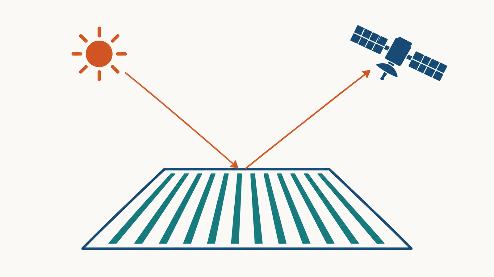

<!--
昨年度（2025-11-07）の 39 枚を、2026 年の衛星とデータの現況に合わせて組み直した版。
電磁波の基礎は内容を変えず、順番と分量を「一段ずつ上る」形に組み替えた。
講義時間は 90 分。1 枚 1 分強の目安で 57 枚、付録 3 枚。
-->

---

## 0-1 今日の地図：生き物の環境を「測る」4 本柱

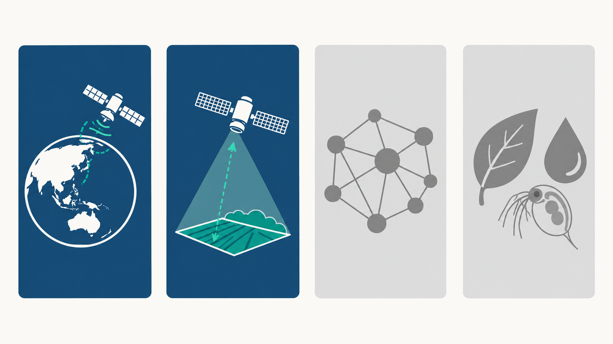

- 農業は生態系を保全する役割も担う。そのために「生物が生息している環境の情報」を得る技術を学ぶ
- ① GNSS と GIS（どこに・何が）　② リモートセンシング（どんな状態か）
- ③ AI 技術（画像判別を例に）　④ 環境 DNA（そこに何がいるか）
- 今日は①を軽く、②を主役に。③は次回、④はその後

<!--
昨年度の目次（2・13）を 1 枚に。講義の全体像は「生物の生息環境の情報を得る技術」で一貫している。
今日の主役はリモートセンシング。GNSS/GIS は「位置を知る・重ねる」土台として 10 分で触れる。
-->

---

## 0-2 今日のゴール：3 つ言えるようになる

1. 衛星が持ち帰るのは「写真」ではなく、**数か所の波長で測った反射率の数値**
2. 植物の葉は**赤い光を吸い、近赤外の光を強く返す**。その「差」を「和」で割ったものが NDVI
3. 十勝の畑で、その NDVI を**追肥・可変施肥・収穫順**の判断にどう使うか

> 一本の筋：光は波 → 見えない波長がある → 反射と放射 → 葉の反射 → NDVI → 衛星で測る → 畑の判断

<!--
この 3 つは最後の確認問題と対応させる。途中で迷子になったら、この枚に戻る。
-->

---

## 1 道標 A：位置を知る（GNSS）・重ねる（GIS）

- **GNSS**：いま自分（トラクタ・ドローン・測器）がどこにいるかを、衛星からの電波で知る
- **GIS**：地図を「層」で重ね、どこに何があるかを計算する道具
- 今日のリモートセンシングは、この 2 つの上に載る
- 所要 10 分。細かい数字より「仕組みの一行」を持ち帰る

<!--
章の切れ目の道標。ここから 8 枚。
-->

---

## 1-1 GNSS：GPS は「GNSS の一つ」

- **GNSS**（全球測位衛星システム）＝ 衛星からの電波で地上の位置を決める仕組みの総称
- 衛星は高度約 2 万 km を周回。もとは米軍のために作られた GPS が始まり
- いまは複数の国の衛星を**同時に**受信する

| 名前 | 運用 | 2026 年の一言 |
| --- | --- | --- |
| GPS | 米国 | 最初の GNSS。「GPS」が代名詞になった |
| GLONASS | ロシア | 運用中 |
| Galileo | 欧州 | 2025-12 に 2 機追加、2026-07 に運用入り |
| BeiDou | 中国 | 第 3 世代が 2020 年に完成 |
| みちびき（QZSS） | 日本 | 日本の上空に長くとどまる軌道（1-3 で詳しく） |

<!--
昨年度の 3 と 5 を統合。「GPS と GNSS の違い」は、GPS は固有名詞、GNSS は総称、という一言で済ませる。
Galileo の 2 機追加は ESA の発表（2025-12-17 打上げ、2026-07-23 までに両機が運用開始）。GLONASS と BeiDou の 2026 年の機数は未確認なので数字を出さない。
-->

---

## 1-2 位置はどう決まる：4 つの衛星からの「距離」で決める

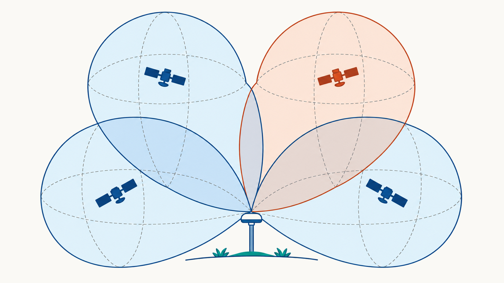

- 衛星は「いまの時刻と自分の位置」を電波で送り続ける
- 受信機は電波の**到達時間 × 光速 ＝ 距離**を計算する。1 マイクロ秒のずれは距離 300 m のずれ
- 距離が分かれば、衛星を中心とした球の上のどこかにいる。3 つの球の交点が位置
- 受信機の時計は安くて不正確。その誤差も未知数にして解くので**4 機以上**が要る

<!--
昨年度は「三角測量」と書いていたが、角度ではなく距離で決めるので「距離の交会（三辺測量）」に直した。
みちびき公式コラム「宝探しで理解する衛星測位（3）」と JAXA の解説（1 µs = 300 m）に沿った説明。
昨年度の 12 MB の 3D モデルは使わず、自作図に置き換えた。
-->

---

## 1-3 みちびきと高精度測位：センチメートル級の時代

- みちびき：日本の真上に長く見える「準天頂軌道」の衛星 ＋ 静止衛星
- 2026-10 時点：運用 **5 基**（準天頂 3 ＋ 静止 2）。7 号機は 2026-08-11 に H3 で打上げ成功、運用に入れば 6 基
- 5 号機は 2025-12 の H3 失敗で喪失。7 機体制は 2031 年度の見込み（報道）
- 位置の精度は「補強信号」で決まる

| 方式 | 精度の目安 | 例 |
| --- | --- | --- |
| 単独測位 | 数 m 〜 10 m | スマホ |
| サブメータ級補強 | 1 m 前後 | みちびき SLAS |
| センチメータ級補強 | 数 cm | みちびき CLAS、RTK（基地局） |

<!--
機数は JST サイエンスポータル（2026-08-12）と内閣府資料に基づく。7 機体制の完成時期は報道間で表現が違い（2031 年度／不透明）、公式発表は要確認。授業では「報道では」と添える。
みちびきのサービス名：SLAS、CLAS、MADOCA-PPP、災危通報、Q-ANPI、信号認証（なりすまし対策）。
RTK は基地局からの補正信号を使う方式で、士幌町のように自治体や JA が無料配信している例がある。
-->

---

## 1-4 農業での GNSS：自動操舵・直進アシスト・可変作業の土台

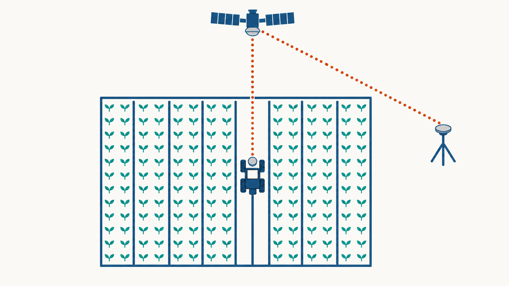

- 自動操舵：数 cm の精度で同じ線をなぞる。重なりと抜けが減り、夜も疲れない
- 北海道内の自動操舵装置の出荷：**3,380 台（2024 年度、前年度比 +17%）**。うち中国製 1,800 台（道の聞き取り調査）
- 士幌町は 2013 年に RTK 基地局を設置し、補正信号を無料配信
- GNSS は「**どこで**」を担う。「**どの状態か**」を担うのが今日の主役、リモートセンシング（RS）

<!--
出荷台数は北海道庁が農機メーカーへの聞き取りでまとめた値（北海道新聞の記事、無料部分で確認）。農水省の全国統計ではない。
可変施肥（E 章）は、GNSS の位置 × 衛星画像の生育情報 で初めて成り立つ、と伏線を張る。
-->

---

## 1-5 GIS：地図を「層」で重ねて考える道具

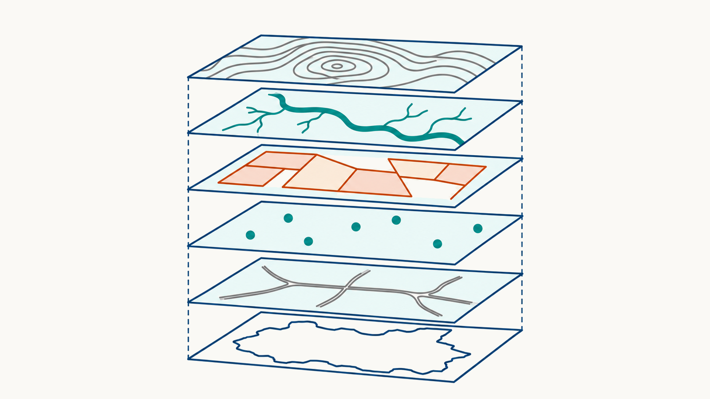

- GIS（地理情報システム）：位置を持つ情報（点・線・面・画像）を**層（レイヤ）**として重ねる
- 大量の地理情報を効率よく扱える／多様な地図表現ができる／計算機に向いた解析ができる
- 層どうしの重なりから、相関や傾向を「見る」だけでなく「計算する」
- 衛星画像も GIS の一つの層。今日の NDVI 地図は、畑の区画の層と重ねて使う

<!--
昨年度の 7・8 を統合。定義の枚は前任教員の講義資料に基づく。
地理院地図の例（札内川の氾濫、陰影起伏図、治水地形分類図の旧河道）は、時間があれば画面を映して見せる。
-->

---

## 1-6 GIS の活用例：搬送計画・ハザードマップ・農地の区画

- **ドローン搬送計画**：3D 地形に高さ 150 m の範囲を重ねて経路を決める
- **洪水ハザードマップ**：浸水の深さ・避難所・道路を重ねる。地形分類（旧河道）を見ると理由が分かる
- **エリアマーケティング・巡回経路**：ボロノイ図や最短経路の計算
- **農地の区画（筆ポリゴン）**：農水省が全国の農地の区画を公開。令和 8 年度版が 2026-05 に追加、**登録不要**でダウンロード可（都道府県ごと）
- 衛星画像を筆ポリゴンで切り出すと「畑ごとの NDVI」になる（E 章）

<!--
昨年度の 9〜11 を 1 枚に。筆ポリゴンは FlatGeobuf 形式、都道府県ごとに分割ファイル。eMAFF 農地ナビ（農地の所在・面積等を地図で公表）は 2026 年版の反映状況が未確認なので口頭で触れる程度に。
-->

---

## 1-7 GIS はこれから必須：高校「地理総合」と無料ツール

- 2022 年度から高校で「地理総合」が必履修。内容 A「地図や地理情報システムで捉える現代世界」
- 皆さんの後輩は、地理院地図・RESAS・jSTAT MAP・e-Stat を授業で触って入学してくる
- 防災と持続可能な社会、国際理解にも GIS が前提になる
- 大学では「作る」側へ：QGIS（無料）で層を重ね、衛星画像を読み込む

<!--
昨年度の 12 を更新。GIS ソフトの技術習得までは高校では求められていない、との指摘がある（教科書会社の資料）。
-->

---

## 2 道標 B：リモートセンシング

- ここから本題。**離れた所から、電磁波で、物の性質を測る**技術
- 順番：定義 → 「目」も同じ仕組み → なぜ衛星か → 電磁波の梯子（15 分）→ 衛星とセンサ → 農業の現場
- 式はほとんど出ない。出るのは NDVI の 1 本だけ

<!--
昨年度の 13（目次の再掲）を道標に。
-->

---

## 2-1 リモートセンシングとは：離れた所から、電磁波で、物の性質を測る

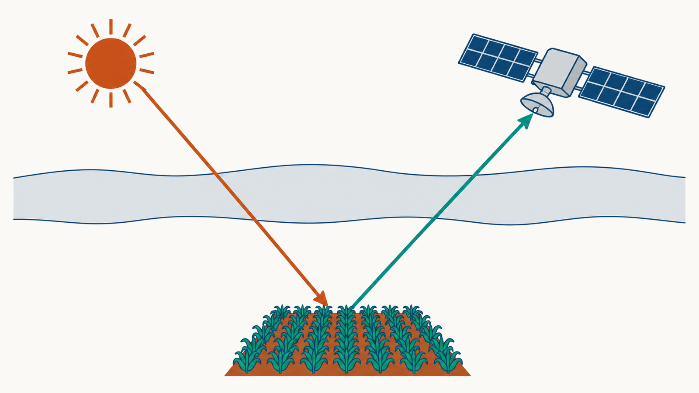

- **Remote**（離れて）**Sensing**（感じ取る）：対象に触れずに測る
- 情報を運ぶのは**電磁波**。太陽の光が畑で**反射**して衛星に届く。畑そのものが出す**放射**も届く
- センサは、届いた電磁波の「強さ」を波長ごとに数値にする
- 「写真を撮る」のではなく「反射率を測る」と考えると、この先がすべてつながる

<!--
定義は昨年度の 14 のまま（前任教員の講義資料に基づく）。図は太陽 → 対象 → センサの自作図に置き換えた。
「反射」と「放射」の 2 語をここで出し、C 章の段 4 で区別する。
-->

---

## 2-2 目は天然のリモートセンサ：画素は「数値」

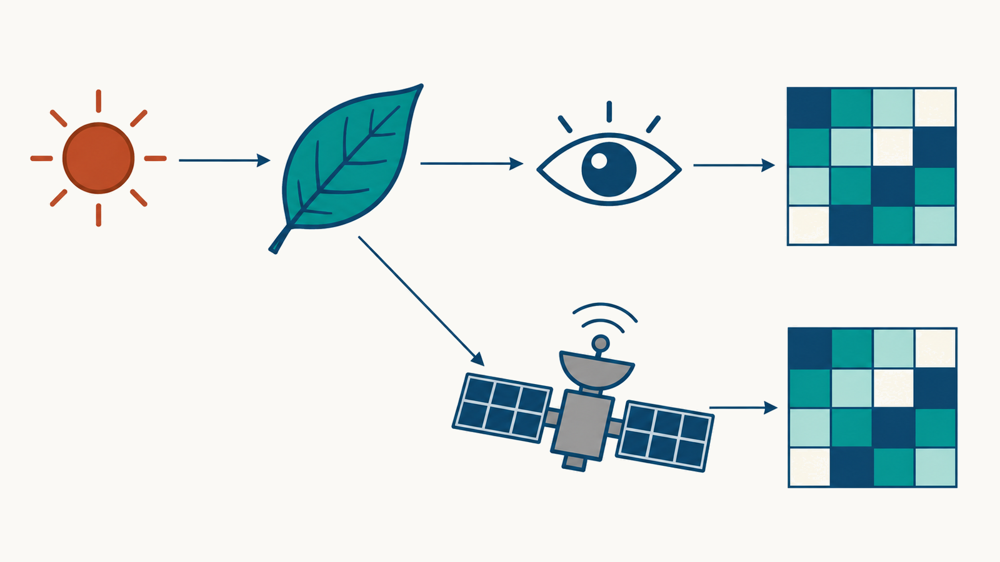

- 目も、離れた物からの光を網膜で受けて「色と明るさ」にしている。リモートセンシングそのもの
- デジタル写真の 1 画素は「その場所から来た光の強さ」の**測定値**（例：0〜255 の 256 段階）
- 衛星画像も同じ。1 画素 ＝ 地面の 10 m 角から来た光の強さ、を波長ごとに記録した**数値の表**
- 違いは 2 つ：目に見えない波長も測る／地球全体を繰り返し測る

<!--
R4 の段 0。「画像＝数値」を先に言っておくと、NDVI の計算と次回の AI 画像判別が自然につながる。
-->

---

## 2-3 なぜリモートセンシングか：広く・繰り返し・見えない波長で

- **広く**：Sentinel-2 の 1 回の撮影幅は 290 km。十勝平野が 1 枚に入る
- **繰り返し**：同じ場所を 5 日ごと（Sentinel-2）、毎日（PlanetScope）に
- **見えない波長で**：作物の健康状態は、目に見える色より**近赤外**にはっきり出る
- だから「人が歩いて見る」の代わりではなく、「人には見えないものを、見きれない広さで」測る

<!--
昨年度の 15（高い時空間分解能、農機メーカーの生育診断の例）に「見えない波長」を加え、C 章への動機づけにした。
ここで「近赤外って何？」という疑問を立てておき、次の章で答える。
-->

---

## 3 道標 C：見えない光を、数字にする

- ここから **15 分、12 段の梯子**を一段ずつ上る。内容は昨年度と同じ、順番を変えた
- 段 1〜3：光は波、見えない光、波長と向き
- 段 4〜7：反射と放射、温度と色、太陽と地球、大気の窓
- 段 8〜12：反射・吸収・透過、葉の断面、反射曲線、バンド、NDVI
- 各段に口頭の一問。最後に確認問題 4 問。式で確かめたい人は付録へ

<!--
世界の入門教材に共通する順序「波 → スペクトルの名前 → 太陽の反射と地球の放射 → 大気 → 対象との相互作用 → 指数」に揃えた。
放射の 3 法則は「温度が高いほど強く・短い波長で光る」の 2 つの結論に畳み、式は付録に回す。
1 枚の内訳：説明 40〜45 秒、図を読む 10 秒、口頭確認 5〜10 秒。口頭確認は講師が問いかけて直ちに答えを示す。挙手で集計するのは段 4・9・12 の 3 問だけ。
時間が押したときに削る順番：① 段 2 のリモコン実演を言葉に（20 秒）② 段 10 の雪・短波長赤外（15 秒）③ 口頭確認を挙手の 3 問だけに（40〜50 秒）④ 段 12 の頭打ちの話を 5-8 に任せる ⑤ 段 5 を付録に回し、段 6 の冒頭で「熱いほど強く・短い波長で」の 1 文を言う。
最後まで残す骨格：光の経路 → 可視と赤外 → 反射と放射 → 大気 → 入射光の分配 → 葉の内部 → 赤と近赤外の違い → バンド → NDVI。
-->

---

## 3-1 段 1：光は波。色のちがいは「波長」のちがい

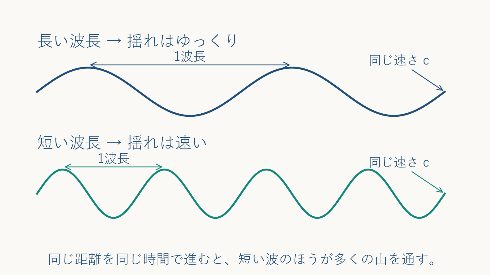

- 光（電磁波）は**波**。山から次の山までの長さが**波長**
- 媒体がいらない（真空でも伝わる）。速さはどれも同じ、光速 c ＝ 秒速 30 万 km
- 同じ速さで進むので、波長が短いほど 1 秒に通る山の数（周波数）が多い
- 見える光は波長 0.4〜0.7 µm（1 µm は 1/1000 mm）。紫が短く、赤が長い

<!--
昨年度の 16・17（電界と磁界、水面波の図、媒体不要、光速）をここに畳んだ。電界と磁界の図は付録。
図の上下の波は、同じ距離を同じ速さで進むと考えてもらう。短い波長では山の間隔が狭いので、同じ時間に多くの山が通り、周波数が高くなる。波形は電場の変化を表す概念図で、光の粒が蛇行して進む軌道ではない。
水面波のたとえは「波長を考えるため」だけに使い、電磁波は水や空気がなくても伝わると必ず添える。
「色＝波長」が、この後ずっと使う言い換え。ただし色は目が作る感覚で、どんな色も波長 1 本で決まるわけではない（混色）。
口頭確認：「短い波長の光ほど、真空を速く進む」→ ×（揺れの速さと伝わる速さの混同）。
-->

---

## 3-2 段 2：見えない光がある。可視光はほんの一部

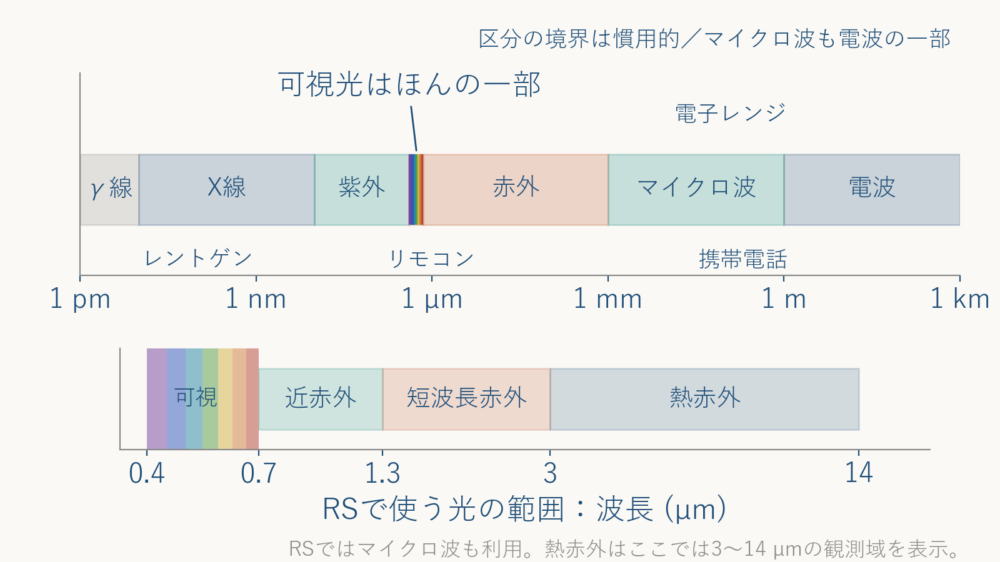

- 波長が 0.4 µm より短い：紫外、X 線、γ 線。0.7 µm より長い：赤外、マイクロ波、電波
- 名前が違っても、全部「同じ波」。違いは波長だけ
- リモートセンシングで使うのは主に **0.4〜14 µm**（可視・近赤外・短波長赤外・熱赤外）と**マイクロ波**
- 体験：スマホのカメラでリモコンの先を見ると、近赤外 LED が光って見える

<!--
昨年度の 18 の周波数帯の表を自作のスペクトル図に。区分の境界は慣用的。最初は可視の細い帯だけを指し、近赤外と熱赤外の位置を後から示す。
赤外の内側の 3 区分（近赤外 0.7〜1.3、短波長赤外 1.3〜3、熱赤外 3〜14 µm）を、この後の段で使う。マイクロ波は電波の一部。
リモコンの実演は事前に試した機材で 20 秒以内。機種によっては赤外カットが強く写らない。画面に映る白や紫は、センサと表示が作った色であって赤外線の色ではない。時間が押したら実演を省き、言葉だけにする。
潰す誤解：赤外線＝熱、電波＝音、赤外線は見える。
口頭確認：「リモコンの近赤外は、A 音／B 電磁波／C 熱という物質」→ B。
-->

---

## 3-3 段 3：波長が短いほど、揺れが速く、エネルギーが大きい（向きだけ）

- 波長 λ と周波数 f：**λ が短い ⇔ f が高い**（c ＝ λ f、c は一定）
- 光の粒 1 個のエネルギー：**f が高いほど大きい**（E ＝ h f）
- だから紫外線は日焼けを起こし、赤外線は起こさない。向きだけ覚えればよい
- よくある誤解：「赤外線 ＝ 熱」ではない。赤外線は**温かい物がよく出す光**であって、光そのものは熱ではない。葉が返す近赤外は温度とは無関係

<!--
計算はしない。式は付録。向きだけ：真空では λ と f は反比例、光子 1 個のエネルギーは f に比例。光全体の強さは光子が届く数にもよるので、「短波長＝強い光」ではない。
「赤外線＝熱」の誤解を潰しておかないと、段 9 の「葉が近赤外を返す」を「葉が熱い」と誤読する学生が出る。正確には「常温の葉の近赤外は、葉自身の放射ではなく太陽光の反射が主」。近赤外も吸収されれば物を温めるし、高温の物は近赤外でも放射する。
-->

---

## 3-4 段 4：昼は「反射」、夜も「放射」。物はみな温度で光っている

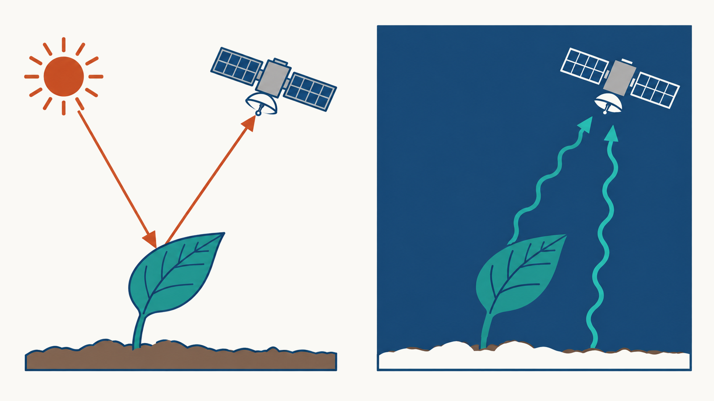

- 昼に物が見えるのは、太陽の光を**反射**するから（色 ＝ 波長ごとの返し方）
- 太陽が沈んでも、物は温度に応じた光を**放射**している。目に見えないだけ
- サーモグラフィはその放射（熱赤外）を見ている。焚き火や電熱線は、熱いので目に見える波長まで出す
- 衛星のセンサには**反射した太陽光**と**物自身の放射**の両方が届く。どちらを見ているかを常に意識する

<!--
法則の前に直感を置く。「温度が低い物は光っていない」という誤解を、サーモグラフィで崩す。
図の読み方：左は太陽 → 葉 → センサ（反射）、右は常温の葉 → 熱赤外センサ（放射）。左の太陽を隠すと反射の観測は暗くなるが、右の矢印は残る。
問いかけ：「夜に照明を消したら、葉の普通の写真と熱画像のどちらが撮りにくくなるか」→ 普通の写真（近赤外の反射観測にも光源が要る。熱赤外は夜も使える）。
潰す誤解：反射と放射の混同、近赤外と熱赤外の混同（名前が同じ「赤外」）、熱い物だけが放射する。
口頭確認（挙手）：「常温の畑を太陽なしで放射から見るのは、A 赤／B 近赤外／C 熱赤外」→ C。
-->

---

## 3-5 段 5：熱いほど強く光り、短い波長で光る

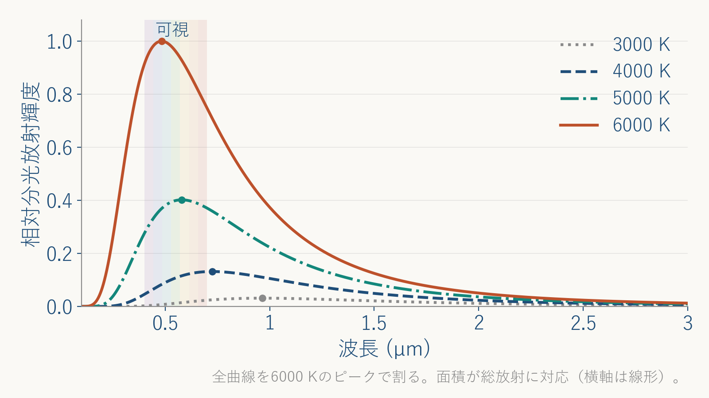

- 温度が高いほど、放射は**全体に強く**なる（曲線の下の面積が大きい）
- 温度が高いほど、**ピークの波長が短く**なる（山が左へ動く）
- 焚き火：赤く光る（低め）→ 白く光る（高め）。熱した鉄の色の変化も同じ
- 3 つの法則（ステファン・ボルツマン、プランク、ウィーン）は、この 2 行を式にしたもの。付録に

<!--
昨年度の 19〜21（3 枚とも題が「放射」）を 1 枚に。向きだけ：総放射 ∝ T の 4 乗、ピーク波長 ∝ 1/T。
曲線は 6000 K のピークで規格化（図の注記のとおり）。4 本は「入ってきた放射をすべて吸収する理想の物体（黒体）」の曲線。黒体は「黒く見える物」のことではない。ピークは 3000／4000／5000／6000 K で 0.97／0.72／0.58／0.48 µm。
焚き火の炎はすすや分子の放射も含むので、炎の色を黒体の温度計としては扱わない。3000 K の曲線を焚き火の温度とも言わない。見える色は可視光全体の混ざり方で決まり、ピークの波長の色だけでは決まらない。
口頭確認：「温度が上がると曲線の頂上は、A 短波長側／B 長波長側／C 動かない」→ A。
-->

---

## 3-6 段 6：太陽は 0.5 µm、地球は 10 µm。3 µm を境に世界が分かれる

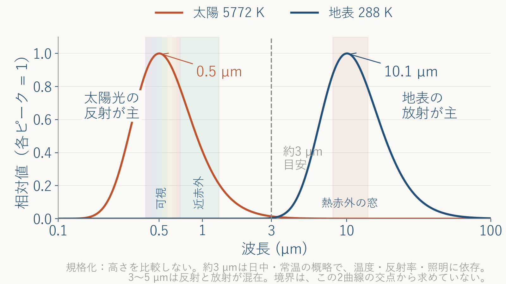

- 太陽（約 5800 K）のピークは **0.5 µm** ＝ 可視光の真ん中。目が可視光に合わせて進化した理由
- 地表（約 290 K、15 ℃）のピークは **10 µm** ＝ 熱赤外
- 2 つの山はほとんど重ならない。**約 3 µm より短い側は「太陽光の反射」、長い側は「地表の放射」**を見ている
- 今日の NDVI は短い側（反射）。地表面温度や蒸発散は長い側（放射）。D 章で両方出てくる

<!--
昨年度の 22（太陽の放射スペクトル）をここに統合。図は太陽 5772 K、地表 288 K の黒体で、ウィーンの式（2898/T）から 0.50 µm と 10.1 µm。図の 2 曲線はそれぞれのピークで規格化しているので高さは比べない（2 曲線の交点から「反射と放射が等しい波長」は求められない）。
「約 3 µm」は日中・常温での目安。3〜5 µm は反射と放射が混在し、実際の割合は温度・反射率・照明条件で変わる。
思考実験：「人の目が 10 µm を感じたら、夜にも別の景色が見えるか」→ 見える（物はみな放射している）。サーモグラフィの色は人工的に割り当てた色。
口頭確認：「高さをそろえた 2 曲線の交点から、反射と放射が等しい波長が分かる」→ ×。
-->

---

## 3-7 段 7：大気の窓。衛星が地上を見られる波長

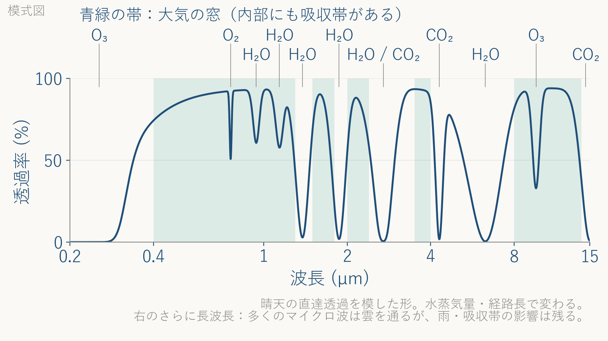

- 光は大気を通って往復する。水蒸気・CO₂・オゾンが特定の波長を**吸収**する
- よく通る波長帯が「**大気の窓**」：可視〜近赤外、1.6 µm、2.2 µm 付近、3〜5 µm、8〜14 µm
- 衛星のバンドは、この窓の中に置かれる（段 11 で確認）
- **マイクロ波**は雲も通る。だから雲の上から・夜でも測れるレーダ衛星が作れる（D 章の SAR）

<!--
晴天の直達透過を模した模式図。水蒸気量で窓の透過率は変わる。吸収する分子の名前（H₂O、CO₂、O₃、O₂）は暗記させない。大気は「波長ごとに通し方が違うフィルター」で、全波長を同じ割合で暗くするサングラスではない。
付録 C に「大気の外の太陽光と地上に届く太陽光」の図（谷を 2 か所だけ指す）を置いた。時間があればこちらを先に見せてもよい。
雲は可視〜熱赤外を遮るので、光学衛星は「晴れ待ち」になる。8〜14 µm が「窓」でも、厚い雲の下は見えない。マイクロ波も強い雨の影響は受ける。E 章の限界（5-10）で回収。
口頭確認：「8〜14 µm は大気の窓なので、厚い雲の下の地面も必ず見える」→ ×（気体の吸収の窓と、雲がないことは別）。
-->

---

## 3-8 段 8：光が物に当たると、反射・吸収・透過に分かれる

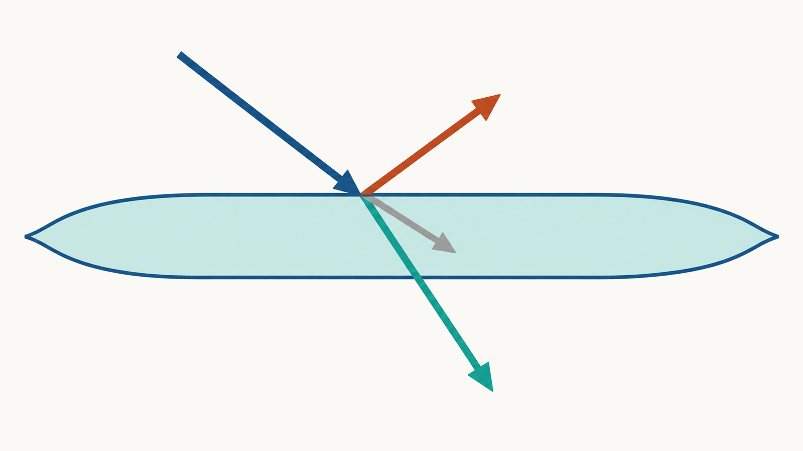

- 入ってきた光 ＝ **反射** ＋ **吸収** ＋ **透過**。割合は物と波長で変わる
- **反射率** ＝ 反射した光 ÷ 入った光（0〜1、または %）。衛星が測るのはこれ
- 鏡のように一方向に返す「鏡面反射」と、紙のように四方に返す「拡散反射」。畑はほぼ拡散
- 水は可視〜近赤外をほとんど吸収する（暗く写る）。乾いた土は波長が長いほど少しずつ明るい

<!--
反射率の定義をここで固定する。「明るさ」は太陽の強さや時刻で変わるが、「反射率」は物の性質。段 12 の NDVI の分母の話につながる。
図の矢印の太さは割合を表すものではない。反射＋吸収＋透過＝100% は「同じ波長・同じ入射光」の分配で、物自身の放射はこの分配に足す項ではない。
衛星が測るのは「その方向に届いた光」なので、反射率を求めるには照明・大気・観測方向も考える（5-10 の「明るさ ≠ 反射率」）。
口頭確認：「反射率が同じ葉でも、届く照明が違えばセンサの信号は変わる」→ ○（割合と絶対量の違い）。
-->

---

## 3-9 段 9：葉は赤を吸い、近赤外を返す（葉の断面）

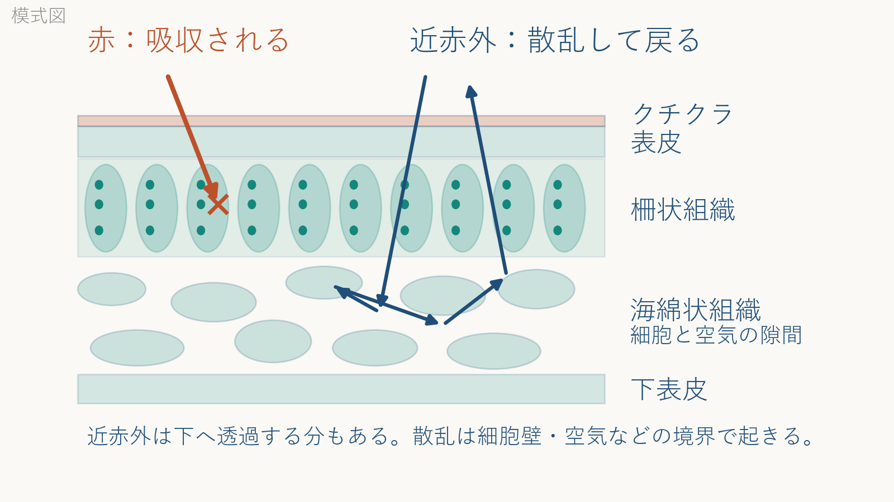

- 葉の上側（柵状組織）にクロロフィルが多い。クロロフィルは**青と赤を吸収**して光合成に使う。緑は少し返すので葉は緑に見える
- 近赤外はクロロフィルに吸収されない。下側（海綿状組織）の**細胞と空気の境界で何度も散乱**し、40〜50% が上へ戻る
- 注意：「クロロフィルが近赤外を反射する」のではない。返しているのは**葉の構造**
- 元気な葉ほど、赤は暗く・近赤外は明るい。弱ると赤が明るくなり、近赤外が暗くなる

<!--
昨年度に無かった枚。R4 の誤解リスト「クロロフィルが近赤外を反射する」をここで潰す。図は最初に赤の経路、次に近赤外の経路を指す。組織の名前は背景で、暗記させない。
近赤外は細胞壁と空気など屈折率の違う境界で何度も散乱して多くが上へ戻るが、下へ透過する分もある（段 8 の 3 分岐）。
葉が枯れる・水が抜けると海綿状組織の空隙構造が崩れ、近赤外の反射が落ちる。
問いかけ：「目の感度が長波長側にずれたら、葉はどう見えるか」→ 今より強く返す帯を感じる（特定の「赤外色」があるわけではない）。
口頭確認（挙手）：「近赤外が多く戻る主因は、A クロロフィルが近赤外を出す／B 葉の内部の境界で散乱／C 葉が高温だから」→ B。
-->

---

## 3-10 段 10：分光反射曲線。植生・土・水・雪の「指紋」

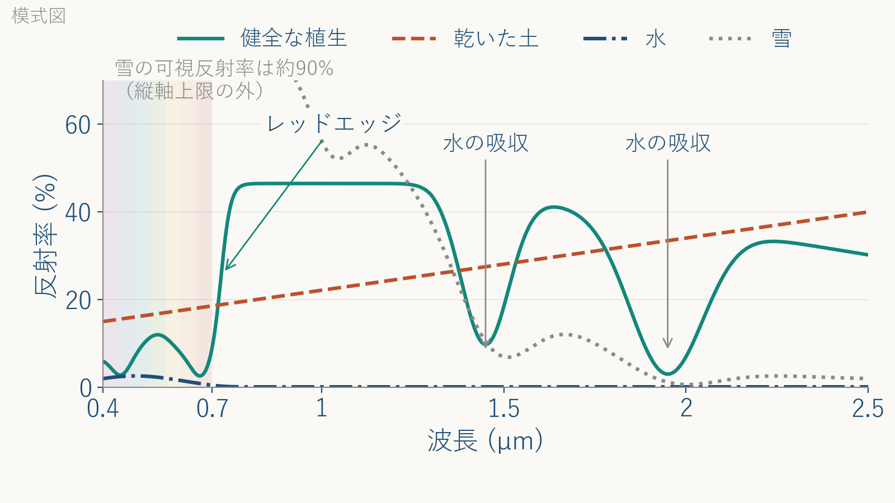

- 横軸：波長、縦軸：反射率。物ごとに曲線の形が違う ＝ **指紋**
- 植生：赤で低く、0.7 µm で急に立ち上がる（**レッドエッジ**）、近赤外で高い。1.45・1.95 µm の谷は**葉の水**の吸収
- 乾いた土：波長とともに緩やかに上がる。水：ほぼ 0。雪：可視で約 90%、近赤外で落ちる
- 曲線の形を比べれば「何が写っているか」「植物がどれくらい元気か」が分かる

<!--
昨年度の 23・24 を 1 枚に。赤 → レッドエッジ → 近赤外の順に植生の線を指し、土・水との差へ進む。雪と短波長赤外の水の吸収は時間があれば。
「指紋」は完全に一意・不変ではない。線の高さは生育・葉の角度・土の背景で変わる。レッドエッジの位置は窒素・クロロフィル量で動く（E 章の NDRE の根拠）。
昨年度の「分光反射特性＝強く反射・吸収・放出する波長域」は、反射率の定義に放射を混ぜていたので、「波長ごとの反射する割合」に直した。
雪の可視反射率は縦軸の上限の外（図の注記）。
口頭確認：「典型的な植生で反射率が高いのは、A 赤／B 近赤外／C いつも同じ」→ B。
-->

---

## 3-11 段 11：衛星はこの曲線を「数か所」でしか測らない

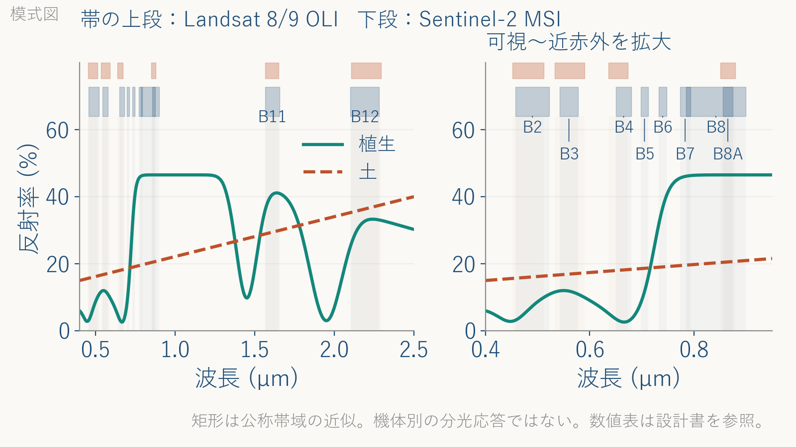

- 衛星のセンサは、曲線を連続では測らず、決めた波長の帯＝**バンド**で何か所か測る
- Sentinel-2：13 バンド（青 B2、緑 B3、赤 B4、レッドエッジ B5〜B7、近赤外 B8・B8A、短波長赤外 B11・B12 ほか）
- Landsat 8/9：可視〜短波長赤外 9 バンド ＋ 熱赤外 2 バンド
- 1 画素 ＝ 「バンドごとの反射率の組」（例：赤 5%、近赤外 50%）。段 2-2 の「画素は数値」がここで具体になる

<!--
「バンド」という言葉をここで導入。バンドは 1 点の波長ではなく、幅を持つ帯域の光をまとめて測った値（連続した曲線をいくつかの「窓」から見る）。図の矩形は公称帯域の近似で、実際の分光応答関数ではない。番号を全部読み上げない。
帯を細かく分けると特徴を見分けやすくなるが、1 本に入る光の量と雑音との兼ね合いがある（4-1 の分光分解能）。
波長帯の数字（nm）：S2 の B2 490、B3 560、B4 665、B5 705、B6 740、B7 783、B8 842、B8A 865、B11 1610、B12 2190。
口頭確認：「B4 の中心が 665 nm なら、その 1 点の波長だけを測っている」→ ×（中心値と帯域幅の混同）。
-->

---

## 3-12 段 12：赤と近赤外の「差」を、「和」で割る：NDVI

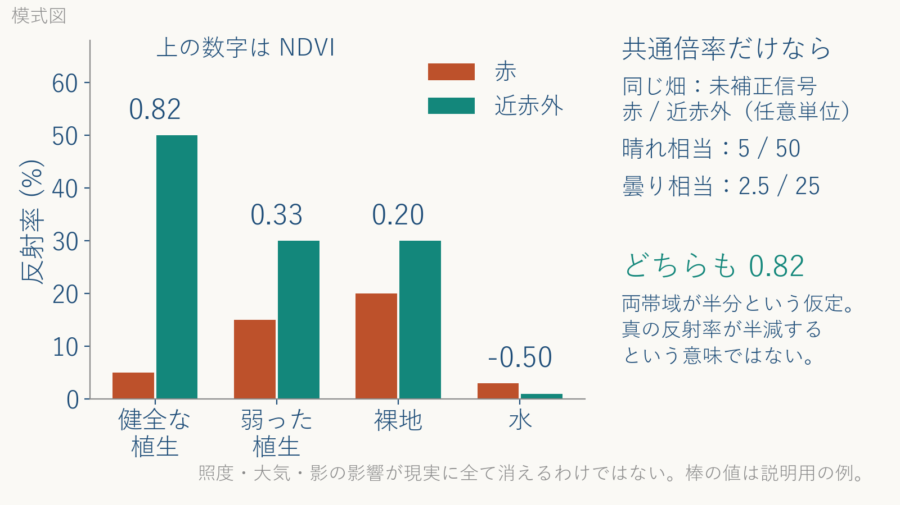

$$
\mathrm{NDVI} = \frac{\rho_{\mathrm{NIR}} - \rho_{\mathrm{R}}}{\rho_{\mathrm{NIR}} + \rho_{\mathrm{R}}}
$$

- 元気な葉ほど「近赤外 − 赤」の**差**が大きい。差だけでも植生の量は分かる
- **和で割る**理由：晴れと曇りで明るさが半分になっても、赤と近赤外が同じ比率で減れば値は変わらない
- 値は −1〜1。健全な植生 0.8 前後、弱った植生 0.3、裸地 0.2、水は負

<!--
昨年度の 28 の式はそのまま。図の読み方：まず棒の「差」だけを指し、次に NDVI の数字、最後に右の「共通倍率」の例。
棒の値は説明用の例（植生 赤 0.05／近赤外 0.50 → 0.82、弱った植生 0.15／0.30 → 0.33、裸地 0.20／0.30 → 0.20、水 0.03／0.01 → −0.50）。「どちらも 0.82」は未補正の 2 つの信号が同じ倍率で変わるだけなら、という仮定で、現実には照度・大気・影の影響がすべて消えるわけではない。「曇天で反射率が半分になる」とは言わない。
値域 −1〜1 は反射率が非負で分母が正のとき。分母が 0 に近いと不安定。通常は大気補正した反射率を使い、画素の生の値（DN）をそのまま入れない。
NDVI が高ければ必ず健康、ではない。限界（頭打ち）は 5-8 で。
口頭確認（挙手）：「両バンドが同じ倍率で変わると、差は変わるが NDVI は変わらない」→ ○。
-->

---

## 3-13 確認問題：どれが正しい？

1. 「赤外線は熱そのものである」　→　○か×か
2. 「衛星は写真を撮るだけで、人の目と同じ色しか見ない」　→　○か×か
3. NDVI が最も高いのはどれか：（a）収穫後の裸地　（b）出穂前の元気な小麦　（c）湖の水面
4. 「葉が近赤外を強く返すのは、クロロフィルが反射するから」　→　○か×か

<!--
答え：1 ×（赤外線は温かい物がよく出す光。光そのものは熱ではない）。2 ×（目に見えない近赤外・短波長赤外・熱赤外・マイクロ波も、反射率や放射として数値で測る）。3 (b)。4 ×（海綿状組織の細胞と空気の境界での散乱。クロロフィルは近赤外を吸収も反射もほとんどしない）。
隣の人と 1 分相談してから挙手。
-->

---

## 4 道標 D：どの衛星が、何を、どれくらい細かく

- 梯子を上りきった。ここからは「測る道具」の 2026 年の現況
- 順番：4 つの分解能 → トレードオフ → 衛星の系譜 → 無料の光学 → 商用 → レーダ（SAR）→ 熱赤外・ハイパー → 蛍光 → 無料ツール → 使い分け
- 数字は 2026-10 時点。来年には変わる

<!--
章の切れ目。D 章は 11 枚、18 分。
-->

---

## 4-1 4 つの分解能：空間・時間・分光・放射

| 分解能 | 問い | 例 |
| --- | --- | --- |
| 空間 | 1 画素は地面の何 m 角か | Sentinel-2 10 m、Landsat 30 m、PlanetScope 3 m、ドローン数 cm |
| 時間 | 同じ場所を何日ごとに撮るか | Landsat 8 日（2 機）、Sentinel-2 5 日（2 機）、PlanetScope 毎日 |
| 分光 | バンドは何本、どの幅か | Landsat 11、Sentinel-2 13、ハイパースペクトル 数百 |
| 放射 | 明るさを何段階に分けるか | 8 bit 256 段階、12 bit 4096 段階 |

- バンドを細くすると 1 本に入る光が減り、感度が落ちる。幅・本数・感度は両立しない

<!--
昨年度の 31（観測波長・空間分解能・時間分解能）に放射分解能を足し、30（バンド幅のトレードオフ）を分光分解能に吸収した。
Landsat 8/9 は OLI 9 バンド＋TIRS 2 バンドで計 11。
-->

---

## 4-2 分解能のトレードオフ：広く頻繁に撮るほど粗い

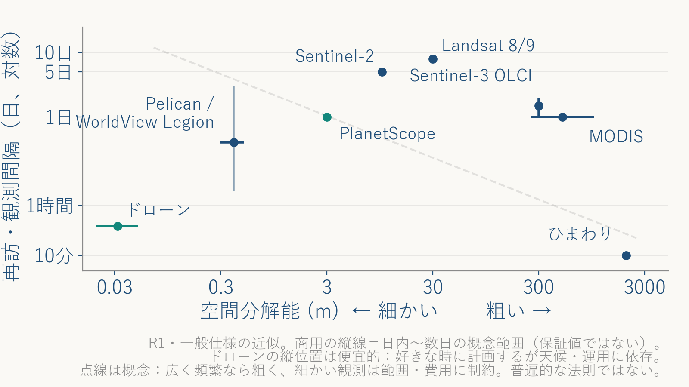

- 静止気象衛星「ひまわり」：10 分ごとだが 1 画素 1〜2 km。畑は見えない
- Sentinel-2・Landsat：10〜30 m、5〜8 日。畑 1 枚の中の濃淡が見える。**無料**
- PlanetScope：約 3 m、毎日。商用衛星群（多数の小型衛星）で両立させた
- ドローン：数 cm、好きな時に。ただし 1 回に数 ha〜数十 ha。細かさと広さの両立は、今も費用の問題

<!--
点線は概念で、普遍的な法則ではない。商用衛星の縦線は日内〜数日の概念範囲。
「毎日 3 m」が農業で何を変えるかは次の次の枚。
-->

---

## 4-3 衛星の系譜：Landsat の半世紀から、2020 年代の多様化へ

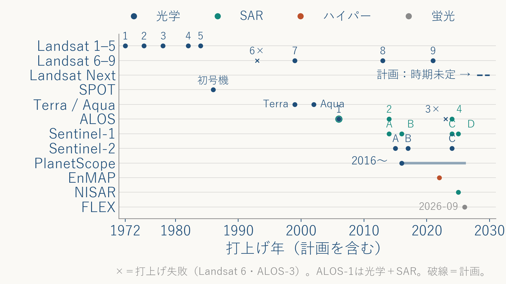

- Landsat 1（1972）から Landsat 9（2021）まで、**半世紀の記録が無料**で使える。次の Landsat Next は時期未定
- 2010 年代：欧州の Sentinel-1（レーダ）・Sentinel-2（光学）が無料で加わり、民間の PlanetScope が「毎日」を実現
- 日本：ALOS-3 は 2023-03 の H3 試験機で失敗、ALOS-4（レーダ）は 2024-07 に成功
- 2020 年代：ハイパースペクトル（EnMAP）、NISAR（2025-07）、蛍光を測る FLEX（2026-09 打上げ）

<!--
昨年度の 26（Landsat が最古株、半世紀のデータ、無料）を系譜図に。点は打上げの年で、運用期間ではない。×は失敗（Landsat 6、ALOS-3）。
FLEX は ESA が 2026-09-15 に Vega-C での打上げ成功を発表（Sentinel-3C と相乗り、R3）。図は打上げ済みの点「2026-09」で描いてある。Landsat Next だけが「計画・時期未定」の破線。
1972〜2010 年の歴史年は一般知識で補った（Codex の作図記録に要確認と注記）。
-->

---

## 4-4 無料で使える光学衛星：Sentinel-2 と Landsat 8/9

| | Sentinel-2（欧州） | Landsat 8/9（米国） |
| --- | --- | --- |
| 空間分解能 | 10 m（可視・近赤外）、20 m、60 m | 30 m（パンクロ 15 m、熱赤外 100 m） |
| バンド | 13 | 11 |
| 再訪 | 5 日（2 機） | 8 日（2 機） |
| 撮影幅 | 290 km | 185 km |
| 記録 | 2015 年〜 | 1972 年〜（Landsat 1 から） |

- Sentinel-2：2A（2015）・2B（2017）に加え **2C が 2024-09 に打上げ**。2A は 2026 年末まで運用延長、2D は 2028 年以降
- Landsat 9 は 1 日約 750 シーン。両系列とも**無料・登録のみ**

<!--
R1 §1 の日付付きの値。Sentinel-2C の打上げは Vega ロケットの最終号機。
Landsat Next は計画が再編され時期未定。
-->

---

## 4-5 商用の高頻度・高分解能：PlanetScope、Pelican、Legion

- **PlanetScope**（Planet 社）：約 3 m、8 バンド、**毎日**全陸地。多数の小型衛星（2025-11 にも 36 機追加）
- **SkySat** 約 50 cm、**Pelican** 40 cm・6 バンド（次世代）、**WorldView Legion** 30 cm 級 6 機（1 日に何度も再訪）、**Pléiades Neo** 30 cm
- 「毎日撮れる」と何が変わるか：雲の合間を拾える／生育ステージの変化を日単位で追える／災害直後に撮れる
- 有料。研究・教育向けの枠はあるが、無料枠は変わりやすい（Planet の熱帯林向け無料モザイクは 2025-01 に終了）

<!--
機数は日付付きで言う（Planet の運用機数は資料間で食い違う）。
十勝農試の追肥判断（E 章）は PlanetScope（Dove）と Sentinel-2 の両方を使っている。
-->

---

## 4-6 能動センサ SAR：雲の上から、夜でも測る

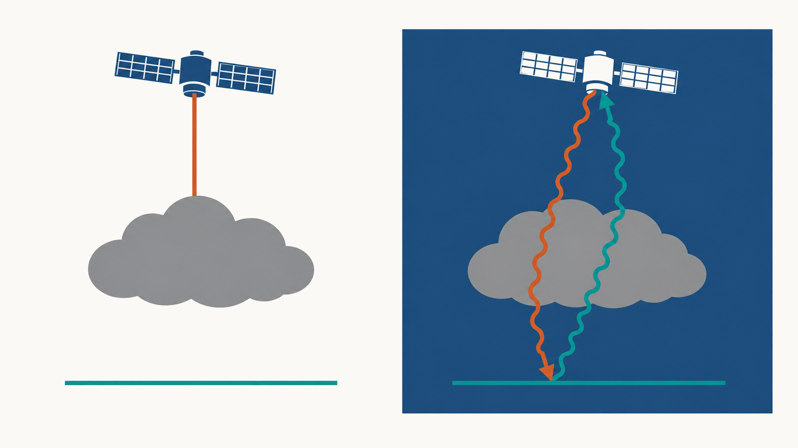

- ここまでは太陽光を待つ**受動**センサ。SAR（合成開口レーダ）は**自分でマイクロ波を出し**、戻りを測る**能動**センサ
- マイクロ波は雲を通り、太陽もいらない → **天候・昼夜に関係なく**定期的に撮れる
- 波長で見えるものが変わる：C バンド（Sentinel-1、約 5.6 cm）、L バンド（ALOS-4、NISAR、約 24 cm、植生を透過しやすい）
- 平らな水面は電波を向こうへ跳ね返すので**暗く映る** → 水田の湛水、浸水の範囲（E 章）

<!--
2026 年の機体：Sentinel-1C（2024-12）、1D（2025-11、2026-05 に定常運用）。ALOS-4（2024-07-01、PALSAR-3、3 m〜25 m、14 日）。NISAR（NASA と ISRO、2025-07-30、12 日、無料、L バンドのデータ公開は 2026-07 から）。P バンドの Biomass（2025-04）。国内の小型 SAR 群：StriX 13 機（2026-09）、QPS-SAR 14 機打上げ・9 機運用（2026-06）。
SAR 画像は光学と見え方が違う（斜め照射、スペックル）。詳しくは専門科目で。
-->

---

## 4-7 熱赤外とハイパースペクトル：温度・蒸発散と、数百の色

- **熱赤外（段 6 の 10 µm）**：地表の**温度**を測る → 葉温から蒸発散・水ストレスが分かる
  - ECOSTRESS（ISS、70 m）、Landsat の熱赤外（100 m）。TRISHNA（2027 予定、57 m、約 3 日）、LSTM（2028〜29）
  - 米国 OpenET：Landsat の熱赤外から畑ごとの蒸発散量を公開（17 州）
- **ハイパースペクトル**：13 バンドではなく**数百の細いバンド**で曲線をほぼ連続に測る
  - EnMAP（2022、30 m）、PRISMA（30 m）、EMIT（ISS）、Tanager-1（約 420 バンド、2025-09 から提供）、Pixxel（5 m・135 バンド）。欧州の CHIME は 2028〜30 年
  - 窒素・病害・土壌有機物など、曲線の細かい形に出る情報が狙い。EnMAP で水稲の窒素を決定係数 0.92 で推定した報告（スペイン）

<!--
段 6 の「長い側は放射」をここで回収。熱赤外は昼夜とも測れる。
ハイパースペクトルは「分光分解能」を極端に上げた道具。データ量が大きく、解析に AI が使われる（E 章 50）。
-->

---

## 4-8 光合成を直接見る：太陽光誘起クロロフィル蛍光（FLEX）

- 植物は光合成のとき、吸った光のごく一部を**赤い弱い光（蛍光、685・740 nm 付近）**として返す
- 反射率（NDVI）は「葉がある」ことを見るが、蛍光は「いま光合成しているか」を見る
- TROPOMI の蛍光は、米コーンベルトの総光合成量と決定係数 0.89 で対応
- 欧州 **FLEX** は蛍光専用の衛星。**2026-09-15 に打上げ**（Sentinel-3C と相乗り）、300 m、27 日周期。データはこれから

<!--
R3 §6。時間が押したら飛ばす候補（1 番目に削る）。
-->

---

## 4-9 今日から触れる：無料のデータ基盤

| 入口 | 何ができるか | 2026 年の条件 |
| --- | --- | --- |
| Copernicus Browser | ブラウザで Sentinel-2 を表示し NDVI をすぐ計算 | 無料、登録のみ |
| Google Earth Engine | 世界中の衛星画像をプログラムで解析 | 非商用は無料枠（2026-04 から枠の制度が変更） |
| Tellus | さくらインターネットが運営。日本の衛星と解析環境 | 基本機能は無料（2026 年の条件は要確認） |
| G-Portal（JAXA） | ALOS、GCOM-C などの日本の衛星データ | 無料。ALOS 無償提供は 2025-10 停止、2026-03 再開 |
| NASA Earthdata | Landsat、MODIS、ECOSTRESS、NISAR | 無料、登録のみ |

- **無料 ＝ 永続ではない**。条件は毎年変わる。使う前に確認する

<!--
昨年度の 27（JAXA のデータ提供画面）と 29（宙畑の NDVI 画像）を、この入口一覧に置き換えた。
GEE：非商用は 2026-04-27 から EECU 時間の枠（Community は月 150 EECU 時間）。授業で使う範囲なら足りる。
URL は最終枚。
-->

---

## 4-10 プラットフォームの使い分け：衛星・航空機・ドローン・車両

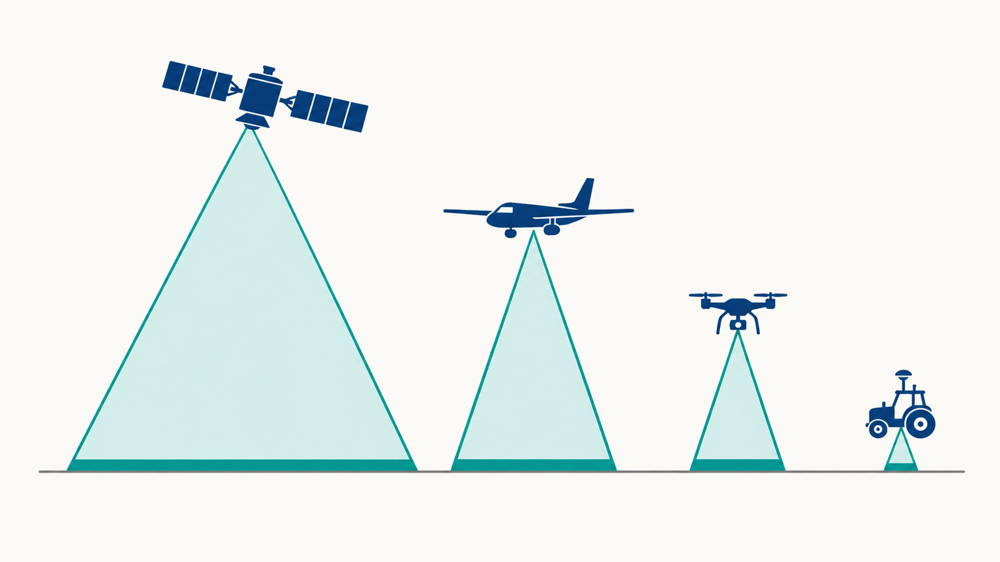

- **衛星**：広く・定期的に・無料のものがある。細かさは 3〜30 m。雲に弱い（SAR を除く）
- **航空機**：広め・随時・細かい。費用が高く、災害時や事業で使う
- **ドローン**：**好きな時に・数 cm で・狭く**（1 回に数 ha〜数十 ha）。センサは可視・近赤外・熱・レーザ
- **車両・地上**：点だが常時。実測値は衛星の「正解」にもなる（E 章の限界）
- 使い分け：面積・頻度・細かさ・費用・天候の 5 つで決める

<!--
昨年度の 32 を自作図に。ドローンの例：福岡県の小麦で近赤外カメラの NDVI と収量の相関 r ＝ 0.64、可変施肥区で収量約 10% 増（農水省資料、要確認）。
-->

---

## 5 道標 E：NDVI の地図が、畑の判断に変わるまで

- 道具はそろった。ここからは「現場でどう使われているか」を **十勝 → 日本 → 世界 → AI** の順に
- 追肥の要否 → 可変施肥 → 収穫の順番 → 民間サービス → 行政 → 水田と SAR → 世界の作物監視 → 指数の進化 → AI → 限界 → 時系列
- 数字は出典の年を添える。数字が無いものは「要確認」と注記

<!--
章の切れ目。E 章は 12 枚、22 分。
-->

---

## 5-1 十勝農試：衛星 NDVI で秋まき小麦の「追肥いらず」を判定

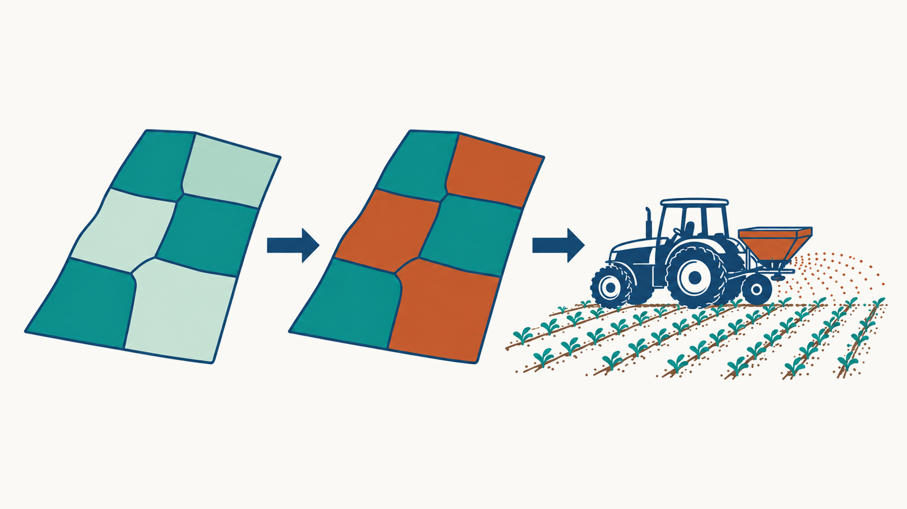

- 秋まき小麦「きたほなみ」。雪解け後の**起生期**に、衛星 NDVI から**茎数**を推定 → 茎数が十分なら追肥を省く
- 「追肥不要」の判定が実測と一致した割合 **約 90%**（2019〜2021 年、試験成績 2022 年）
- **止葉期**には Sentinel-2 の NDRE（レッドエッジ）から窒素吸収量を推定（誤差 2.8 kg N/10a）
- 20 km 四方の範囲を、数筆の実測で校正する。「衛星だけ」ではなく「衛星 ＋ 少数の実測」

<!--
R2 §1-1（道総研の成績概要・紹介資料、本文確認済み）。衛星は PlanetScope（Dove）と Sentinel-2。茎数の推定誤差は約 300 本/m²。
段 12 の NDVI がそのまま「追肥するかしないか」という判断になっている例として、E 章の先頭に置いた。
-->

---

## 5-2 JA の可変施肥：NDVI マップ → 施肥マップ → ブロードキャスター

- 十勝の **21 農協**で使える営農支援システムに衛星画像の機能（2022 年の利用 1,401 件）
- 流れ：畑の NDVI マップ → 生育の弱い所に多く、強い所に少なく施肥する**施肥マップ** → GNSS 付きの散布機が走りながら量を変える
- 小麦の実証：硫安を慣行 20 kg/10a から平均 30 kg/10a に（弱い所に厚く）→ 製品率 80.2% → 86.0%
- 可変施肥に対応した機械の所有は **7%**（83 戸）、検討中を含め 25%（2022 年、1,195 戸調査）。これから広がる段階
- 収穫順の最適化でコンバインの延べ台数 24〜31% 削減

<!--
R2 §1-2（農水省の講演資料 2023、本文確認済み）。製品反収は 10.5 → 10.7 俵/10a だが粗原は減っており、効果は品質寄り。
GNSS（A 章）と衛星画像（C〜D 章）が 1 台の機械の中で合流する枚。
-->

---

## 5-3 収穫の順番を衛星で決める：穂水分と刈取り順

- 共同乾燥施設では、どの畑から刈るかで乾燥のコストと品質が変わる
- 新篠津村の共同乾燥施設：NDVI で収穫順を決め、**目視で決めた順と同等**だった（秋まき小麦 30 ha・水稲 41 ha、2020 年）
- 鹿追町のコンバイン利用組合：衛星で穂水分・収穫順・可変施肥を組み合わせる計画を 2025-12 に認定（実績はこれから）
- 民間の生育マップは約 1,100 筆の収穫予測日を配信（要確認）

<!--
R2 §1-5、1-3、1-4。「目視と同等」は、衛星が人を超えるのではなく、人が全部の畑を歩かなくて済む、という価値。
スペースアグリの規模（約 170 名・2,800 ha）は検索要約のみで未確認なので本文には出さない。
-->

---

## 5-4 民間サービスと農機の連携

| サービス | 提供 | 一言 |
| --- | --- | --- |
| ザルビオ | BASF と全農（2021〜） | 生育・可変施肥マップ、病害予測。5 a 以上の圃場 |
| 天晴れ | 国際航業 | 衛星画像から生育診断と刈取り順。岩手県紫波町などの例 |
| アグリノート | ウォーターセル | 営農記録アプリに衛星画像（2026-03 試用版）。農機と連携 |
| KSAS | クボタ | 農機と営農データの連携。収量・食味を圃場ごとに |

- 共通の形：**衛星画像 → 圃場ごとのマップ → 農機・記録アプリに流す**。利用者はデータを見ず、判断だけ受け取る

<!--
R2 §2。各社の国内の利用規模は確認できた数字が無いので出さない。
-->

---

## 5-5 行政の仕事も変わる：現地確認を衛星で代替、耕作放棄地の判定

- 経営所得安定対策の**現地確認**：職員が全圃場を歩いていた → 衛星画像で作付けを確認（2024 年度に要綱改正）
  - 事業者の報告：現地確認の圃場 **80% 削減**、作業 7 割減。山口県では 8 割削減
- **耕作放棄地**の判定：衛星画像を AI で判読し、調査する農地を 40〜50% 減らす。導入 100 市町村超（2026 年）
- 基盤は筆ポリゴン（A 章）：農地の区画が無いと「畑ごと」にできない
- 共済（NOSAI）：衛星で推計した収穫量を損害評価に使う要領（2013 年〜）

<!--
R2 §3-1、2-6、3-4。削減率は事業者の申告値。耕作放棄地のサービスは年間約 100 万円の自治体向け。
「行政の仕事が変わる」は学生の進路の話としても聞かせる。
-->

---

## 5-6 水田と SAR：湛水・落水の検出、浸水被害の把握

- 水面は SAR で暗い（段 4-6）→ **田植え時期の湛水、中干しの落水**が雲の下でも分かる
- 中干しの延長はメタンを減らし J-クレジットになる（2023-04 方法論）。実施の確認に衛星を使う研究が進む
- 災害：2023-06 の台風第 2 号で、ALOS-2 の浸水解析を観測から **2.5 時間後**に国土交通省へ提供
- 2024-01 の能登半島地震：干渉 SAR で農地の地盤の変形を把握
- NISAR（2025-07）は土壌水分を 200 m で推定。畑の乾き具合を定期的に

<!--
R3 §5、R2 §5。中干し延長は減収約 3% の報告もあり、トレードオフ。
SAR は「光学の代わり」ではなく「光学が撮れない時と、水に強い」道具。
-->

---

## 5-7 世界の作物監視：WorldCereal、Crop Monitor、干ばつ警戒

- **WorldCereal**（ESA）：Sentinel-1・2 から**世界の作付図を 10 m** で作成（2021 年作期、CC-BY で公開）
- **GEOGLAM Crop Monitor**：主要国の作柄を衛星で毎月評価し、食料価格の安定に使う（早期警戒版は 2024-12 に 100 号）
- **FAO ASIS**・**JRC ASAP**：植生指数の平年差から干ばつを早期に警告
- **USDA Crop-CASMA**：SMAP 衛星の土壌水分を作物の状態に
- 日本の畑で使う NDVI と同じ指標が、世界の食料安全保障にも使われている

<!--
R3 §3、§9。時間が押したら飛ばす候補（2 番目に削る）。
-->

---

## 5-8 指数の進化：NDVI の頭打ちと、NDRE・kNDVI

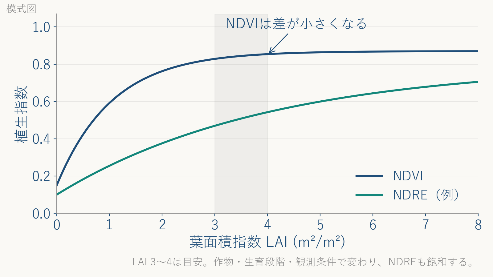

- NDVI は葉面積指数 LAI が 3〜4 を超えると**頭打ち**（赤が吸収され切って差が増えない）。生育後期の違いが見えない
- **NDRE** ＝ 赤の代わりに**レッドエッジ**（Sentinel-2 の B5、20 m）を使う。葉が茂っても窒素の違いに反応する
- 十勝農試が止葉期に NDRE を使った理由（5-1）がこれ
- ほかに kNDVI（NDVI の 2 乗の tanh）、NIRv（NDVI × 近赤外）。目的に合わせて指数を選ぶ

<!--
R3 §7。曲線は模式図で、LAI 3〜4 は目安。NDRE も最終的には飽和する。飽和の直感は「上から見ると葉が重なり、さらに増えても見た目が変わらない」。厳密には放射伝達・背景・吸収の複数の要因。
kNDVI の簡略形 tanh(NDVI²) は符号を失い（水でも正）、元の赤・近赤外にない情報を増やすわけでもない。言いたいのは「万能の指数はない。目的と時期で選ぶ」。
口頭確認：「LAI が増えても NDVI が同じなら、作物の状態は必ず同じ」→ ×。
-->

---

## 5-9 AI と地球観測の基盤モデル：Prithvi、AlphaEarth、Clay

- 画素の数値の組（段 11）を大量に学習させ、作付・被災・土地被覆を判読する**基盤モデル**が 2024〜25 年に相次いだ
- **Prithvi-EO-2.0**（NASA と IBM、2024-12）：Landsat と Sentinel-2 の 30 m 画像で学習。公開
- **AlphaEarth Foundations**（Google DeepMind、2025-07）：地球全体を 10 m で 64 次元の「埋め込み」に。Earth Engine で使える
- **Clay**：オープンなモデル。衛星画像を入れると特徴量が出る
- 次回の「AI 画像判別」：今日の「画素 ＝ 数値」がそのまま入力になる

<!--
R3 §1。基盤モデル＝一度大量に学習させ、用途ごとに少量の追加学習で使い回すモデル。
-->

---

## 5-10 限界と注意：雲・位置ずれ・混ざった画素・地上データ

- **雲**：光学衛星は晴れ待ち。秋雨・雪の時期は欠測が続く → SAR か、毎日撮る商用衛星で補う
- **位置ずれと混ざった画素**：10 m 画素に畦・道・隣の畑が混ざる。小さい畑ほど注意
- **明るさ ≠ 反射率**：大気の影響を補正した「地表反射率」を使う。NDVI の分母だけでは消えない
- **地上データが要る**：茎数・収量・窒素の実測で校正して初めて「判断」になる（5-1 の数筆の実測）
- **無料 ≠ 永続**：データの条件は毎年変わる。「衛星で決めた順が目視と同等」が現時点の到達点

<!--
R2 の事例に共通する「衛星 ＋ 少数の実測」を一般化。
学生が「衛星があれば現地に行かなくてよい」と受け取らないようにする枚。
-->

---

## 5-11 変化をとらえる：時系列で見るから分かること

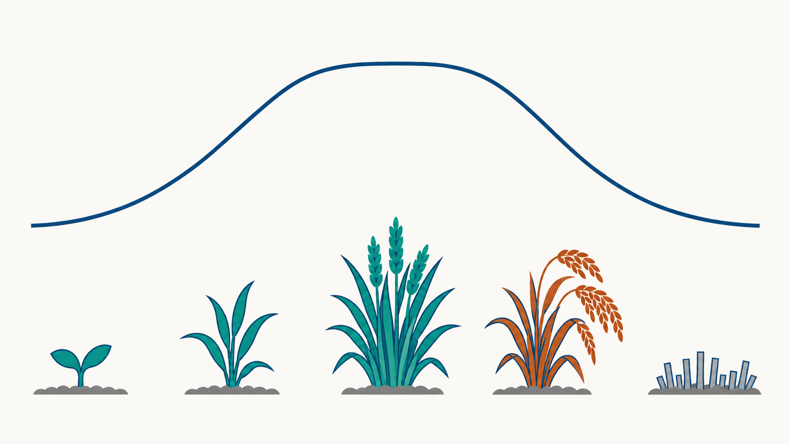

- 1 枚の NDVI は「いまの緑の量」。**時系列**にすると、播種 → 出芽 → 最大 → 登熟 → 収穫の**山の形**が見える
- 山の形は作物ごとに違う → 作付の判読（5-5 の現地確認、5-7 の WorldCereal の原理）
- 前後の比較で変化を検出：浸水、倒伏、収穫の済んだ畑
- 「どこが変化したか分からない」ときも、同じ場所を同じ条件で繰り返し測っているから差が取れる

<!--
昨年度の 33〜35（GIS ソフトの変化検出・時系列の画面）を自作図 1 枚に集約。
「土地のモニタリング・比較・変化の検出・特徴の理解」の 4 つは、この時系列の見方に含まれる。
-->

---

## 6-1 まとめ：今日の一本の筋

1. 光は**波**。色は**波長**。目に見えない波長がある
2. 物は太陽光を**反射**し、温度に応じて**放射**する。約 3 µm を境に反射か放射か
3. 葉は**赤を吸い、近赤外を返す**（葉の構造）。反射曲線は物の指紋
4. 衛星は曲線を**数本のバンド**で測る。赤と近赤外の「差÷和」が **NDVI**
5. 2026 年：無料の Sentinel-2・Landsat、毎日の商用衛星、雲を通す **SAR**、熱赤外・ハイパー・蛍光
6. 十勝の畑で NDVI が**追肥・可変施肥・収穫順**の判断に使う。**実測**と組で

<!--
0-2 の 3 つのゴールと対応。
-->

---

## 6-2 確認問題：3 問

1. Sentinel-2 の 1 画素（10 m 角）が持つ情報として最も適切なものは：（a）その場所の写真の色　（b）バンドごとの反射率の数値　（c）地表の温度
2. 曇った日と晴れた日で NDVI の値があまり変わらないのは、式のどの部分のおかげか：（a）分子の差　（b）分母の和　（c）近赤外を使うこと
3. 雲の下の水田の湛水を見たい。使う衛星は：（a）Sentinel-2（光学）　（b）Sentinel-1 や ALOS-4（SAR）　（c）ひまわり（気象）

<!--
答え：1 (b)。2 (b)。3 (b)。
Moodle の小テストの出題範囲は、この 3 問と 3-13 の 4 問の範囲を基本にする。
-->

---

## 6-3 課題：Moodle の小テスト

- Moodle 上で**小テスト**と**感想**を提出してください
- 回答は一度だけ・時間無制限。ただし一度入ると途中退室できないので、時間に余裕があるときに受験してください
- 期間：講義後 〜 次回講義の前日（日付は Moodle に記載）
- 出題範囲：今日の確認問題（3-13、6-2）と同じ範囲

<!--
昨年度の 25 を最後へ移動。締切の日付・設問は講師が Moodle 側で設定する。
-->

---

## 6-4 次回：AI 画像判別。今日の「画素の数値」がそのまま入力になる

- 4 本柱：GNSS と GIS（済）→ リモートセンシング（済）→ **AI 技術（次回）** → 環境 DNA
- 今日の画素 ＝ バンドごとの数値の組。次回は、その数値の組から「何が写っているか」を機械に学習させる
- 5-9 の基盤モデルが「どうやって」学んでいるかを、画像判別の仕組みから
- 準備：今日の 3 つのゴールを言えるようにしておく

<!--
0-1 の地図を言葉で再掲し、3 本目へ橋渡し。
-->

---

## 6-5 参考資料・無料データの入口

- Copernicus Browser：https://browser.dataspace.copernicus.eu/
- Google Earth Engine：https://earthengine.google.com/
- Tellus：https://www.tellusxdp.com/
- G-Portal（JAXA）：https://gportal.jaxa.jp/
- NASA Earthdata：https://www.earthdata.nasa.gov/
- 筆ポリゴン（農水省）：https://www.maff.go.jp/j/tokei/porigon/
- みちびき公式「宝探しで理解する衛星測位」：https://qzss.go.jp/overview/column/intro03_150926.html
- 道総研 十勝農試の秋まき小麦の衛星追肥判断、農水省の衛星による現地確認の資料：講義の Moodle にリンクを置く

<!--
URL は 2026-10-22 時点で確認したもの。研究報告の URL は Moodle に掲載する。
図版はすべて自作（matplotlib と画像生成）。模式図は数値の正確さより形を優先している。
-->

---

## 付録 A：式で確かめたい人へ（電磁波）

- 電磁波 ＝ 電場（電荷に力を及ぼす場）と磁場（動く電荷に力を及ぼす場）の変化が、直交して振動しながら空間を伝わる波。媒体は不要で、真空ではどの波長も光速 c で進む
- 波長 λ、周波数 f、光速 c の関係：

$$
c = \lambda f, \qquad c \approx 3.0 \times 10^{8}\ \mathrm{m/s}
$$

- 光子 1 個のエネルギー（h はプランク定数）：

$$
E = h f = \frac{h c}{\lambda}, \qquad h \approx 6.63 \times 10^{-34}\ \mathrm{J\,s}
$$

- 例：赤（0.65 µm）の f は約 4.6 × 10¹⁴ Hz、近赤外（0.85 µm）は約 3.5 × 10¹⁴ Hz

<!--
授業では飛ばす。昨年度の 16・18 の内容。昨年度の「電界は電圧がかかると発生／磁界は電流が流れると発生」「電流で磁場が発生する詳しい原因は不明」「波長（周波数）はエネルギーでもある」は物理として不正確なので、場の定義と反比例・比例の向きに改めた。
-->

---

## 付録 B：式で確かめたい人へ（放射の 3 法則）

- ステファン・ボルツマンの法則：黒体の総放射は温度の 4 乗に比例

$$
M = \sigma T^{4}, \qquad \sigma = 5.67 \times 10^{-8}\ \mathrm{W\,m^{-2}\,K^{-4}}
$$

- ウィーンの変位則：ピーク波長は温度に反比例

$$
\lambda_{\max} = \frac{2898\ \mathrm{\mu m\,K}}{T} \qquad \text{太陽 5800 K} \rightarrow 0.50\ \mathrm{\mu m}, \quad \text{地表 290 K} \rightarrow 10\ \mathrm{\mu m}
$$

- プランクの法則：波長ごとの放射輝度を温度の関数で与える（段 5 の曲線）

$$
B(\lambda, T) = \frac{2 h c^{2}}{\lambda^{5}} \cdot \frac{1}{e^{h c / (\lambda k T)} - 1}
$$

<!--
授業では飛ばす。昨年度の 19〜21 の内容。黒体は「入射する放射をすべて吸収する理想体（反射も透過もしない）」。昨年度の「全波長を反射しない物体」では透過する物を除外できないので改めた。
-->

---

## 付録 C：大気の外の太陽光と、地上に届く太陽光

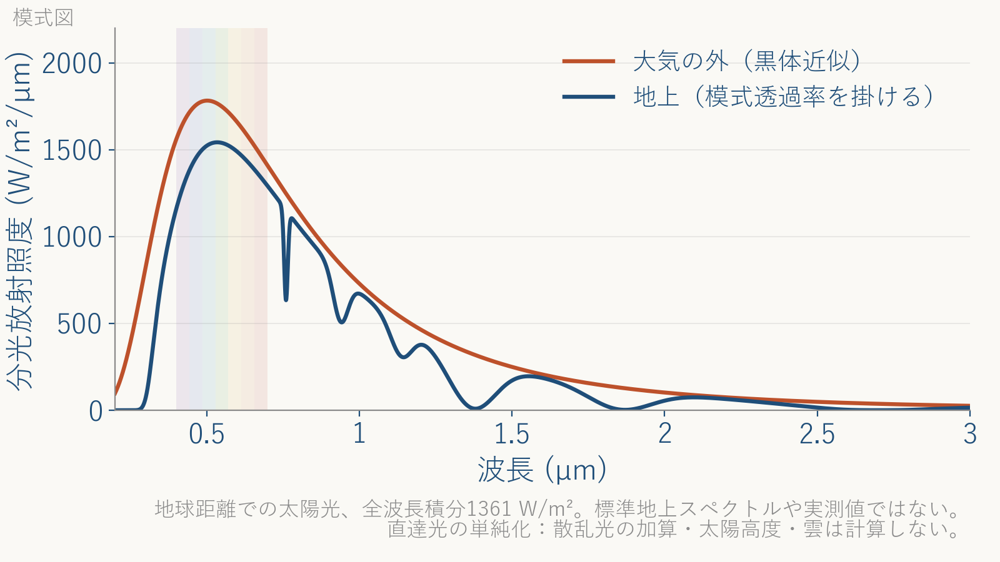

- 橙：大気の外（5772 K の黒体で近似）。紺：地上（模式的な透過率を掛けたもの）
- 谷は水蒸気などの吸収。短い波長では散乱も効く
- 段 7 の「大気の窓」は、この谷と谷の間。谷の分子名は覚えなくてよい

<!--
段 7 の補足。図は黒体近似 × 模式透過率で、実測や標準大気モデルではない。全波長の積分が 1361 W/m²（太陽定数）になるよう規格化。
-->
