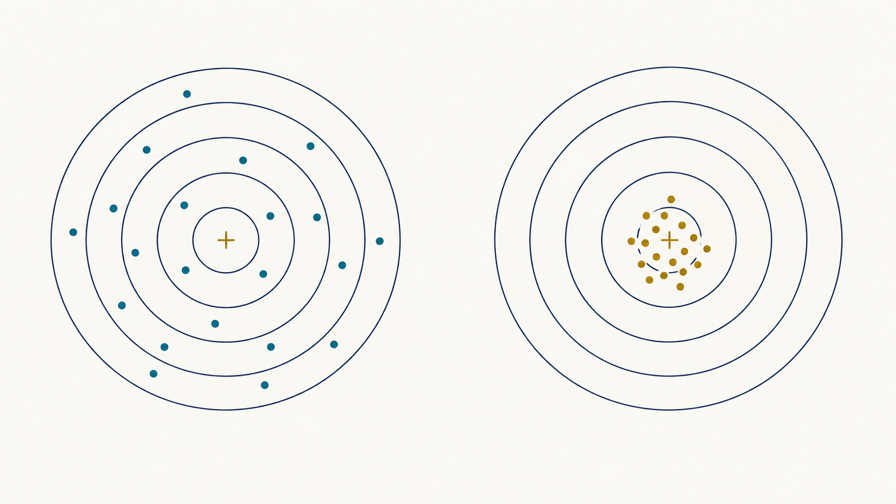

# 平均の誤差伝播

<!-- layout: cover -->

測量学 第2回 補足

なぜ、平均のばらつきは √n で小さくなるのか

<!-- notes: 同じ距離を何度か測り、平均を取る場面から始めます。この補足では、平均が安定する理由を、具体例から式へ順にたどります。画像はAI生成の概念イラストです。 -->

---

## 補足01 同じ距離でも、測定値は少しずつ違う

同じ距離を、同じ精度で4回測った例。

| 観測 | 1回目 | 2回目 | 3回目 | 4回目 |
| --- | --- | --- | --- | --- |
| 距離（m） | 30.000 | 30.004 | 30.002 | 30.006 |

> 式：x̄ = (30.000 + 30.004 + 30.002 + 30.006) / 4
> 式：x̄ = 30.003 m

> 要点：知りたいのは、この「平均」がどのくらい揺れるか。

<!-- notes: 数値は説明用の仮想データです。平均を計算できても、その値がどの程度安定しているかはまだ分かりません。平均の不確かさを求めるのが、今回の目的です。 -->

---

## 補足02 「1回の値」と「平均」のばらつき

<!-- layout: targets -->

1回ずつの測定値　　　　　　　　4回ずつ測った平均値

> 要点：「4回測って平均する」を繰り返すと、平均にもばらつきがある。

<!-- notes: 左は1回ずつの測定値、右は別々の4回分の組から求めた平均値に相当します。各点は概念表現で、右の点は1組の観測値ではありません。図は同じ尺度のAI生成概念図で、実測値や厳密な標準偏差を表したものではありません。偏りがなく独立・同精度である場合を考えます。 -->

---

## 補足03 観測値を「真値＋偶然のずれ」で表す

> 式：xᵢ = X + eᵢ

X は知りたい真値、xᵢ は i 回目の観測値。
eᵢ は、その回に生じる偶然のずれ（誤差）。
n は測定回数、x̄（エックスバー）は平均。

> 式：x̄ = (x₁ + ⋯ + xₙ) / n = X + (e₁ + ⋯ + eₙ) / n

> 要点：ここでは偏りを除き、偶然のずれだけを考える。

<!-- notes: 真値は通常分からないので、各回の本当の誤差eᵢも直接計算できません。ここは観測値が生まれる仕組みのモデルです。まずE[eᵢ]=0、有限の分散、互いに独立、各回が同じ精度という条件を置きます。 -->

---

## 補足04 誤差伝播は「入力のずれが結果へ伝わること」

4回のうち、1回目だけが 4 mm 大きくなったら？

> 式：x̄ = (x₁ + x₂ + x₃ + x₄) / 4
> 式：平均の変化 = 4 mm / 4 = 1 mm

1個の観測の影響は、平均には 1/4 だけ伝わる。
ただし、実際には4個すべての観測が揺れる。

> 要点：「1個の影響が1/4」と「全体のばらつきが1/4」は別。

<!-- notes: 他の3個を固定して1個だけ変える思考実験です。この伝わる割合を感度係数と呼びます。平均ではどの入力も係数が1/nですが、結果全体のばらつきには全n個の寄与が必要です。 -->

---

## 補足05 ばらつきを測る「分散」と「標準偏差」

E[ ] は、何度も繰り返したときの理論上の平均（期待値）。
プラスとマイナスのずれは、そのまま平均すると打ち消し合う。

> 式：E[eᵢ] = 0
> 式：分散 τ² = E[eᵢ²]　　　　標準偏差 τ = √E[eᵢ²]

ずれを二乗して平均し、最後に平方根で元の単位へ戻す。

> 要点：ずれと標準偏差の単位は mm。分散の単位は mm²。

<!-- notes: τ（タウ）は観測を生む仕組みの母標準偏差で、一般には未知です。eᵢの期待値が0なので、分散はE[eᵢ²]と書けます。ここでの期待値は、手元の有限個の観測の平均とは区別します。 -->

---

## 補足06 独立な誤差を、4通りの例で見る

e₁ と e₂ がそれぞれ ＋1 mm、−1 mm を等確率で取る。

| e₁（mm） | e₂（mm） | e₁＋e₂（mm） | e₁e₂（mm²） |
| --- | --- | --- | --- |
| ＋1 | ＋1 | ＋2 | ＋1 |
| ＋1 | −1 | 0 | −1 |
| −1 | ＋1 | 0 | −1 |
| −1 | −1 | −2 | ＋1 |

> 式：E[e₁e₂] = (1 − 1 − 1 + 1) / 4 = 0

<!-- notes: 独立なので4通りの確率はすべて1/4です。積がプラスになる場合とマイナスになる場合が同数あります。これは全事象を数えた厳密な例であり、有限回の実測では積の標本平均が必ず0になるという意味ではありません。 -->

---

## 補足07 独立なら、分散を足し算できる

Var は分散の記号。まず、誤差の和を二乗する。

> 式：(e₁ + e₂)² = e₁² + 2e₁e₂ + e₂²
> 式：E[(e₁ + e₂)²] = E[e₁²] + 2E[e₁e₂] + E[e₂²]

独立で、各誤差の期待値が0なら E[e₁e₂] = 0。

> 式：Var(e₁ + e₂) = Var(e₁) + Var(e₂)

> 要点：足し合わせるのは「標準偏差の二乗＝分散」。

<!-- notes: Varは分散を表す記号です。独立ならE[e₁e₂]=E[e₁]E[e₂]=0となり、交差項が消えます。前の例では合計の分散が1+1=2 mm²、標準偏差は√2 mmになります。正規分布を仮定する必要はありません。 -->

---

## 補足08 ずれを 1/n にすると、分散は 1/n²

平均では、1個のずれ eᵢ が eᵢ/n として結果に入る。

> 式：(eᵢ / n)² = eᵢ² / n²
> 式：Var(eᵢ / n) = τ² / n²

4回平均なら、1個分の分散への寄与は τ²/16。

> 要点：係数も二乗する。それが 1/n² の由来。

<!-- notes: 定数倍した量の分散は定数の二乗倍です。一般にVar(ae)=a²Var(e)となります。1/n倍した標準偏差と、その二乗である分散を混同しないよう、単位も確認します。 -->

---

## 補足09 n 個分の寄与を足し、平方根を取る

独立・同精度なら、同じ分散の寄与が n 個ある。

> 式：Var(x̄) = τ²/n² + ⋯ + τ²/n²
> 式：　　　　 = n × τ²/n² = τ²/n
> 式：SD(x̄) = √(τ²/n) = τ/√n

SD は標準偏差。真値 X は固定値なので分散に影響しない。

> 要点：1/n² を n 個足して 1/n。平方根で 1/√n。

<!-- notes: 分散がn分の1になるので、標準偏差は√n分の1です。この式は算術平均という線形の計算について厳密に成立します。独立・同精度・有限の分散が条件で、正規分布は必要ありません。 -->

---

## 補足10 1回の標準偏差 4 mm、4回の平均なら

説明用に、1回の母標準偏差 τ = 4 mm と分かっているとする。

| 計算の段階 | 計算 | 結果 |
| --- | --- | --- |
| 1個の入力が平均へ伝える標準偏差 | 4 / 4 | 1 mm |
| 1個分の分散への寄与 | 1² | 1 mm² |
| 4個分の分散を合計 | 1＋1＋1＋1 | 4 mm² |
| 平方根で標準偏差へ | √4 | 2 mm |

> 要点：4回平均の標準偏差は 2 mm。1回の半分になる。

<!-- notes: 4 mmを4で割った1 mmは、1個の入力だけの寄与です。入力が4個あるため、分散で合成して√(1²+1²+1²+1²)=2 mmとなります。ここでの4 mmは、冒頭の4個の観測値から計算した値ではありません。 -->

---

## 補足11 未知の τ は、観測データから推定する

残差 vᵢ = xᵢ − x̄ を使って、1回のばらつきを推定する。

> 式：σ = √[ (v₁² + ⋯ + vₙ²) / (n − 1) ]
> 式：σ(x̄) = σ / √n

σ は1回の標準偏差の推定値。σ(x̄) は平均の標準偏差の推定値。
前回の「平均の標準偏差」を、この補足では σ(x̄) と表す。

> 要点：n−1 は分散の推定、√n は平均への伝播で使う。

<!-- notes: 本講義の記号σは、統計学でしばしばsと書く標本標準偏差です。平均をデータから決めるため残差の和が0となり、自由度がn−1になります。σ²は母分散の不偏推定量ですが、σ自体が母標準偏差の不偏推定量という意味ではありません。nは2以上とします。 -->

---

## 補足12 実際のデータで計算する

5回の独立・同精度の観測。平均 x̄ = 30.004 m。Σ は合計を表す。

| 観測値 xᵢ（m） | 残差 vᵢ（mm） | vᵢ²（mm²） |
| --- | --- | --- |
| 30.000 | −4 | 16 |
| 30.002 | −2 | 4 |
| 30.004 | 0 | 0 |
| 30.006 | ＋2 | 4 |
| 30.008 | ＋4 | 16 |

> 式：Σvᵢ² = 40 mm²　　σ = √(40/4) = √10 ≈ 3.16 mm
> 式：σ(x̄) = √10/√5 = √2 ≈ 1.41 mm

<!-- notes: これは仮想の計算用データです。1観測の標準偏差は約3.16 mm、平均の標準偏差は約1.41 mmです。途中では丸めず、最後に小数第2位まで表示します。平均の値30.004 mと標準偏差1.41 mmを分けて報告し、1.41 mmを最大誤差や95%区間と呼ばないようにします。 -->

---

## 補足13 標準偏差を半分にするには、回数を4倍に

<!-- layout: chart -->

1回の標準偏差 τ = 4 mm の理論例。

| 観測回数 n | 1 | 4 | 9 | 16 |
| --- | --- | --- | --- | --- |
| 平均の標準偏差（mm） | 4.00 | 2.00 | 1.33 | 1.00 |

> 式：SD(x̄) = 4/√n mm

> 要点：回数を2倍にしても、ばらつきは半分にならない。

<!-- notes: グラフは表の理論値4/√nを使います。半分にしたいなら√nを2倍にする必要があるため、nは4倍です。9回の理論値4/3 mmは、表示では1.33 mmに丸めています。 -->

---

## 現場例① 30 m の基準線を、何回測ればよいか

<!-- layout: field_count -->
<!-- scenario: {"sigma":6,"target":2,"seconds":30} -->

TSで約30 mの同じ距離を繰り返し測り、基準線の長さを決める。
事前評価：1観測の標準偏差 σ = 6 mm。平均の目標 t = 2 mm。

> 式：σ/√n ≤ t
> 式：n ≥ (σ/t)²
> 式：n ≥ (6/2)² = 9

> 要点：9回以上を計画する。整数にならない場合は切り上げる。

<!-- notes: 説明用の仮想現場です。TSはトータルステーションで、ここでは基準線の同一距離を測る作業を考えます。6 mmは同じ観測方法・条件で十分な反復観測から評価した標準偏差の計画値であり、機器カタログの±値や最大誤差をそのまま代入したものではありません。独立・同精度で、共通の偏りを補正した条件で平均の標準偏差を見積もります。9回は「実際の誤差が必ず±2 mm以内」という保証ではなく、標準偏差の目標に対する必要回数です。実施後には元データと残差のばらつきを確認し、想定した精度を満たすか評価します。法令・作業規程で定めた観測回数や許容値の例ではありません。 -->

---

## 現場例② 必要な精度から、作業時間も見積もれる

<!-- layout: field_time -->
<!-- scenario: {"sigma":6,"target":2,"seconds":30} -->

同じ基準線で、1観測の標準偏差は6 mm。
1回の観測に30秒かかると仮定し、目標別に比較する。

| 平均の目標標準偏差 | 必要回数 | 観測時間 | 計算 |
| --- | --- | --- | --- |
| 3 mm 以下 | 4回 | 2分 | (6/3)² = 4 |
| 2 mm 以下 | 9回 | 4分30秒 | (6/2)² = 9 |
| 1 mm 以下 | 36回 | 18分 | (6/1)² = 36 |

> 式：目標を 2 mm から 1 mm へ。回数も観測時間も4倍。

> 要点：回数が多すぎるなら、器械・測定手順の改善も検討する。

<!-- notes: 観測時間は必要回数×30秒で計算し、準備・器械設置・記録確認・点検などの時間は含みません。30秒は説明用に置いた条件で、実機の測距時間や現場の標準作業時間ではありません。精度目標を先に決めると必要回数と人員・時間配分の計画に使えます。ただし同じデータを複製したり、相関の強い連続値を独立な観測として数えたりしても、この回数効果は得られません。共通の偏りの対策は次のスライドで扱います。 -->

---

## 補足14 すべてに共通するずれは、平均しても残る

器械の零点に b = ＋2 mm の偏りがある場合。

> 式：xᵢ = X + b + eᵢ
> 式：x̄ = X + b + (e₁ + ⋯ + eₙ) / n

偶然のばらつきは小さくなるが、中心は X＋2 mm のまま。
回数を増やすことに加え、点検・補正が必要になる。

> 要点：平均がよくそろうことと、真値に近いことを区別する。

<!-- notes: 固定された偏りbは平均によって除けません。ただし、SD(x̄)が|b|以下になった瞬間に追加観測が無意味になる、という厳密な境界はありません。このモデルの真値に対する平均二乗誤差はb²+τ²/nで、回数によって減少し続けますがb²が残ります。 -->

---

## 補足15 一緒に揺れる観測では、減り方が違う

同じ環境変化などで、観測が同じ方向に動く場合がある。
4回とも全く同じずれ e を受けたなら、

> 式：(e + e + e + e) / 4 = e

平均しても、その共通の揺れは小さくならない。
独立性は「記録が4個ある」だけでは保証できない。

> 要点：σ/√n を使う前に、観測の独立性と精度を確かめる。

<!-- notes: ここは実施ごとに変動する共通の揺れの例で、固定された偏りbとは区別します。正の相関があると独立の場合ほど平均の分散は減りません。同精度で各組の相関係数がρならVar(x̄)=τ²{1+(n−1)ρ}/nです。ρ=1ならτ²のまま、ρ=0ならτ²/nになります。 -->

---

## 補足16 ここまでの確認

独立・同精度の観測で、1回の標準偏差は 6 mm。

1. 9回平均の標準偏差はいくつか。
2. 平均の標準偏差を 1 mm にするには、何回必要か。
3. 全観測に ＋3 mm の偏りがあれば、9回平均で消えるか。

> 要点：答えだけでなく、「どの条件で使える式か」も説明しよう。

<!-- notes: 1分程度、各自で考えさせます。第1問と第2問では、与えられた6 mmを使って観測回数を計画する理論計算とします。第3問では、偶然誤差と固定された偏りを分けて考えます。 -->

---

## 補足17 答えと、式の読み方

> 式：① 6/√9 = 2 mm
> 式：② 6/√n = 1　なので √n = 6、n = 36 回

③ ＋3 mm の偏りは残る。回数を増やしても補正にはならない。

> 式：平均の標準偏差 = 1回の標準偏差 / √観測回数

> 要点：各入力の寄与を二乗して足し、最後に平方根を取る。

<!-- notes: 公式を思い出すときは、1/nの寄与を二乗し、n個分を足す過程も思い出してもらいます。1回の散らばりσと平均の散らばりσ(x̄)を、言葉で区別できることが到達目標です。 -->

---

## 付録A 一般の誤差伝播式とのつながり

y = f(x₁, …, xₙ) に対し、cᵢ = ∂f/∂xᵢ を感度係数と呼ぶ。
cᵢ は、入力 xᵢ の小さな変化が結果に伝わる割合。

> 式：Var(y) ≈ Σ cᵢ² Var(xᵢ)　　　　（入力が無相関）
> 式：平均なら cᵢ = 1/n　なので Var(x̄) = Σ τ²/n² = τ²/n

平均は線形なので、この分散の式は近似でなく厳密に成り立つ。
相関がある場合は、共分散の項も必要になる。

<!-- notes: ∂は偏微分の記号で、他の入力を固定したときの変化率を表します。一般の非線形関数では一次のテイラー近似を使うため近似式です。相関を含む一次近似はVar(y)≈Σcᵢ²Var(xᵢ)+2Σ(i<j)cᵢcⱼCov(xᵢ,xⱼ)です。平均の導出には微分の知識は必須ではありません。 -->

---

## 付録B 出典と記号の対応

JCGM 100:2008（GUM）、BIPM 公式公開版。
4.2.2–4.2.3：反復観測と平均の分散。
5.1.2：無相関な入力の不確かさの伝播。
5.2.2：相関がある場合の共分散の項。

τ：母標準偏差。σ：データから求めた標準偏差（通常の s）。
σ(x̄)：平均の標準偏差の推定値（前回のエックスバーの標準偏差）。

<!-- notes: 参照日2026年10月14日。原文 https://www.bipm.org/documents/20126/2071204/JCGM_100_2008_E.pdf 。本資料の数値例と説明は独自に作成し、図は概念を説明するAI生成画像です。前回資料は「第02回_測量の基礎と誤差論/改訂版_20261008/slides_revised.md」の2-4節です。 -->
