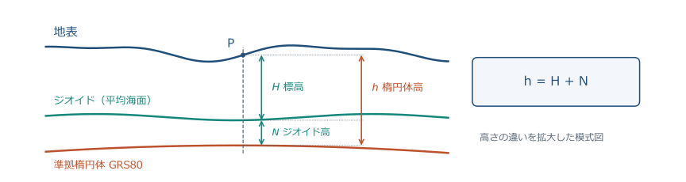
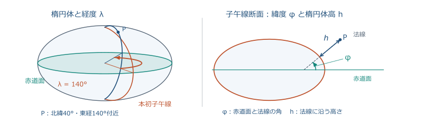
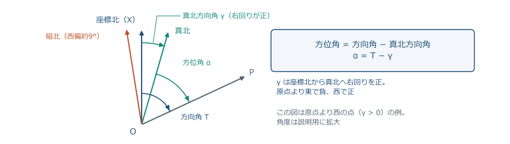
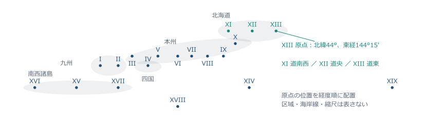
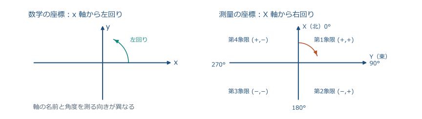
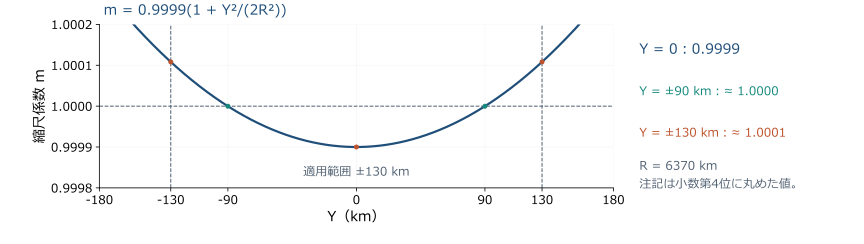
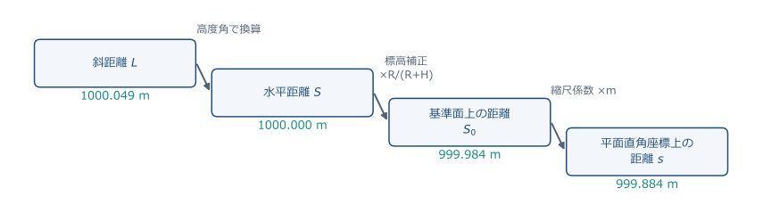
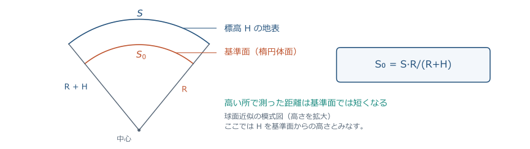
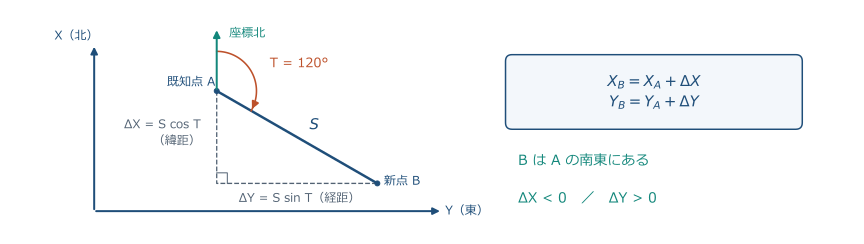
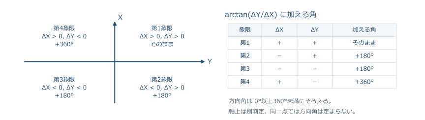

# 測量学 第3回

## 測量の座標

農業農村工学系の学部講義｜図解版（2026-10-14）

**地球上の位置を平面直角座標で表し、座標・距離・方向角を相互に計算する。**

<!-- 導入の1枚目です。前回は観測値のばらつきを扱いました。今回は観測した距離や角を、どの座標の約束で表すかを学びます。実習で TS や GNSS の画面に出る X・Y・標高の意味が分かるようになります。 -->

---

## 3-0 前回の手計算テスト 問1の解答

| 項目 | 値 |
| --- | ---: |
| 最確値 $\bar{x}=\sum x_i/6$ | 30.006 m |
| 残差 $v_i$（mm） | −3, −2, −1, +1, +2, +3（和 0） |
| $\sum v_i^2$ | 28 mm² |
| 1観測の標準偏差 $\sigma=\sqrt{28/5}$ | 2.37 mm |
| 最確値の標準偏差 $\sigma/\sqrt{6}$ | 0.97 mm |

<!-- 残差和が0になることと、分母が n−1 の5であることを確認します。最確値の標準偏差は観測回数の平方根で小さくなります。 -->

---

## 3-0 前回の手計算テスト 問2の解答

| 項目 | 値 |
| --- | ---: |
| 重み（回数に比例） | $w_1:w_2=1:4$ |
| 重み付き平均 $(1\times80.000+4\times80.015)/5$ | 80.012 m |
| 残差 $v_i$（mm） | −12, +3（$\sum w_iv_i=0$） |
| $\sum w_iv_i^2$ | 180 mm² |
| $\sigma_0=\sqrt{180/1}$、$\sigma_{\bar{x}_w}=\sigma_0/\sqrt{5}$ | 13.42 mm、6.00 mm |

<!-- 通常の残差和は −9 で0になりませんが、重み付き残差和は0になります。重みの根拠を書けていたかを重点的に見ました。詳しい採点基準は配布した解答に書いてあります。 -->

---

## 3-0 本日の到達目標

- 標高・楕円体高・ジオイド高の関係を式で説明できる。
- 平面直角座標系の約束（X が北、Y が東、原点の縮尺係数）を説明できる。
- 方向角・方位角・真北方向角の違いを言える。
- 既知点から新点の座標を計算し、逆に2点から距離と方向角を求められる。
- 斜距離を水平距離・基準面距離・平面距離に段階的に換算できる。

<!-- 今日は5つの到達目標があります。最後の演習では4番と5番を計算で確認し、1〜3番は冒頭の小テストと同じ形式で次回問います。 -->

---

## 3-0 本日の流れと時間配分

| 時間 | 内容 |
| --- | --- |
| 0〜5分 | 前回の確認・到達目標 |
| 5〜18分 | 小テスト（前回範囲、測量士補形式）10分＋解説3分 |
| 18〜65分 | 地球の形と座標 → 平面直角座標系 → 方向角と座標計算 |
| 65〜85分 | 手計算テスト20分 |
| 85〜90分 | 要点確認・提出・次回予告 |

<!-- 今回から冒頭に前回範囲の小テストを入れます。測量士補試験と同じ五肢択一で、電卓は使いません。講義は3つの節に分け、各節の終わりに短い確認問題を置きます。 -->

---

## 3-Q 小テストの形式：測量士補試験にならう

- 国家試験「測量士補」は択一式（五肢）28問・3時間・700点満点、450点以上で合格。**電卓は使えない**（関数表が付く）。
- 出題区分（令和7年〜）：測量に関する法規、測地測量、測図測量、応用測量（三次元点群測量も出題）。
- 本日の小テストは前回範囲（誤差論）から5問・10分・各2点。
- 問題文は配布用紙と同じ。答は番号で書く。

<!-- 測量士補試験は国土地理院が行う国家試験で、合格すると測量士補として登録できます。計算問題も電卓なしで解ける数値になっているので、今日の小テストも同じ条件にします。詳しい試験の要項は配布資料の注記を見てください。 -->

---

## 3-Q 問1 誤差の種類

次の a〜e のうち、**明らかに間違っているもの**はどれか。

- a. 過失（読み違い・転記の誤り）は、点検や再測によって取り除く。
- b. 尺定数のように原因と大きさが分かる定誤差は、補正計算で取り除く。
- c. 偶然誤差は、同精度の独立な観測回数を増やしても平均の標準偏差は小さくならない。
- d. 同精度の独立な観測の最確値は算術平均である。
- e. 較差が許容値を超えたら、観測値を書き換えずに再測する。

<!-- 1問2分の目安で進めます。選択肢の番号は a から順に1〜5です。 -->

---

## 3-Q 問2 最確値

同一の距離を同精度で独立に5回観測した（過失・定誤差は処理済み）。最確値はどれか。

観測値（m）：50.003、50.005、50.006、50.008、50.008

選択肢　1. 50.005 m　2. 50.006 m　3. 50.007 m　4. 50.008 m　5. 50.0055 m

<!-- 末尾の mm だけを足すと早く計算できます。残差の和が0になるかで検算できます。 -->

---

## 3-Q 問3 最確値の標準偏差

同精度で独立に4回観測し、残差の二乗の和が $\sum v_i^2=27\ \mathrm{mm^2}$ であった。最確値の標準偏差はどれか。

選択肢　1. 0.75 mm　2. 1.5 mm　3. 2.6 mm　4. 3.0 mm　5. 6.0 mm

<!-- 1観測の標準偏差と最確値の標準偏差の区別を問う問題です。分母が n−1 であることにも注意させます。 -->

---

## 3-Q 問4 重み付き平均

新点 P の標高を2本の水準路線で観測した。路線1（2 km）は 10.012 m、路線2（4 km）は 10.018 m。重みを路線長に反比例させるとき、最確値はどれか。

選択肢　1. 10.012 m　2. 10.013 m　3. 10.014 m　4. 10.015 m　5. 10.016 m

<!-- 路線長に反比例なので、短い路線の重みが大きくなります。単純平均の 10.015 を選ばないよう、比を作ってから計算させます。 -->

---

## 3-Q 問5 機器の精度表示

TS の測距精度が「±(2 mm + 2 ppm × D)」と表示されている。1 km の距離を測ったとき、この表示が示す標準偏差はどれか。

選択肢　1. 2 mm　2. 4 mm　3. 6 mm　4. 22 mm　5. 202 mm

<!-- ppm は100万分の1です。1 km は 10⁶ mm なので、2 ppm は 2 mm になります。残り1分で解答欄を確認させ、用紙を回収します。 -->

---

## 3-Q 解答（問1〜3）

| 問 | 正答 | 根拠 |
| --- | --- | --- |
| 1 | 3（c） | 独立・同精度なら平均の標準偏差は $\sigma/\sqrt{n}$ で減る |
| 2 | 2（50.006 m） | 合計 250.030 ÷ 5。残差 −3,−1,0,+2,+2 の和は 0 |
| 3 | 2（1.5 mm） | $\sigma=\sqrt{27/3}=3.0$ mm、$\sigma_{\bar{x}}=3.0/\sqrt{4}=1.5$ mm |

<!-- 問1は「減らない」が誤りです。問3で 3.0 mm を選んだ人は、1観測の標準偏差で止まっています。士補試験では残差が整数 mm、平方和が平方数になるように作られているので、根号が開けなければ計算ミスを疑ってください。 -->

---

## 3-Q 解答（問4〜5）

| 問 | 正答 | 根拠 |
| --- | --- | --- |
| 4 | 3（10.014 m） | 重み 2:1。(2×10.012+10.018)/3 |
| 5 | 2（4 mm） | 2 mm + 2×10⁻⁶×10⁶ mm |

- 士補の型：水準測量は「路線長に反比例」、多角測量の反復は「回数に比例」。
- 機器の性能表示は距離に応じて読む。

<!-- 問4で 10.015 を選んだ人は単純平均です。問5は 2 ppm と 1 km の単位を合わせる問題で、実習で使う TS のカタログにも同じ書き方があります。 -->

---

## 3-1 「座標」とは何か

- 位置を**数の組**で表す約束。
- 約束の中身：原点、軸の向き、単位、基準面（高さの0）。
- 約束がそろって初めて、別の人・別の日・別の機器の成果を重ねられる。
- 同じ杭でも、約束が違えば数値は違う。

| 約束 | 同じ杭の表し方 |
| --- | --- |
| 緯度・経度・楕円体高 | 42°52′N、143°10′E、85.0 m |
| 平面直角座標（XIII系）と標高 | X=−120 000 m、Y=−85 000 m、H=50.0 m |
| 器械点を原点にした器械座標 | x=+12.345 m、y=−3.210 m、h=+0.52 m |

<!-- 座標は「位置を数で表す約束」です。表の3行は同じ杭を違う約束で表した例で、値は説明用の概数です。今日はこの3つの約束の関係を順に見ていきます。 -->

---

## 3-1 地球の3つの面

- **地表**：実際の地面。起伏がある。
- **ジオイド**：平均海面を陸地の下まで延長した面。重力の等ポテンシャル面で、水準測量の「高さ0」。
- **準拠楕円体**：ジオイドに近い滑らかな回転楕円体（GRS80）。緯度・経度・楕円体高の基準。

<!-- 高さには基準が2つあります。水が流れる向きを決めるのはジオイド、GNSS が計算するのは楕円体です。図の3本の線の違いを押さえてください。 -->

---

## 3-1 標高・楕円体高・ジオイド高

$$
h = H + N
$$

- $H$：標高（ジオイドからの高さ。水準測量・地形図の高さ）
- $h$：楕円体高（楕円体からの高さ。GNSS が出す高さ）
- $N$：ジオイド高（楕円体からジオイドまでの高さ）

<!-- この式は測量士補で毎年のように問われます。GNSS で得た楕円体高からジオイド高を引くと標高になります。符号を間違えないよう、図で N が楕円体とジオイドの間の高さであることを確認してください。 -->

---

## 3-1 数値例：GNSS の高さを標高に直す

- GNSS が表示した楕円体高：$h=85.000$ m
- ジオイドモデルから読んだジオイド高：$N=35.000$ m

$$
H = h - N = 85.000 - 35.000 = 50.000\ \mathrm{m}
$$

- 日本のジオイド高はおよそ 20〜45 m。帯広市付近は約 29 m（ジオイド2024）。
- ジオイド高はモデル（「ジオイド2024日本とその周辺」）から求める。

<!-- 楕円体高をそのまま標高と思うと 35 m も違います。実習の GNSS 受信機は内部にジオイドモデルを持っていて、標高に変換して表示できます。どちらを表示しているか必ず確認してください。 -->

---

## 3-1 緯度・経度・楕円体高（測地座標）

- 緯度 φ：赤道面と、その点の楕円体の法線がなす角（北緯・南緯）。
- 経度 $\lambda$：本初子午線からの角（東経・西経）。
- 楕円体高 $h$：法線に沿った楕円体面からの高さ。
- 日本の測地系：**日本測地系 2011（JGD2011）**、楕円体は GRS80。

<!-- 緯度は地球の中心から測る角ではなく、楕円体面に垂直な線（法線）で定義します。度分秒で表すので、前回の DMS 変換が必要になります。 -->

---

## 3-1 測地成果 2024 とは

- 日本の基準点の成果は「測地成果 2011」（東北地方太平洋沖地震後に再定義）。
- **測地成果 2024**：2025 年 4 月 1 日から適用。**標高成果のみ**を改定し、水平位置（緯度経度・平面直角座標）は測地成果 2011 のまま。
- 標高の基準はジオイドモデル「ジオイド2024日本とその周辺」に基づく。
- 旧成果・旧ジオイドモデルと混用しない。

<!-- 2025 年から標高の成果が変わっています。古い成果表やジオイドモデルを混ぜると数 cm〜数十 cm の食い違いが出ます。実習データの日付と使ったモデルを必ず記録してください。 -->

---

## 3-1 地心直交座標（GNSS の内部座標）

- 原点＝地球の重心、Z 軸＝自転軸、X 軸＝本初子午線と赤道の交点方向。
- GNSS は衛星までの距離からこの $(X, Y, Z)$ を解く。
- 測地座標 (φ, λ, h) とは公式で相互変換できる（本講義では計算しない）。
- 国際的な枠組み ITRF と JGD2011 は、ほぼ同じ地心座標系。

<!-- GNSS の受信機は、まず地心直交座標を解き、それを緯度経度楕円体高に直し、さらに平面直角座標と標高に変換して表示しています。この3段階を知っていると、受信機の設定画面が読めます。 -->

---

## 3-1 日本の基準：原点と基準点

| 基準 | 内容 |
| --- | --- |
| 日本経緯度原点 | 東京都港区麻布台。経緯度の出発点 |
| 日本水準原点 | 東京都千代田区永田町。標高の出発点（24.3900 m） |
| 電子基準点 | 国土地理院が全国約 1300 点に設置した GNSS 連続観測点 |
| 三角点・水準点 | 位置・標高を与える基準点。公共測量の出発点 |

- 測量法第11条：位置は経緯度と平均海面からの高さで表す。ただし**直角座標**と高さ、極座標と高さ、地心直交座標でも表せる。

<!-- 測量法第11条は、位置をどう表すかを定めています。条文の「直角座標」が平面直角座標系の根拠で、告示で19系が定められています。電子基準点は実習で使うネットワーク型 RTK の基準になっています。 -->

---

## 3-1 3種類の北

- **真北**：その点の子午線の方向（北極の方向）。
- **座標北**：平面直角座標系の X 軸の正の方向。
- **磁北**：磁針が指す方向。年々変わり、北海道では真北から西へ約 9°。

<!-- 「北」は3つあります。測量の計算で使うのは座標北で、角を座標北から測ったものを方向角と呼びます。真北との差は後で真北方向角として出てきます。 -->

---

## 3-1 球面を平面に写す理由と代償

- 曲面を平面に広げると、距離・面積・角のどれかは必ずひずむ。
- 測量は**角を保つ投影（等角投影）**を使う：ガウス・クリューゲル投影。
- 代わりに距離のひずみを**縮尺係数**として扱う。
- 「平面で直角座標を使える」利点が、ひずみの管理の手間に勝る。

<!-- 地球は丸いので、平面の直角座標でそのまま計算すると誤差が出ます。それでも平面で計算したいので、角が変わらない投影を選び、距離のひずみは係数で管理します。この考えが平面直角座標系です。 -->

---

## 3-1 2つの投影座標系

| 項目 | 平面直角座標系 | UTM 座標系 |
| --- | --- | --- |
| 用途 | 公共測量、地籍、設計図 | 地形図（1:25 000 など） |
| 区分 | 日本を 19 系に分割 | 経度 6° 幅の帯（日本は 51〜56 帯） |
| 原点の縮尺係数 | 0.9999 | 0.9996 |
| 軸 | X が北、Y が東 | N が北、E が東 |

- 本日は平面直角座標系。UTM は第 10 回（地形図）で扱う。

<!-- どちらもガウス・クリューゲル投影で、違いは分割の幅と原点の縮尺係数です。狭い範囲を高い精度で扱う公共測量は平面直角座標系、広い範囲の地形図は UTM を使います。 -->

---

## 3-1 ここまでの確認①

- 楕円体高 50.0 m、ジオイド高 35.0 m の点の標高は？
- GNSS が出す高さと水準測量の高さ、どちらが「ジオイドからの高さ」か？
- 測地成果 2024 で変わったのは、水平位置か、標高か？

<!-- 答えは 15.0 m、水準測量、標高です。隣の人と30秒で確認してください。 -->

---

## 3-1 試験で問われる型（高さと基準）

| 型 | 着眼点 |
| --- | --- |
| $h=H+N$ の計算 | $H=h-N$。符号と図の対応 |
| 基準の正誤 | 電子基準点は国土地理院（約 1300 点）、経緯度原点（麻布台）と水準原点（永田町、24.3900 m）の違い |
| 測地系の正誤 | JGD2011・GRS80・測地成果 2024（標高のみ改定） |
| 北の区別 | 真北・座標北・磁北、方向角は座標北基準 |

<!-- 士補試験の法規と GNSS の分野では、この表の型がそのまま出ます。計算より用語の正確な理解が問われます。 -->

---

## 3-2 平面直角座標系の定義

- 根拠：測量法施行令と国土交通省告示。日本を **19 の系（I〜XIX）** に分ける。
- 各系の原点は**緯度・経度**で定め、原点の座標は $(X, Y)=(0, 0)$。
- 原点を通る子午線を X 軸、原点を通りそれに直交する線を Y 軸とする。
- 1つの系の東西の幅はおよそ 130 km 以内（ひずみを抑えるため）。

<!-- 日本を19に分ける理由は、1つの平面で扱う範囲を狭くして距離のひずみを 1 万分の 1 以内に収めるためです。図は配置の模式図で、正確な境界は告示の別表で確認します。 -->

---

## 3-2 X 軸が北、Y 軸が東

- 数学：$x$ が横、$y$ が縦、角は $x$ 軸から**左回り**。
- 測量：**X が北（縦）、Y が東（横）**、角は X 軸（北）から**右回り**。
- 式の形は同じ：$\Delta X=S\cos T$、$\Delta Y=S\sin T$。
- 数学の $(x, y)$ を測量の $(Y, X)$ と読み替えれば、電卓の極座標変換も使える。

<!-- 一番間違えやすい点です。測量では縦軸が X です。GIS ソフトに座標を入れるとき X と Y を逆にして、点が別の場所に飛ぶ事故がよく起きます。 -->

---

## 3-2 象限と座標の符号

| 象限 | 位置 | $X$ | $Y$ | 方向角の範囲 |
| --- | --- | --- | --- | --- |
| 第1 | 北東 | ＋ | ＋ | 0°〜90° |
| 第2 | 南東 | − | ＋ | 90°〜180° |
| 第3 | 南西 | − | − | 180°〜270° |
| 第4 | 北西 | ＋ | − | 270°〜360° |

- 象限は X 軸から右回りに数える（数学とは順番が違う）。

<!-- 原点から見てどの方角にあるかで符号が決まります。後で逆計算をするときに、この表で方向角の範囲を決めます。 -->

---

## 3-2 北海道の系と本学の位置

| 系 | 原点 | 主な適用地域 |
| --- | --- | --- |
| XI | 北緯 44°、東経 140°15′ | 道南西部（函館・小樽など） |
| XII | 北緯 44°、東経 142°15′ | 道央（札幌・旭川など） |
| XIII | 北緯 44°、東経 144°15′ | 道東（帯広・釧路・北見・網走・根室など） |

- 帯広市は **第 XIII 系**。原点（北緯 44°、東経 144°15′）の南西にあるので、$X<0$、$Y<0$（市中心部で $X\approx-120$ km、$Y\approx-85$ km）。
- 系をまたぐ現場では、系を統一してから計算する。

<!-- 本学の座標は第 XIII 系で X も Y も負になります。実習で GNSS の座標が負の値で出ても異常ではありません。隣の系と混ぜると数十 km ずれるので、成果には必ず系を書きます。 -->

---

## 3-2 縮尺係数：中央で縮め、端で伸ばす

- 原点で $m_0=0.9999$（1 万分の 1 だけ短く）。
- 原点から東西に約 90 km で $m=1.0000$、約 130 km で $m=1.0001$。
- 系の中でひずみを $\pm1/10\,000$ 以内に収める工夫。
- $m$ は Y（東西方向の距離）だけで決まり、X にはよらない。

<!-- 縮尺係数は「基準面上の距離に掛けると平面上の距離になる係数」です。原点で 1 より小さくし、端で 1 より大きくすることで、全体のひずみを小さく保っています。 -->

---

## 3-2 縮尺係数の近似式と数値例

$$
m \approx m_0\left(1+\frac{Y^2}{2R^2}\right),\qquad m_0=0.9999,\quad R\approx6370\ \mathrm{km}
$$

| $Y$ | $Y^2/(2R^2)$ | $m$ |
| ---: | ---: | ---: |
| 0 km | 0 | 0.99990 |
| 50 km | 0.000031 | 0.99993 |
| 90 km | 0.000100 | 1.00000 |
| 130 km | 0.000208 | 1.00011 |

<!-- 実務では国土地理院の計算サービスや成果表の値を使いますが、この近似式で桁の感覚がつかめます。Y が 50 km なら 1 km あたり 7 cm 短く計算されます。 -->

---

## 3-2 距離の4段階

- ① 斜距離 $L$：TS や巻尺で直接測る。
- ② 水平距離 $S$：高度角または高低差で水平に直す。
- ③ 基準面上の距離 $S_0$：標高 $H$ の分だけ楕円体面に下ろす。
- ④ 平面直角座標上の距離 $s$：縮尺係数 $m$ を掛ける。

<!-- 座標計算に使う距離は④です。実習で TS が表示する「水平距離」は②で、座標計算に使うにはまだ2段階の換算が要ります。TS の設定で③④を自動にできますが、何をしているかを知っておきます。 -->

---

## 3-2 ① → ②：斜距離から水平距離へ

高度角 $\theta$（水平からの角）が分かるとき：

$$
S = L\cos\theta
$$

高低差 $\Delta h$ が分かるとき：

$$
S = \sqrt{L^2-\Delta h^2}
$$

- 例：$L=1000.049$ m、$\Delta h=9.900$ m → $S=\sqrt{1000.049^2-9.900^2}=1000.000$ m

<!-- TS は鉛直角から自動で水平距離にしています。巻尺で斜面を測ったときは、高低差を別に測って自分で直します。補正は必ず短くする向きです。 -->

---

## 3-2 ② → ③：標高補正（基準面に下ろす）

$$
S_0 = S\,\frac{R}{R+H} \approx S\left(1-\frac{H}{R}\right)
$$

- $R\approx6370$ km（地球の半径）、$H$：その区間の平均標高。
- 高い所で測った距離は、基準面では**必ず短く**なる。
- 補正量の目安：$S\times H/R$。標高 100 m で 1 km あたり約 1.6 cm。

<!-- 図の外側の弧と内側の弧は同じ中心角です。半径が大きい外側の方が長いので、基準面に下ろすと短くなります。式は相似比そのものです。 -->

---

## 3-2 ③ → ④：縮尺係数を掛ける

$$
s = m\,S_0
$$

- 原点付近（$m<1$）では短く、原点から約 90 km 以上離れると（$m>1$）長くなる。
- 標高補正と縮尺係数補正は別の理由による別の補正。両方行う。
- 逆向き（座標 → 現地）：$S = \dfrac{s}{m}\cdot\dfrac{R+H}{R}$

<!-- 標高補正は常にマイナス、縮尺係数は場所によってプラスにもマイナスにもなります。試験では「符号の向き」を問う正誤問題が出ます。 -->

---

## 3-2 数値例：4段階を通して計算する

条件：$L=1000.049$ m、$\Delta h=9.900$ m、$H=100$ m、$m=0.9999$

| 段階 | 式 | 値 |
| --- | --- | ---: |
| ② 水平距離 | $S=\sqrt{L^2-\Delta h^2}$ | 1000.000 m |
| ③ 基準面距離 | $S_0=S\times6370000/6370100$ | 999.984 m |
| ④ 平面距離 | $s=0.9999\times S_0$ | 999.884 m |

- 標高補正 −0.016 m、縮尺係数補正 −0.100 m。合計 −0.116 m。

<!-- 1 km で 12 cm 近く違います。設計図の距離と現地で測る距離が合わない原因の多くがこの換算の抜けです。演習では同じ型を数値を変えて解きます。 -->

---

## 3-2 逆向きの換算：設計図の距離を現地に戻す

- 設計図・座標から計算した距離は**平面距離 $s$**。
- 現地で巻尺や TS で測って杭を打つのは**水平距離 $S$**。

$$
S = \frac{s}{m}\cdot\frac{R+H}{R}
$$

- 例：$s=300.000$ m、$H=200$ m、$m=0.9999$ → $S=300.039$ m（現地では約 4 cm 長く）。

<!-- 農業土木の現場では、設計座標から杭の位置を出すことが多いです。平面距離のまま巻尺で測ると、標高の高い所ほど短く打ってしまいます。 -->

---

## 3-2 ここまでの確認②

- $X=-200$ m、$Y=+300$ m の点は、原点から見てどの方角か？
- 標高 500 m の地点で水平距離 2000 m を基準面に下ろすと、補正量はいくらか？（$R=6370$ km）
- 原点から東へ 90 km の地点の縮尺係数はいくらか？

<!-- 答えは南東（第2象限）、2000×500/6370000 ≒ 0.157 m、約 1.0000 です。 -->

---

## 3-2 試験で問われる型（平面直角座標系）

| 型 | 着眼点 |
| --- | --- |
| 座標系の正誤 | X が北・Y が東、19 系、原点 (0, 0)、原点の縮尺係数 0.9999 |
| 標高補正の計算 | $S\times H/R$、$R=6370$ km が与えられる。向きは必ず短く |
| 縮尺係数の計算 | $s=mS_0$。$m$ の範囲 0.9999〜1.0001 |
| 系の選択 | 現場の系を告示の別表で確認し、混用しない |

<!-- 士補では「原点の縮尺係数は 1.0000 である」のような誤文を見抜く問題と、標高補正の計算が頻出です。電卓なしで 2000×500/6370000 のような割り算ができるよう、概算の練習をしておいてください。 -->

---

## 3-2 （参考）UTM との違い

| 項目 | 平面直角座標系 | UTM |
| --- | --- | --- |
| 帯の幅 | 約 130 km（19 系） | 経度 6°（約 500 km） |
| 原点の縮尺係数 | 0.9999 | 0.9996 |
| 原点の Y | 0 m | 500 000 m（負を避ける） |
| 縮尺係数の範囲 | 0.9999〜1.0001 | 0.9996〜約 1.0010 |

<!-- 時間が押していれば飛ばします。UTM は第 10 回の地形図で再登場します。 -->

---

## 3-3 方向角・方位角・磁針方位

- **方向角 $T$**：座標北（X 軸）から右回りに測った角。0°〜360°。
- **方位角 $\alpha$**：真北から右回りに測った角。
- **磁針方位**：磁北から右回りに測った角。コンパスの値。
- 座標計算で使うのは**方向角**。

<!-- 角の呼び名は「どの北から測ったか」で決まります。今後のトラバース計算で出てくるのは全部方向角です。 -->

---

## 3-3 真北方向角

- 座標北と真北のずれの角を**真北方向角 $\gamma$**という（子午線収差角）。
- 原点の子午線上では 0°。原点から東西に離れるほど大きくなる（最大で 1° 程度）。
- 符号：座標北から真北へ**右回りを正**。原点より東（$Y>0$）では負、西（$Y<0$）では正。

$$
\alpha = T - \gamma\qquad(\text{方位角}=\text{方向角}-\text{真北方向角})
$$

- 帯広付近（第 XIII 系、$Y\approx-85$ km）では $\gamma\approx+0°43′$。計算サービスで緯度経度から求める。

<!-- 符号は国土地理院の定義（座標北から真北へ右回りが正）に合わせています。帯広は原点より西なので真北が座標北の右（東）側にあり、正の値になります。計算サービスの値をそのまま使えるよう、この定義で覚えてください。 -->

---

## 3-3 方位（N 30° E など）と方向角の換算

| 象限 | 方位の書き方 | 方向角 $T$ |
| --- | --- | --- |
| 北東 | N $\beta$ E | $T=\beta$ |
| 南東 | S $\beta$ E | $T=180°-\beta$ |
| 南西 | S $\beta$ W | $T=180°+\beta$ |
| 北西 | N $\beta$ W | $T=360°-\beta$ |

- 例：S 30° E → $T=150°$、N 40° W → $T=320°$。

<!-- 方位は「北か南から、東か西へ何度」という書き方で、0〜90° の範囲です。方向角への換算は象限ごとに決まっています。 -->

---

## 3-3 順計算：既知点から新点の座標

既知点 A$(X_A, Y_A)$、方向角 $T$、平面距離 $S$ のとき：

- 緯距 $\Delta X = S\cos T$（南北の差）、経距 $\Delta Y = S\sin T$（東西の差）。

$$
X_B = X_A + S\cos T,\qquad Y_B = Y_A + S\sin T
$$

<!-- 緯距は南北方向の差、経距は東西方向の差です。X に cos、Y に sin が付くのは、角を北から測っているからです。 -->

---

## 3-3 数値例：順計算

A$(1000.000,\ 2000.000)$、$T=120°00′00″$、$S=150.000$ m

$$
\Delta X = 150.000\cos120° = 150.000\times(-0.5) = -75.000\ \mathrm{m}
$$

$$
\Delta Y = 150.000\sin120° = 150.000\times0.866025 = +129.904\ \mathrm{m}
$$

$$
X_B = 1000.000-75.000 = 925.000,\qquad Y_B = 2000.000+129.904 = 2129.904
$$

<!-- 方向角 120° は第2象限（南東）なので、ΔX が負、ΔY が正になります。電卓は度モードにし、DMS 入力を使います。 -->

---

## 3-3 逆計算：2点の座標から距離と方向角

$$
S = \sqrt{\Delta X^2+\Delta Y^2},\qquad \tan T = \frac{\Delta Y}{\Delta X}
$$

- $\Delta X = X_B-X_A$、$\Delta Y = Y_B-Y_A$（「終点 − 始点」）。
- $\arctan$ は $-90°$〜$+90°$ しか返さない → **象限で補正**する。
- 電卓の極座標変換（Pol）は $(\Delta X, \Delta Y)$ の順に入れると $S$ と $T$（$-180°$〜$180°$）が出る。

<!-- 逆計算は、座標が分かっている2点の間を測るときや、トラバースの検算で使います。arctan の象限補正が最大の落とし穴です。 -->

---

## 3-3 象限判定：arctan に足す角

| $\Delta X$ | $\Delta Y$ | 象限 | $T$ |
| --- | --- | --- | --- |
| ＋ | ＋ | 第1（北東） | $\arctan(\Delta Y/\Delta X)$ |
| − | ＋ | 第2（南東） | $\arctan(\Delta Y/\Delta X)+180°$ |
| − | − | 第3（南西） | $\arctan(\Delta Y/\Delta X)+180°$ |
| ＋ | − | 第4（北西） | $\arctan(\Delta Y/\Delta X)+360°$ |

<!-- ΔX が負なら 180° を足す、ΔX が正で ΔY が負なら 360° を足す、と覚えます。符号を先に書いてから計算する習慣を付けてください。 -->

---

## 3-3 数値例：逆計算で検算する

B$(925.000,\ 2129.904)$ から A$(1000.000,\ 2000.000)$ を引く：

$$
\Delta X=-75.000,\quad \Delta Y=+129.904,\quad S=\sqrt{75.000^2+129.904^2}=150.000\ \mathrm{m}
$$

$$
\arctan\frac{129.904}{-75.000} = -60°00′00″\ \to\ \Delta X<0\ \text{なので}\ +180°\ \to\ T=120°00′00″
$$

- 順計算の結果が逆計算で元に戻る → 検算完了。

<!-- 順計算した座標を逆計算して元の距離と方向角に戻ることを確かめるのが、座標計算の基本の検算です。演習でもこの検算を書いてもらいます。 -->

---

## 3-3 士補形式の例題：三角関数表で計算

既知点 A$(X=+150.00,\ Y=+250.00)$ から、方向角 $60°$、距離 $200.00$ m の点 B の座標を求めよ。

| 角 | $\sin$ | $\cos$ |
| ---: | ---: | ---: |
| 30° | 0.50000 | 0.86603 |
| 60° | 0.86603 | 0.50000 |

$$
X_B=150.00+200.00\times0.50000=250.00,\qquad Y_B=250.00+200.00\times0.86603=423.21
$$

<!-- 士補試験では電卓が使えない代わりに、この形の表が問題に付きます。掛け算は筆算なので、桁数の少ない値になるよう作られています。 -->

---

## 3-3 計算の検算と桁

- 順計算 → 逆計算で元の $S$・$T$ に戻るか。
- $\Delta X^2+\Delta Y^2 = S^2$ が成り立つか（三平方の定理）。
- 座標は mm（小数第3位）、角は秒まで。三角関数の値は途中で丸めない。
- 符号を先に書く：象限 → 符号 → 数値。

<!-- 前回の「残差の和が0」と同じで、検算を手順に組み込みます。桁は前回と同じく mm と秒です。 -->

---

## 3-3 ここまでの確認③

- $\Delta X=-100$ m、$\Delta Y=-100$ m のとき、方向角は？
- 方向角 $150°$ を方位で書くと？
- 方向角と方位角の違いは何を基準にした角か？

<!-- 答えは 225°、S 30° E、座標北と真北です。 -->

---

## 3-3 試験で問われる型（方向角と座標計算）

| 型 | 着眼点 |
| --- | --- |
| 座標計算（表付き） | $X$ に $\cos$、$Y$ に $\sin$。符号は象限で |
| 方向角の象限 | $\arctan$ に 180° または 360° を足す |
| 方位との換算 | N/S と E/W の組合せで式を選ぶ |
| 真北方向角 | 方位角＝方向角−真北方向角。原点の子午線上で 0 |

- 第5回（トラバース）では、交角から方向角を順に計算する型に発展する。

<!-- 今日の計算は第5・6回のトラバース計算の部品になります。ここで順計算と逆計算を確実にしておくと、トラバースは手順を追うだけになります。 -->

---

## 3-4 GNSS の座標はどう平面直角座標になるか

| 段階 | 座標 | 誰が計算するか |
| --- | --- | --- |
| ① 衛星からの距離 | 地心直交座標 $(X, Y, Z)$ | 受信機 |
| ② 楕円体に投影 | 緯度・経度・楕円体高 (φ, λ, h) | 受信機 |
| ③ 平面に投影 | 平面直角座標 $(X, Y)$（系を指定） | 受信機・後処理ソフト |
| ④ ジオイド補正 | 標高 $H=h-N$（ジオイド2024） | 受信機・後処理ソフト |

- RTK の画面で「系」と「ジオイドモデル」の設定を確認する。

<!-- 実習で GNSS が出す座標は、今日の3つの約束を順に通ったものです。設定が違うと③④で数 m〜数十 m ずれます。協力企業の実習で画面を見せてもらうとき、この表と対応させてください。 -->

---

## 3-4 TS の座標観測は今日の式そのもの

- 入力：器械点の座標 $(X_A, Y_A, H_A)$、後視点への方向角 $T_0$、器械高・目標高。
- 観測：水平角 $\beta$、鉛直角、斜距離 $L$。
- 計算：$T=T_0+\beta$ → 水平距離 $S=L\cos\theta$ → $X=X_A+S\cos T$、$Y=Y_A+S\sin T$。
- 標高補正・縮尺係数は設定で自動化できるが、何をしているかは今日の式。

<!-- TS の「座標観測モード」は、今日やった順計算を機械が代わりにしているだけです。設定の縮尺係数を 1 のままにすると、座標が数 cm 単位でずれます。 -->

---

## 3-5 手計算テスト：問1 座標の逆計算と順計算（5点）

20分・10点満点。関数電卓使用可。$R=6370$ km。

| 点 | $X$（m） | $Y$（m） |
| --- | ---: | ---: |
| A | +1200.000 | +800.000 |
| B | +1050.000 | +600.000 |

- (1) $S_{AB}$ と $T_{AB}$ を求める（象限判定を書く）（3点）。
- (2) A から $T_{AC}=30°00′00″$、$S_{AC}=200.000$ m の新点 C の座標（2点）。

<!-- 演習開始時刻を告げ、問1は10分を目安にします。配布用紙と同じ問題文です。質問には記号の意味だけ答え、数値は伝えません。 -->

---

## 3-5 手計算テスト：問2 距離の換算（5点）

標高 $H=200$ m 付近で、斜距離 $L=500.020$ m、高低差 $\Delta h=4.500$ m を観測した。縮尺係数 $m=0.9999$。

- (1) 水平距離 $S$（1点）
- (2) 基準面上の距離 $S_0$（1.5点）
- (3) 平面直角座標上の距離 $s$（1.5点）
- (4) (2)(3) の補正は距離を長くするか短くするか。理由を1行ずつ（1点）
- 発展（加点なし）：設計の平面距離 300.000 m を現地で測る水平距離に戻す。

<!-- 問2は8分を目安にします。発展問題は余った人向けで、採点しません。 -->

---

## 3-5 計算手順と記入規則

- 逆計算：$\Delta X$・$\Delta Y$ の符号 → 象限 → $S$ → $\arctan$ → 加える角。
- 順計算：$X$ に $\cos$、$Y$ に $\sin$。
- 距離換算：水平 → 基準面 → 平面の順。符号を文で書く。
- 座標・距離は m で小数第3位、角は秒まで。三角関数は途中で丸めない。
- 検算：順計算の結果を逆計算で戻す。$\Delta X^2+\Delta Y^2=S^2$。

<!-- このスライドは計算中に映しておきます。残り2分になったら検算と単位の確認へ移るよう声を掛けます。 -->

---

## 3-5 提出方法

- 提出用番号は配布紙にのみ記入する。
- 冒頭の小テストの用紙と、手計算テスト2ページをまとめて提出する。
- 解けなかった箇所も、考えた式や途中計算を残す。
- 公開ファイルには個人を特定する情報を記入しない。
- 解説は次回冒頭に行う。

<!-- 演習20分の終了を告げ、計算途中も採点対象になることを伝えます。小テストと手計算テストの両方がそろっているか確認させます。 -->

---

## 3-6 本日の要点

- 高さ：$h=H+N$。GNSS は $h$、水準測量と地形図は $H$。
- 平面直角座標系：19 系、X が北・Y が東、原点 $(0,0)$、$m_0=0.9999$。
- 距離の4段階：$L\to S\to S_0=S\,R/(R+H)\to s=mS_0$。
- 順計算：$X_B=X_A+S\cos T$、$Y_B=Y_A+S\sin T$。
- 逆計算：$S=\sqrt{\Delta X^2+\Delta Y^2}$、$T=\arctan(\Delta Y/\Delta X)$＋象限の補正。

<!-- 5つの式を結び直します。どれも次回以降のトラバース・水準・GNSS の計算で前提になります。 -->

---

## 3-6 試験で問われる型

| 型 | 着眼点 |
| --- | --- |
| 高さの関係 | $H=h-N$、符号 |
| 平面直角座標系の正誤 | 軸の向き、19 系、原点の縮尺係数 0.9999 |
| 標高補正・縮尺係数 | 向き（標高補正は短く）、$R=6370$ km の概算 |
| 座標計算（表付き） | $\cos$ が X、$\sin$ が Y、象限で符号 |
| 方向角の象限 | $\arctan$ に 180°・360° を足す |

- 次回の冒頭小テストは、この表から 5 問出す。

<!-- 次回の小テストの範囲を予告します。計算は電卓なしで解ける数値にするので、式と符号の理解を優先して復習してください。 -->

---

## 3-6 次回：第4回 角測量

- 冒頭 5 分：本日の演習の解答確認。冒頭小テスト：第3回範囲から 5 問。
- 角の観測法（単測法・倍角法・方向法）と検算。
- 偏心観測の補正。TS の自動視準と二軸補正。
- 巻尺の補正（尺定数・温度・傾斜）と光波測距の原理も第4回の前半で扱う。
- 関数電卓を持参し、本日の順計算・逆計算を復習する。

<!-- 次回は角の観測です。今日の方向角は、次回の観測した角と合わせて第5回のトラバース計算につながります。 -->

---

## 付録 出典

- **[1] 国土地理院「平面直角座標系（平成十四年国土交通省告示第九号）」** — 19 系の原点と適用区域。
- **[2] 国土地理院「測地成果 2024」「ジオイド2024日本とその周辺」** — 標高成果の改定、ジオイドモデル。
- **[3] 国土地理院「測量士・測量士補試験」受験案内・Q&A・出題区分** — 択一28問・700点満点・450点以上で合格、電卓不可、令和7年からの4区分。
- **[4] 測量法（昭和二十四年法律第百八十八号）第 11 条、測量法施行令第 2・3 条** — 位置の表示方法（経緯度・直角座標・平均海面からの高さ）、日本経緯度原点、楕円体の長半径 6 378 137 m と扁平率 1/298.257222101。

<!-- 出典は公式サイトで最新を確認してください。本スライドの数値例は本教材用に作ったもので、実測データではありません。 -->
