# 測量の座標

測量学 第3回

位置を表す約束と、距離・角からの座標計算

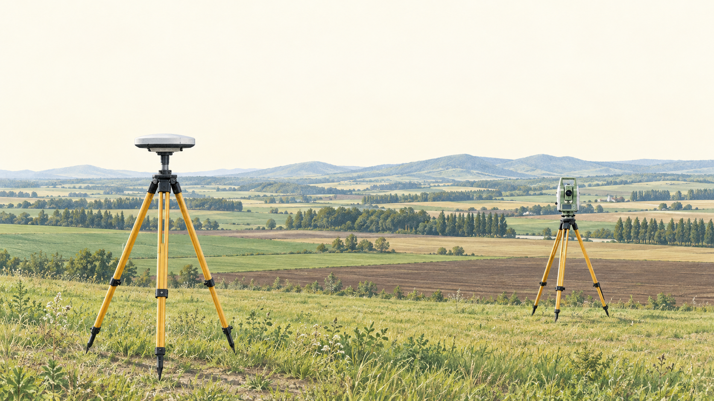

<!-- 導入の1枚目です。前回は観測値のばらつきを扱いました。今回は「座標とは何か」から始めて、地球の形（ジオイド）、測地系と投影、平面直角座標系、座標計算までを順に学びます。実習で TS や GNSS の画面に出る X・Y・標高の意味が分かるようになります。表紙の絵は AI（Codex の画像生成）で作った概念イラストで、実際の現場の写真ではありません。
補足（従来の本文）：
## 測量の座標

農業農村工学系の学部講義｜図解版 改訂（2026-10-15）

 -->

---

## 3-0 前回の解答①：平均とばらつき

$$
\bar{x}=\frac{\sum_{i=1}^{6}x_i}{6}=30.006\ \mathrm{m}
$$

| 確認する量 | 計算結果 |
| --- | --- |
| 残差（mm） | −3, −2, −1, +1, +2, +3 |
| 残差の和・二乗和 | $\sum v_i=0$、$\sum v_i^2=28\ \mathrm{mm}^2$ |
| 1観測の標準偏差 | $\sigma=\sqrt{\frac{28}{6-1}}=2.37\ \mathrm{mm}$ |
| 平均の標準偏差 | $\sigma_{\bar{x}}=\frac{\sigma}{\sqrt{6}}=0.97\ \mathrm{mm}$ |

> 平均のばらつきは、1観測のばらつきより小さい。

<!-- 残差和が0になることと、分母が n−1 の5であることを確認します。最確値の標準偏差は観測回数の平方根で小さくなります。
補足（従来の本文）：
| 項目 | 値 |
| --- | ---: |
| 最確値 $\bar{x}=\sum x_i/6$ | 30.006 m |
| 残差 $v_i$（mm） | −3, −2, −1, +1, +2, +3（和 0） |
| $\sum v_i^2$ | 28 mm² |
| 1観測の標準偏差 $\sigma=\sqrt{28/5}$ | 2.37 mm |
| 最確値の標準偏差 $\sigma/\sqrt{6}$ | 0.97 mm | -->

---

## 3-0 前回の解答②：重み付き平均

$$
\bar{x}_w=\frac{1\times80.000+4\times80.015}{1+4}=80.012\ \mathrm{m}
$$

| 確認する量 | 計算結果 |
| --- | --- |
| 残差（mm） | −12、+3 |
| 重み付き残差の和 | $1\times(-12)+4\times3=0$ |
| 単位重みの標準偏差 | $\sigma_0=\sqrt{\frac{180}{2-1}}=13.42\ \mathrm{mm}$ |
| 平均の標準偏差 | $\sigma_{\bar{x}_w}=\frac{\sigma_0}{\sqrt{5}}=6.00\ \mathrm{mm}$ |

> 確認するのは「重み付き」の残差和。

<!-- 通常の残差和は −9 で0になりませんが、重み付き残差和は0になります。重みの根拠を書けていたかを重点的に見ました。詳しい採点基準は配布した解答に書いてあります。
補足（従来の本文）：
| 項目 | 値 |
| --- | ---: |
| 重み（回数に比例） | $w_1:w_2=1:4$ |
| 重み付き平均 $(1\times80.000+4\times80.015)/5$ | 80.012 m |
| 残差 $v_i$（mm） | −12, +3（$\sum w_iv_i=0$） |
| $\sum w_iv_i^2$ | 180 mm² |
| $\sigma_0=\sqrt{180/1}$、$\sigma_{\bar{x}_w}=\sigma_0/\sqrt{5}$ | 13.42 mm、6.00 mm | -->

---

## 3-0 今日できるようになること

- **位置の約束**を説明する：座標系・測地系・投影。
- **高さの違い**を図で読む：$h=H+N$。
- **現地の距離**を、座標計算で使う距離に直す。
- **距離と方向角**から座標を求め、逆計算で確かめる。

> 図で意味をつかみ、式で計算し、符号で点検する。

<!-- 今日は6つの到達目標があります。6 つ目は国家試験との対応で、各節末の「試験で問われる型」で確認します。前半（1〜3）は「考え方」で、図を見ながら理解することが中心です。後半（4〜5）は計算で、最後の演習で確認します。1〜4 は次回の冒頭小テストでも問います。
補足（従来の本文）：
- 「座標」を数学（点と数の組の対応）と測量（位置を共有する約束）の両面から説明できる。
- **ジオイドとは何か**を自分の言葉で説明でき、$h=H+N$ の関係を図と式で示せる。
- 測地系・地理座標・投影座標（メルカトル、UTM、平面直角座標系）の違いを図で説明できる。
- 平面直角座標系の約束（X が北、Y が東、原点の縮尺係数 0.9999）を説明できる。
- 既知点から新点の座標を計算し、2点から距離と方向角を求め、斜距離を平面距離まで換算できる。
- 測量士補 No.4（地球の形状）・No.22（投影法）・No.6（座標計算）、測量士 No.2（ITRF）の定番の誤文と数値を見抜ける。 -->

---

## 3-0 90分の見通し

| 時間 | 内容 |
| --- | --- |
| 0〜16分 | 前回の確認・小テストと解説 |
| 16〜34分 | 座標の意味・地球の形・ジオイド |
| 34〜56分 | 測地系・投影・平面直角座標系 |
| 56〜68分 | 方向角・座標計算・GNSSとTS |
| 68〜86分 | 手計算テスト（18分） |
| 86〜90分 | まとめ・提出・次回予告 |

<!-- 今回から冒頭に前回範囲の小テストを入れます。測量士補試験と同じ五肢択一で、電卓は使いません。講義は理論（座標・ジオイド・投影）と実務（平面直角座標系・座標計算）の2部構成で、各節の終わりに短い確認問題を置きます。
補足（従来の本文）：
| 時間 | 内容 |
| --- | --- |
| 0〜4分 | 前回の確認・到達目標 |
| 4〜16分 | 小テスト（前回範囲、測量士補形式）10分＋解説2分 |
| 16〜34分 | 座標とは何か → 地球の形とジオイド |
| 34〜56分 | 測地系と投影（メルカトル・UTM） → 平面直角座標系 |
| 56〜68分 | 方向角と座標計算 → GNSS・TS との接続 |
| 68〜86分 | 手計算テスト18分 |
| 86〜90分 | 要点確認・提出・次回予告 | -->

---

## 3-Q 小テスト：前回の誤差論

**5問・10分・10点満点**

- 五肢択一。答は **1〜5の番号**で書く。
- 各問2点。**電卓は使わない**。
- 問題文は配布用紙と同じ。

> 測量士補試験と同じ、式と概算で考える形式。

<!-- 測量士補試験は国土地理院が行う国家試験で、合格すると測量士補として登録できます。計算問題も電卓なしで解ける数値になっているので、今日の小テストも同じ条件にします。詳しい試験の要項は配布資料の注記を見てください。
補足（従来の本文）：
- 国家試験「測量士補」は択一式（五肢）28問・3時間・700点満点、450点以上で合格。**電卓は使えない**（関数表が付く）。
- 出題区分（令和7年〜）：測量に関する法規、測地測量、測図測量、応用測量（三次元点群測量も出題）。
- 本日の小テストは前回範囲（誤差論）から5問・10分・各2点。
- 問題文は配布用紙と同じ。答は番号で書く。 -->

---

## 3-Q 問1 誤差の種類

次の a〜e のうち、**明らかに間違っているもの**はどれか。

- a. 過失（読み違い・転記の誤り）は、点検や再測によって取り除く。
- b. 尺定数のように原因と大きさが分かる定誤差は、補正計算で取り除く。
- c. 偶然誤差は、同精度の独立な観測回数を増やしても平均の標準偏差は小さくならない。
- d. 同精度の独立な観測の最確値は算術平均である。
- e. 較差が許容値を超えたら、観測値を書き換えずに再測する。

<!-- 1問2分の目安で進めます。選択肢の番号は a から順に1〜5です。 -->

---

## 3-Q 問2：最確値

同精度・独立の5回の観測。過失・定誤差は処理済み。
この距離の最確値はどれか。

$$
50.003,\quad50.005,\quad50.006,\quad50.008,\quad50.008\ \mathrm{m}
$$

| 1 | 2 | 3 | 4 | 5 |
| --- | --- | --- | --- | --- |
| 50.005 m | 50.006 m | 50.007 m | 50.008 m | 50.0055 m |

<!-- 末尾の mm だけを足すと早く計算できます。残差の和が0になるかで検算できます。
補足（従来の本文）：
同一の距離を同精度で独立に5回観測した（過失・定誤差は処理済み）。最確値はどれか。

観測値（m）：50.003、50.005、50.006、50.008、50.008

選択肢　1. 50.005 m　2. 50.006 m　3. 50.007 m　4. 50.008 m　5. 50.0055 m -->

---

## 3-Q 問3：平均の標準偏差

同精度・独立の4回の観測。残差の二乗和は次のとおり。

$$
\sum_{i=1}^{4}v_i^2=27\ \mathrm{mm}^2
$$

求めるのは **最確値（平均）の標準偏差**。

| 1 | 2 | 3 | 4 | 5 |
| --- | --- | --- | --- | --- |
| 0.75 mm | 1.5 mm | 2.6 mm | 3.0 mm | 6.0 mm |

<!-- 1観測の標準偏差と最確値の標準偏差の区別を問う問題です。分母が n−1 であることにも注意させます。
補足（従来の本文）：
同精度で独立に4回観測し、残差の二乗の和が $\sum v_i^2=27\ \mathrm{mm^2}$ であった。最確値の標準偏差はどれか。

選択肢　1. 0.75 mm　2. 1.5 mm　3. 2.6 mm　4. 3.0 mm　5. 6.0 mm -->

---

## 3-Q 問4：重み付き平均

新点Pの標高を2本の水準路線で観測した。
**重みは路線長に反比例**するとき、最確値はどれか。

| 路線 | 長さ | 観測した標高 |
| --- | --- | --- |
| 1 | 2 km | 10.012 m |
| 2 | 4 km | 10.018 m |

| 1 | 2 | 3 | 4 | 5 |
| --- | --- | --- | --- | --- |
| 10.012 m | 10.013 m | 10.014 m | 10.015 m | 10.016 m |

<!-- 路線長に反比例なので、短い路線の重みが大きくなります。単純平均の 10.015 を選ばないよう、比を作ってから計算させます。
補足（従来の本文）：
新点 P の標高を2本の水準路線で観測した。路線1（2 km）は 10.012 m、路線2（4 km）は 10.018 m。重みを路線長に反比例させるとき、最確値はどれか。

選択肢　1. 10.012 m　2. 10.013 m　3. 10.014 m　4. 10.015 m　5. 10.016 m -->

---

## 3-Q 問5：機器の精度表示

TSの測距精度が、次のように表示されている。

$$
\pm\left(2\ \mathrm{mm}+2\ \mathrm{ppm}\times D\right)
$$

**1 km**を測ったとき、この表示が示す標準偏差はどれか。

| 1 | 2 | 3 | 4 | 5 |
| --- | --- | --- | --- | --- |
| 2 mm | 4 mm | 6 mm | 22 mm | 202 mm |

<!-- ppm は100万分の1です。1 km は 10⁶ mm なので、2 ppm は 2 mm になります。残り1分で解答欄を確認させ、用紙を回収します。
補足（従来の本文）：
TS の測距精度が「±(2 mm + 2 ppm × D)」と表示されている。1 km の距離を測ったとき、この表示が示す標準偏差はどれか。

選択肢　1. 2 mm　2. 4 mm　3. 6 mm　4. 22 mm　5. 202 mm -->

---

## 3-Q 解答：問1〜3

| 問 | 正答 | 考え方 |
| --- | --- | --- |
| 1 | **3（c）** | 独立・同精度なら平均の標準偏差は $\frac{\sigma}{\sqrt n}$ |
| 2 | **2** | $\bar{x}=\frac{250.030}{5}=50.006\ \mathrm{m}$ |
| 3 | **2** | まず1観測の標準偏差：$\sigma=3.0\ \mathrm{mm}$ |

$$
\sigma_{\bar{x}}=\frac{3.0}{\sqrt{4}}=1.5\ \mathrm{mm}
$$

> 問3の「3.0 mm」は、1観測の標準偏差。

<!-- 問1は「減らない」が誤りです。問3で 3.0 mm を選んだ人は、1観測の標準偏差で止まっています。士補試験では残差が整数 mm、平方和が平方数になるように作られているので、根号が開けなければ計算ミスを疑ってください。
補足（従来の本文）：
| 問 | 正答 | 根拠 |
| --- | --- | --- |
| 1 | 3（c） | 独立・同精度なら平均の標準偏差は $\sigma/\sqrt{n}$ で減る |
| 2 | 2（50.006 m） | 合計 250.030 ÷ 5。残差 −3,−1,0,+2,+2 の和は 0 |
| 3 | 2（1.5 mm） | $\sigma=\sqrt{27/3}=3.0$ mm、$\sigma_{\bar{x}}=3.0/\sqrt{4}=1.5$ mm | -->

---

## 3-Q 解答：問4〜5

問4の正答は **3（10.014 m）**。短い路線に大きな重み。

$$
w_1:w_2=\frac12:\frac14=2:1,\qquad
\bar{H}=\frac{2\times10.012+10.018}{3}=10.014\ \mathrm{m}
$$

問5の正答は **2（4 mm）**。まず単位をmmにそろえる。

$$
2+2\times10^{-6}\times10^6=4\ \mathrm{mm}
$$

<!-- 問4で 10.015 を選んだ人は単純平均です。問5は 2 ppm と 1 km の単位を合わせる問題で、実習で使う TS のカタログにも同じ書き方があります。
補足（従来の本文）：
| 問 | 正答 | 根拠 |
| --- | --- | --- |
| 4 | 3（10.014 m） | 重み 2:1。(2×10.012+10.018)/3 |
| 5 | 2（4 mm） | 2 mm + 2×10⁻⁶×10⁶ mm |

- 士補の型：水準測量は「路線長に反比例」、多角測量の反復は「回数に比例」。
- 機器の性能表示は距離に応じて読む。 -->

---

## 3-1 座標：点に「数の組」を対応させる

- 座標系で決めるのは **原点・軸の向き・単位**。
- 同じ点Pでも、座標系を変えると数値が変わる。

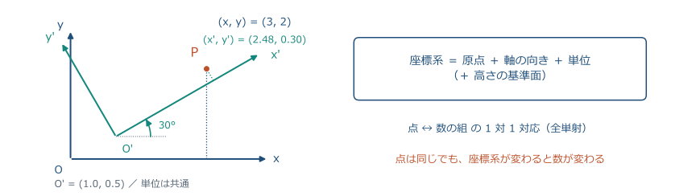

<!-- デカルト以来の考え方です。平面の点の集合と実数の組の集合の間に、原点と2本の軸を決めることで1対1の対応（全単射）ができます。対応は「約束」なので、約束を変えれば同じ点の数は変わります。図の右の軸は原点を (1.0, 0.5) に動かし、30° 回したもので、P の座標は (2.48, 0.30) になります。
補足（従来の本文）：
- 座標＝**点と「数の組」を 1 対 1 に対応させる約束**。平面なら 2 つ、空間なら 3 つの実数。
- 対応のしかたを決めるのが**座標系**：原点 O、軸の向き、単位（物差し）。
- 点は 1 つでも、座標系を変えれば数は変わる。図の P は左の軸では (3, 2)、右の軸では別の値。
- 「点そのもの」と「点の座標」は別物。測量が決めたいのは位置、記録するのは座標。

 -->

---

## 3-1 軸を回す座標変換

原点を $(x_0,y_0)$ に移し、軸を反時計回りに $\theta$ 回す。

$$
\begin{aligned}
x'&=(x-x_0)\cos\theta+(y-y_0)\sin\theta\\
y'&=-(x-x_0)\sin\theta+(y-y_0)\cos\theta
\end{aligned}
$$

- 点は動かさず、**同じ点を別の座標で読む**。
- 平行移動と回転では、点間距離・角・形は変わらない。
- 縮尺も変える相似変換では、角は保たれ、距離は倍率分変わる。

<!-- 数学的には、平面直角座標系の変換は平行移動と回転の合成（合同変換）に、必要なら一様な縮尺を加えたものです。距離と角が保たれるので、現地で測った形はどの座標系でも同じ形として表せます。測量が「距離と角の観測」でできているのはこのためです。式の導出は線形代数で学んだ回転行列そのものです。
補足（従来の本文）：
原点を $(x_0, y_0)$ に移し、軸を角 $\theta$ だけ回した座標系では：

$$
x' = (x-x_0)\cos\theta + (y-y_0)\sin\theta,\qquad
y' = -(x-x_0)\sin\theta + (y-y_0)\cos\theta
$$

- 2 点間の**距離**と 2 直線のなす**角**は変わらない（座標変換の**不変量**）。数は変わっても「形」は変わらない。
- 測量で出てくる座標変換（器械座標 → 平面直角座標、旧測地系 → 世界測地系）は、この式の仲間（3 次元では平行移動 3 ＋ 回転 3 ＋ 縮尺 1 の 7 パラメータ）。
- だから測量では、距離と角を測って「形」を決め、既知点の座標で「置き場所」を決める。 -->

---

## 3-1 点を回す回転行列

点を原点のまわりに **反時計回り**に $\theta$ 回す。

$$
\begin{pmatrix}x'\\y'\end{pmatrix}
=\begin{pmatrix}\cos\theta&-\sin\theta\\\sin\theta&\cos\theta\end{pmatrix}
\begin{pmatrix}x\\y\end{pmatrix}
$$

例：$P(1.08,\ 0.91)$ を $30^\circ$ 回す。

$$
\begin{aligned}
x'&=1.08\times0.866-0.91\times0.5\approx0.48\\
y'&=1.08\times0.5+0.91\times0.866\approx1.33
\end{aligned}
$$

> 軸を回すときは逆回転。式の $\sin\theta$ の符号が入れ替わる。

<!-- 測量士試験（午前 No.4〜5）で毎年のように出る型です。2 次元の回転行列を書けること、反時計回りが正であること、原点以外のまわりの回転は「ずらして、回して、戻す」ことの 3 点を押さえます。測量士補では出ません。時間が押していれば飛ばしてよい枚です。
補足（従来の本文）：
点 $(x, y)$ を原点のまわりに**反時計回り**に角 $\theta$ だけ回した点 $(x', y')$：

$$
x' = x\cos\theta - y\sin\theta,\qquad y' = x\sin\theta + y\cos\theta
$$

- 行列で書くと 1 行目が $(\cos\theta,\ -\sin\theta)$、2 行目が $(\sin\theta,\ \cos\theta)$ の**回転行列** $R(\theta)$。
- 前の枚の「軸を回す」式は、この逆回転（$\theta \to -\theta$）。**点を回す**のか**軸を回す**のかで $\sin$ の符号が入れ替わる。
- 例：$P(1.08,\ 0.91)$ を反時計回りに $30°$ → $x'=1.08\times0.866-0.91\times0.5=0.48$、$y'=1.08\times0.5+0.91\times0.866=1.33$。
- 原点以外の点 A のまわりに回すときは、A を原点に平行移動 → 回転 → 平行移動して戻す。 -->

---

## 3-1 球面を平らにすると、ひずみが生じる

- みかんの皮を平らにすると、裂けるか伸びる。
- 地図も同じ。**何を保ち、どのひずみを許すか**を決める。

<!-- 数学ではガウスの「驚異の定理」として知られています。曲率が違う面どうしは、長さを保ったまま写し合えません。球面（曲率が正）を平面（曲率ゼロ）に写すと、必ず長さか角か面積のどれかがひずみます。この絵は AI（Codex の画像生成）で作った概念イラストです。後半の投影の話は、このひずみをどう扱うかの話です。
補足（従来の本文）：
- 球面に平面の直角座標をそのまま貼ることはできない。みかんの皮を平らに押すと必ず裂ける（または伸びる）。
- だから地球の座標には工夫が要る：**曲面のまま**表す座標（緯度・経度）と、**ひずみを管理して平面に写す**座標（投影座標）。

 -->

---

## 3-1 座標を共有するための約束

| 確認すること | 例 |
| --- | --- |
| 地球の基準・時点 | 測地系、成果の元期 |
| 座標の種類・軸・単位 | 緯度経度、平面直角座標の系番号 |
| 高さの基準 | 楕円体高か標高か、成果・ジオイドモデル |

- **座標参照系（CRS）**は、座標系を地球の基準に結び付ける約束。
- 水平位置と標高を組み合わせる場合は、両方の基準を明記する。

> 数値だけでは位置を共有できない。基準とセットで記録する。

<!-- 数学の座標は頭の中の約束で済みますが、測量の座標は地面に打った基準点という「実物」で約束を支えています。GIS で「CRS」や「EPSG コード」を選ぶ画面は、この3点セットを指定しているのです。今日の後半の内容は、この3つの約束を順に具体化していくものです。
補足（従来の本文）：
- 測量＝地球上の点の位置を、**誰がいつ測っても再現できる形**で決め、他の人と共有すること。
- 共有に必要な「約束」の 3 点セット：どの地球の形か（**測地系**）、どの種類の座標か（**緯度経度／平面**）、高さの 0 はどこか（**ジオイド**）。この組を**座標参照系（CRS）**という。
- 約束の実体は**基準点**（三角点・水準点・電子基準点）。新しい点は既知点からの距離と角で決める。
- 同じ約束なら、別の人・別の日・別の機器の成果を重ねられる。約束が違えば、同じ杭でも数値は違う。 -->

---

## 3-1 測量で使う座標の階層

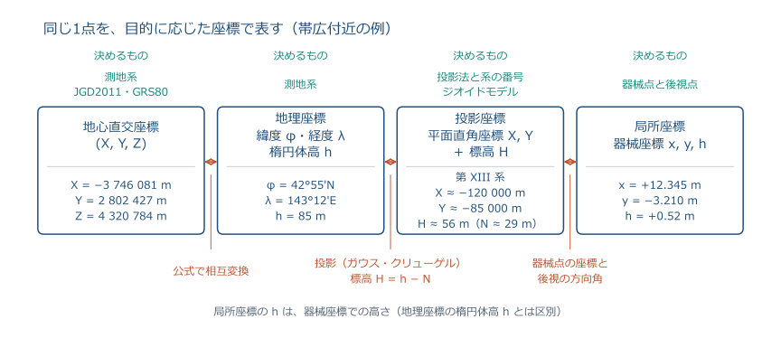

<!-- 左から右へ、同じ1点（帯広付近の例）を4通りの座標で表しています。GNSS 受信機は左から右へ順に変換して表示し、TS は右端の器械座標から左へ向かって平面直角座標に直します。各箱の上に書いた「決めるもの」が、前のスライドの約束です。値は説明用で、実測ではありません。 -->

---

## 3-1 同じ杭を、異なる座標で表す

| 座標の種類 | 説明用の概数 |
| --- | --- |
| 緯度・経度・楕円体高 | 北緯42°55′、東経143°12′、$h=85\ \mathrm{m}$ |
| 第XIII系の平面座標と標高 | $X\approx-120\ \mathrm{km}$、$Y\approx-85\ \mathrm{km}$、$H\approx56\ \mathrm{m}$ |
| 器械点を原点にした局所座標 | $x=12.345\ \mathrm{m}$、$y=-3.210\ \mathrm{m}$、高さの差 $0.52\ \mathrm{m}$ |

$$
h-H=85-56=29\ \mathrm{m}
$$

> この高さの差が、次に学ぶ「ジオイド高」。

<!-- 表の3行は同じ杭を違う約束で表した例で、値は説明用の概数です。農業土木の図面には「第 XIII 系、JGD2011、標高は T.P.」のように約束を書きます。書いていない図面は使えません。
補足（従来の本文）：
| 約束 | 同じ杭の表し方 |
| --- | --- |
| 緯度・経度・楕円体高（JGD2011） | 42°55′N、143°12′E、h = 85.0 m |
| 平面直角座標（第 XIII 系）と標高 | X ≈ −120 000 m、Y ≈ −85 000 m、H ≈ 56.0 m |
| 器械点を原点にした器械座標 | x = +12.345 m、y = −3.210 m、h = +0.52 m |

- どれも正しい。違うのは**約束**だけ。成果には必ず「どの約束か」を書く。
- 標高 56 m と楕円体高 85 m の差 29 m が、次の節で学ぶ**ジオイド高**。 -->

---

## 3-2 地球の近似：回転楕円体

- 赤道方向に少し膨らみ、**短軸が自転軸**に一致する。
- GRS80の赤道半径と極半径の差は約21 km。

$$
f=\frac{a-b}{a}\approx\frac{1}{298.257}
$$

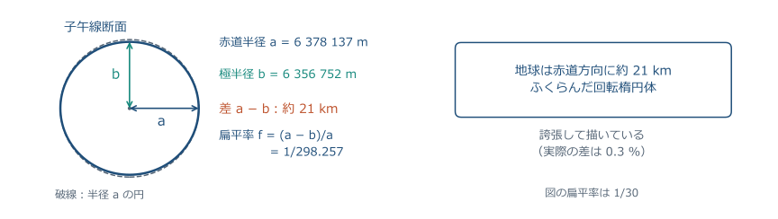

<!-- 地球を「球」とするとき半径 6370 km を使いますが、精密には赤道方向に 21 km 長い回転楕円体です。この滑らかな数学的な面が、緯度・経度・楕円体高の基準になります。ただし実際の海面は、この楕円体にぴったり重なりません。それが次のジオイドの話です。
補足（従来の本文）：
- 地球は自転の遠心力で赤道方向にふくらんだ**回転楕円体**で近似する。
- GRS80 楕円体：赤道半径 $a=6\,378\,137$ m、極半径 $b=6\,356\,752$ m、差は約 21 km（0.3 %）。
- 扁平率 $f=(a-b)/a=1/298.257\ldots$。図は分かるように誇張してある。
- 楕円体の中心は地球の重心、**短軸**（極の方向）が自転軸に一致する（長軸ではない）。

 -->

---

## 3-2 水面と重力の関係

- 静止した水面は、その場所の **重力方向に垂直**。
- 重力の向きは、地球内部や周囲の質量分布によって変わる。
- そのため、水準面は滑らかな楕円体と一致しない。

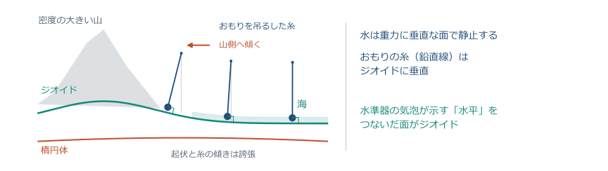

<!-- 高校物理の「重力」の延長です。おもりを糸で吊るすと糸は重力の向きを指し、水面はそれに垂直です。山の近くでは山の質量に引かれて糸がわずかに山側へ傾き、水面もそれに合わせて山側で持ち上がります。この「水面」を地球全体でつないだものがジオイドです。
補足（従来の本文）：
- コップの水面が水平なのは、水が**重力に垂直な面**で静止するから。
- 地球の重力の向きは場所ごとに少し違う（山や地下の重い岩に引かれる）。だから「水平」も場所ごとに少し傾く。
- 海面も同じ。平均海面は、滑らかな楕円体から最大 ±100 m ほど上下にずれた**でこぼこの面**になる。

 -->

---

## 3-2 ジオイド：高さの基準となる面

- 平均海面に近い水準面を、陸の下まで延ばした面。
- **重力の等ポテンシャル面**。地形の凹凸とは別のもの。

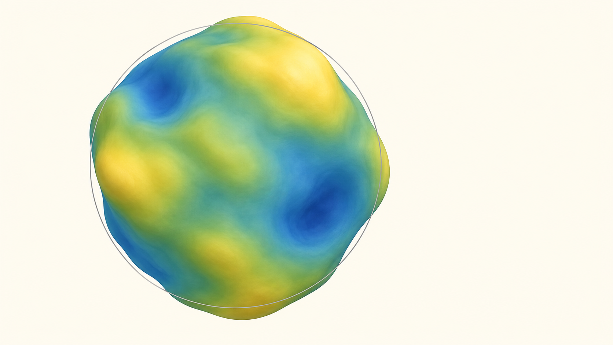

<!-- この絵は AI（Codex の画像生成）で作った概念図で、起伏を強く誇張してあります。色の違いは楕円体より高いか低いかを表し、地形ではありません。ジオイドは「水が静止する面」なので、水準測量の「高さ 0」、つまり標高の基準になります。試験では「ジオイド＝平均海面を陸地の下まで延長した面」「重力の等ポテンシャル面」の2つの言い方を覚えてください。
補足（従来の本文）：
- 海をそのまま陸の下にも運河で引き込んだと考えたときの**水面**。重力に垂直な面（等ポテンシャル面）。
- 滑らかな楕円体（細い輪郭線）に対して、**最大で 100 m ほど**上下にうねっている。

 -->

---

## 3-2 平均海面を測る：検潮所

- 潮位を長期間観測し、潮の満ち引きなどを平均する。
- 日本の標高の基準は **東京湾平均海面（T.P.）**。
- 日本水準原点の標高は **24.3900 m**。

<!-- 「平均海面」は抽象的な言葉ですが、実物は検潮所の潮位記録の平均です。T.P. は Tokyo Peil（オランダ語で基準面）の略です。この絵は AI（Codex の画像生成）で作った概念イラストで、特定の検潮所ではありません。
補足（従来の本文）：
- 港の**検潮所**で潮位を何年も測って平均すると、潮の満ち引きが消えて**平均海面**が得られる。
- 日本の標高 0 m は**東京湾平均海面（T.P.）**。そこから水準測量でつないだ**日本水準原点**（永田町）の標高が 24.3900 m。
- 海のない所の「海面の高さ」は、水準測量と重力の観測でつないで決める。これがジオイド。

 -->

---

## 3-2 ジオイド高 N の大きさ

- $N$ は **楕円体からジオイドまで**の高さ。上なら正。
- 日本の陸域ではおよそ +20〜+45 m。場所によって変わる。
- 東京は約37 m、帯広付近は約29 m（説明用の概数）。

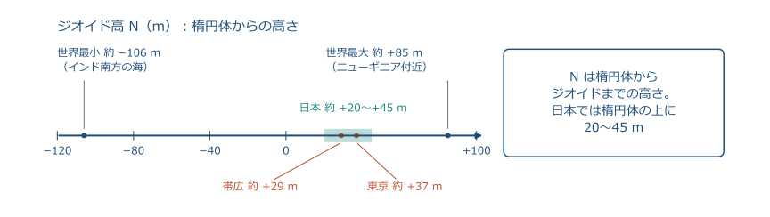

<!-- 日本付近ではジオイドが楕円体より 20〜45 m 上にあります。つまり GNSS の楕円体高は、標高より数十 m 大きく出ます。この N を全国で細かく求めたものがジオイドモデルで、2025 年から「ジオイド2024日本とその周辺」が使われています。
補足（従来の本文）：
- **ジオイド高 N**＝楕円体面からジオイドまでの高さ（ジオイドが上なら正）。
- 世界では約 −106 m（インド南方の海）〜約 +85 m（ニューギニア付近）。
- 日本では約 +20〜+45 m。東京 約 37 m、帯広 約 29 m。「ジオイド2024日本とその周辺」のモデルから読む。

 -->

---

## 3-2 地表・ジオイド・楕円体

- **地表**：実際の地面。
- **ジオイド**：標高の基準となる水準面。
- **楕円体**：緯度・経度・楕円体高の基準となる数学的な面。

<!-- 高さには基準が2つあります。水が流れる向きを決めるのはジオイド、GNSS が計算するのは楕円体です。図の3本の線の違いを押さえてください。
補足（従来の本文）：
- **地表**：実際の地面。起伏がある。
- **ジオイド**：平均海面を陸地の下まで延長した面。重力の等ポテンシャル面で、水準測量の「高さ0」。
- **準拠楕円体**：ジオイドに近い滑らかな回転楕円体（GRS80）。緯度・経度・楕円体高の基準。

 -->

---

## 3-2 3つの高さを、基準面で区別する

$$
\boxed{h=H+N}\qquad\boxed{H=h-N}
$$

| 記号 | 名称 | どこから、どこまで |
| --- | --- | --- |
| $h$ | 楕円体高 | 楕円体から点まで（GNSS） |
| $H$ | 標高 | ジオイドから点まで（水準測量） |
| $N$ | ジオイド高 | 楕円体からジオイドまで |

> 大文字 $H$ と小文字 $h$ は、基準面が違う。

<!-- この式は測量士補で毎年のように問われます。GNSS で得た楕円体高からジオイド高を引くと標高になります。符号を間違えないよう、図で N が楕円体とジオイドの間の高さであることを確認してください。
補足（従来の本文）：
$$
h = H + N
$$

- $H$：標高（ジオイドからの高さ。水準測量・地形図の高さ）
- $h$：楕円体高（楕円体からの高さ。GNSS が出す高さ）
- $N$：ジオイド高（楕円体からジオイドまでの高さ）

 -->

---

## 3-2 GNSSの高さを標高へ

| 与えられた量 | 値 |
| --- | --- |
| GNSSの楕円体高 $h$ | 85.000 m |
| モデルのジオイド高 $N$ | 35.000 m |

$$
\begin{aligned}
H&=h-N\\
 &=85.000-35.000\\
 &=50.000\ \mathrm{m}
\end{aligned}
$$

> 受信機の画面が、楕円体高か標高かを確認する。

<!-- 楕円体高をそのまま標高と思うと 35 m も違います。実習の GNSS 受信機は内部にジオイドモデルを持っていて、標高に変換して表示できます。どちらを表示しているか必ず確認してください。
補足（従来の本文）：
- GNSS が表示した楕円体高：$h=85.000$ m
- ジオイドモデルから読んだジオイド高：$N=35.000$ m

$$
H = h - N = 85.000 - 35.000 = 50.000\ \mathrm{m}
$$

- 日本のジオイド高はおよそ 20〜45 m。帯広市付近は約 29 m（ジオイド2024）。
- ジオイド高はモデル（「ジオイド2024日本とその周辺」）から求める。 -->

---

## 3-2 傾斜から、新点のジオイド高を求める

A：$H_A=30.00\ \mathrm{m}$、$h_A=71.09\ \mathrm{m}$。
B：Aから6 km、$h_B=66.50\ \mathrm{m}$。ジオイド高は1 kmごとに0.02 m低下。

$$
\begin{aligned}
N_A&=71.09-30.00=41.09\ \mathrm{m}\\
N_B&=41.09-0.02\times6=40.97\ \mathrm{m}\\
H_B&=66.50-40.97=25.53\ \mathrm{m}
\end{aligned}
$$

> 既知点で $N$ を求め、傾斜で移し、最後に $h$ から引く。

<!-- 前の枚は 1 点の計算でしたが、ジオイド高は数 km で数十 cm 変わります。既知点でジオイド高を求め、傾斜から新点のジオイド高を補間し、楕円体高から引くという 3 手順です。符号に注意してください。傾斜が負なら新点のジオイド高は小さくなります。測量士補・測量士とも毎年この型が出ます。
補足（従来の本文）：
既知点 A（標高 $H_A=30.00$ m、楕円体高 $h_A=71.09$ m）から 6 km 離れた新点 B で楕円体高 $h_B=66.50$ m を観測した。ジオイドは A から B へ向かって 1 km あたり $-0.02$ m 傾いている。

$$
N_A = h_A - H_A = 41.09,\quad N_B = 41.09 + (-0.02)\times 6 = 40.97,\quad H_B = 66.50 - 40.97 = 25.53\ \mathrm{m}
$$

- ジオイド高は場所ごとに違う。**距離に比例して補間**するのが試験の型（士補 No.10・11、士午前 No.10）。
- 実務では「GNSS 標高測量」として 3 級水準測量に区分され、ジオイドモデルが使えない離島などでは標高補正パラメータを使う。 -->

---

## 3-2 水路の勾配は、標高で判断する

- 楕円体高ではAが高いが、**標高ではBが高い**。
- この例では、水は **BからA** へ流れる。
- ジオイドは水が静止する基準面。流れは水面の勾配で考える。

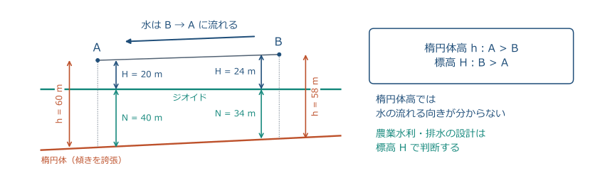

<!-- 農業土木でジオイドを学ぶ理由はこれです。GNSS の楕円体高だけで用水路の勾配を決めると、ジオイドの傾きの分だけ間違えます。数値は説明用に誇張してありますが、ジオイド高が数 km で数十 cm 変わる地域は日本にもあります。
補足（従来の本文）：
- 楕円体高は A（60 m）の方が B（58 m）より高い。しかし標高は B（24 m）の方が A（20 m）より高い。
- この例では水面の勾配により、**B → A** に流れる。楕円体高で判断すると逆になる。
- 農業水利・排水・ほ場の均平は、必ず**標高 H** で設計する。

 -->

---

## 3-2 確認①：高さの基準

1. ジオイドを、高校生に1文で説明すると？
2. $h=50.0\ \mathrm{m}$、$N=35.0\ \mathrm{m}$ の点の標高は？
3. 次の文のうち、誤りをすべて選ぶ。

| 文 | 内容 |
| --- | --- |
| ① | ジオイド高は、楕円体から地表までの高さ |
| ② | ジオイドは、地表に平行な面 |
| ③ | GNSSで直接求まる高さは、楕円体高 |

<!-- 答えの例は「海の水面を陸の下まで延ばした、重力に垂直な面」、15.0 m、水準測量です。4 問目は①と②が誤りで、ジオイド高は楕円体面からジオイド面まで、ジオイドは重力の方向に直交する面で地表とは無関係です。③は正しい文です。士補 No.4 は毎年この 3 つの言い換えで誤文を作ります。隣の人と30秒で確認してください。
補足（従来の本文）：
- 「ジオイド」を高校生に 1 文で説明すると？
- 楕円体高 50.0 m、ジオイド高 35.0 m の点の標高は？
- GNSS が出す高さと水準測量の高さ、どちらが「ジオイドからの高さ」か？
- 誤りはどれ？ ①ジオイド高は楕円体面から**地表**までの高さ ②ジオイドは地表に平行な面 ③GNSS で直接求まるのは楕円体高 -->

---

## 3-3 測地系：楕円体の形と置き方

- 緯度・経度には、**どの楕円体を、どこに置くか**が必要。
- 旧日本測地系と世界測地系では、同じ点の数値が異なる。
- 東京付近の差は位置にして約450 m。古い成果と混用しない。

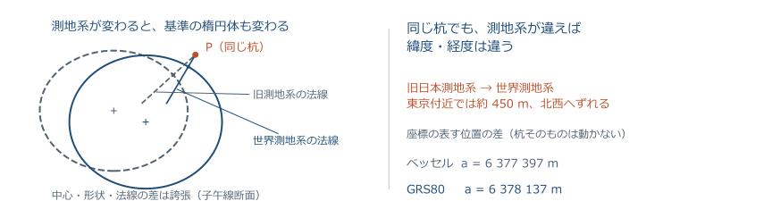

<!-- 測地系は「地球の形と置き方の約束」です。明治以来の旧日本測地系は、天文観測で決めた原点とベッセル楕円体を使っていたため、GPS で決まる世界測地系とは数百 m ずれていました。古い地図や座標リストを使うときは、どの測地系かを必ず確認します。
補足（従来の本文）：
- 緯度・経度は楕円体に対して決まる → **楕円体の大きさと中心の位置**を決めないと座標が定まらない。この約束が**測地系**。
- 旧日本測地系：ベッセル楕円体（$a=6\,377\,397$ m）、中心が地球重心からずれている。2002 年から**世界測地系**（GRS80、$a=6\,378\,137$ m、中心＝地球重心）。
- 同じ杭でも、東京付近で緯度経度が約 450 m（北西方向）ずれる。古い図面と混ぜない。

 -->

---

## 3-3 WGS84・ITRF・日本測地系

| 名称 | 役割 |
| --- | --- |
| WGS84 | GPSの基準。スマートフォンなどでも利用 |
| ITRF | 世界の観測網から実現する地球基準座標系 |
| JGD2024（従来JGD2011） | 日本の測量成果を管理する基準 |

- いずれも地球重心を基準とするが、**実現方法・版・基準時点**が異なる。
- 精密な測量では、地殻変動や元期の違いを補正して比較する。

> 「世界測地系だから、いつでも同じ座標」とは限らない。

<!-- WGS84・ITRF・JGDは、実現方法と基準時点をそろえた上で比較します。JGD2024への名称変更は測地系の定義変更ではありません。
参考：https://www.gsi.go.jp/sokuchikijun/datum-main.html
https://www.gsi.go.jp/sokuchikijun/hyoko2024rev-QA.html
https://service.gsi.go.jp/kijunten/contents/data/datums/explain/detail_info.html -->

---

## 3-3 緯度・経度・楕円体高

- 緯度 $\varphi$：赤道面と **楕円体の法線**がなす角。
- 経度 $\lambda$：本初子午線から東西に測る角。
- 楕円体高 $h$：法線に沿った楕円体面からの高さ。

<!-- 緯度は地球の中心から測る角ではなく、楕円体面に垂直な線（法線）で定義します。度分秒で表すので、前回の DMS 変換が必要になります。
補足（従来の本文）：
- 緯度 φ：赤道面と、その点の楕円体の法線がなす角（北緯・南緯）。
- 経度 $\lambda$：本初子午線からの角（東経・西経）。
- 楕円体高 $h$：法線に沿った楕円体面からの高さ。
- 日本の測地系：**日本測地系 2011（JGD2011）**、楕円体は GRS80。

 -->

---

## 3-3 地心直交座標：地球中心の3軸

| 原点・軸 | 定義 |
| --- | --- |
| 原点 | 地球の重心 |
| $Z$ | 自転軸の北極方向 |
| $X$ | 赤道と本初子午線の交点方向 |
| $Y$ | 赤道上、東経90°の方向 |

$$
\text{日本付近：}\quad X<0,\qquad Y>0,\qquad Z>0
$$

> 平面直角座標の「Xが北、Yが東」とは異なる座標系。

<!-- GNSS の受信機は、まず地心直交座標を解き、それを緯度経度楕円体高に直し、さらに平面直角座標と標高に変換して表示しています。この3段階を知っていると、受信機の設定画面が読めます。日本の X が負になるのは、東経 90° より東にあるからです。測量士午前 No.2 では軸の向きと日本の符号、ITRF の維持方法が毎年問われます。
補足（従来の本文）：
- 原点＝地球の重心、Z 軸＝自転軸（北極向き）、X 軸＝本初子午線と赤道の交点方向、Y 軸＝東経 90° の方向。
- 日本（北緯 25〜45°、東経 123〜154°）の座標は **$X<0$、$Y>0$、$Z>0$**（$\cos 140° <0$ だから）。
- GNSS は衛星までの距離からこの $(X, Y, Z)$ を解く。測地座標 (φ, λ, h) との相互変換には**楕円体高**を使う（ジオイド高ではない）。
- 国際的な枠組み ITRF（原点・軸をこのように定め、GNSS・VLBI 等の観測で維持）と JGD2011 は、ほぼ同じ地心座標系。

 -->

---

## 3-3 基線ベクトル：2点間の座標差

GNSS測量では、2点間の位置関係を3成分で表す。

$$
\Delta\boldsymbol{r}=\begin{pmatrix}\Delta X\\\Delta Y\\\Delta Z\end{pmatrix}
=\begin{pmatrix}100.000\\200.000\\500.000\end{pmatrix}\ \mathrm{m}
$$

$$
D=\sqrt{\Delta X^2+\Delta Y^2+\Delta Z^2}
=\sqrt{300\,000}=547.723\ \mathrm{m}
$$

> 閉じた経路でベクトルを足すと、理想的には $(0,0,0)$。

<!-- 士補 No.9 で基線ベクトルから斜距離を求める計算が繰り返し出ています。√300 000 は 547.72 と暗算しにくいので、問題には選択肢が付きます。閉合差の点検は第 7 回の GNSS 測量で扱います。時間が押していれば飛ばしてよい枚です。
補足（従来の本文）：
GNSS 測量の観測結果は、2 点間の地心直交座標の差（**基線ベクトル**）で表される。

$$
\Delta X = 100.000,\ \Delta Y = 200.000,\ \Delta Z = 500.000\ \mathrm{m}
\ \Rightarrow\ D=\sqrt{100^2+200^2+500^2}=\sqrt{300\,000}=547.723\ \mathrm{m}
$$

- 2 点間の斜距離 $D$ は 3 成分の平方和の平方根。軸の向きによらない（座標変換の不変量）。
- 点検では、閉じた図形で基線ベクトルを足して $(0,0,0)$ になるか（**閉合差**）を見る。
- 座標系の名前は「地心直交座標系（令和 7 年国土交通省告示第 518 号）」。 -->

---

## 3-3 投影座標系：曲面を平面へ写す 3 つの方法

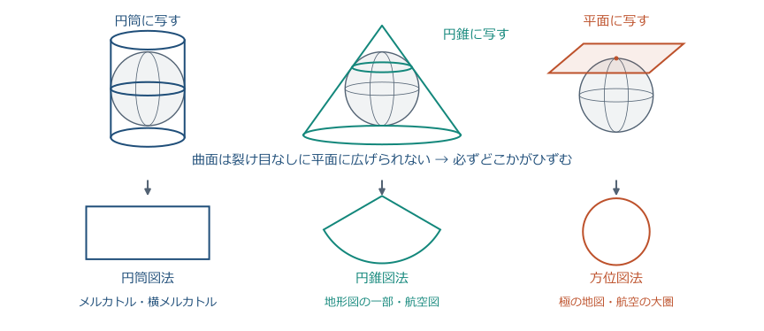

<!-- 地図投影の基本形は3つです。紙を筒にして巻く（円筒図法）、円錐の帽子をかぶせる（円錐図法）、板を当てる（方位図法）。どれも「接している所の近くはひずみが小さく、離れるほど大きい」という共通の性質があります。測量で使うのは円筒図法の仲間です。 -->

---

## 3-3 メルカトル：経線は平行、緯線は不等間隔

- 円筒を開いた形の地図。**局所的な角を保つ**ように計算する。
- 高緯度ほど、緯線の間隔と地図上の長さが大きくなる。

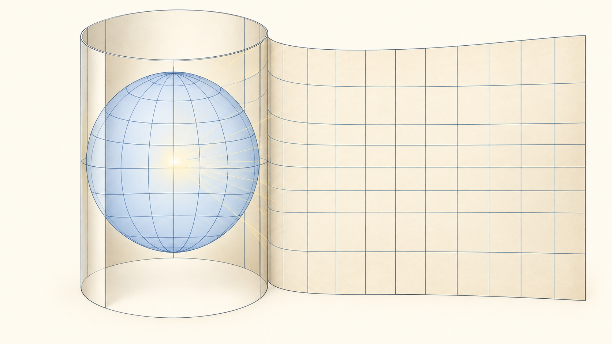

> 絵は円筒を開くイメージ。光の影を写す方法そのものではない。

<!-- 円筒を開く操作のイメージです。メルカトルは中心光源投影ではありません。局所的な角を保つ条件で緯線間隔を計算します。図の格子は模式的です。 -->

---

## 3-3 メルカトル図法：角は正しく、面積はひずむ

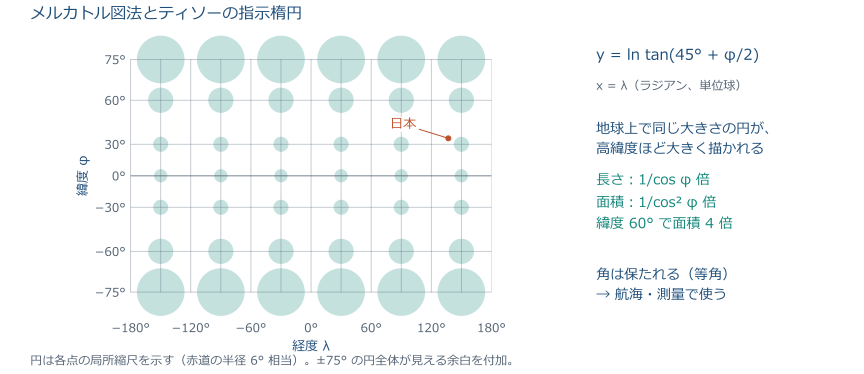

<!-- 地球上では同じ大きさの円が、高緯度ほど大きく描かれています。長さは 1/cos φ 倍、面積は 1/cos² φ 倍で、緯度 60° では面積が 4 倍、グリーンランドが南米より大きく見える理由です。代わりに角が正しく保たれるので（等角）、航海や測量で使われます。平面直角座標系も UTM も、この等角という性質を引き継いでいます。 -->

---

## 3-3 円筒を横に倒す：横メルカトル＝ガウス・クリューゲル投影

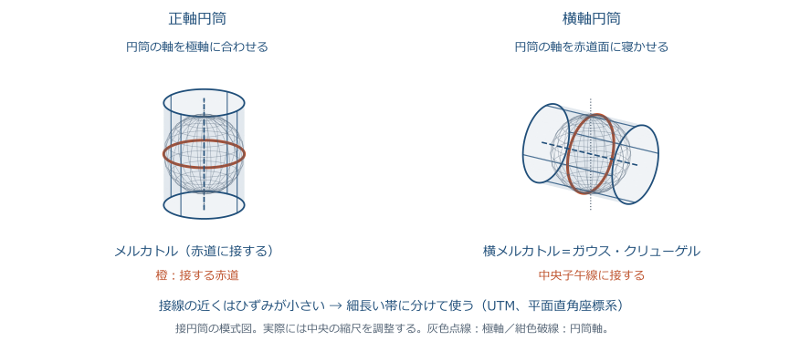

<!-- メルカトルは赤道の近くしか正確ではありません。円筒を横に倒して子午線に接するようにすると、その子午線（中央子午線）の近くが正確になります。これが横メルカトル、ガウス・クリューゲル投影です。南北に長い日本には好都合で、南北に延びる、東西幅の狭い帯に分けて使います。UTM も平面直角座標系も、この投影です。 -->

---

## 3-3 UTM 座標系：6° 幅の帯で世界を覆う

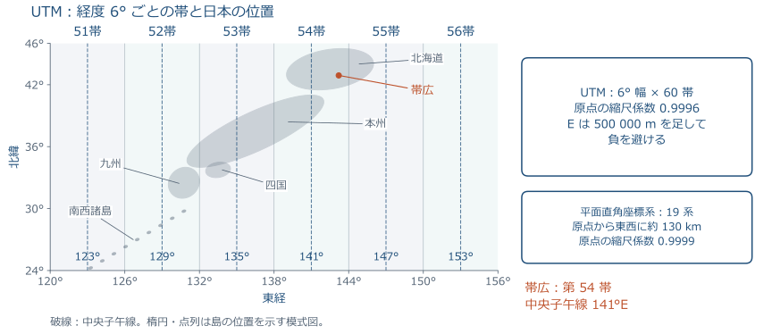

<!-- UTM は世界共通の投影座標系で、経度 6° ごとに 60 の帯に分け、各帯の中央子午線で横メルカトル投影します。日本は 51〜56 帯、帯広は 54 帯（中央子午線 141°E）です。原点の縮尺係数は 0.9996 で、東西の座標 E には 500 000 m を足して負の値を避けます。1:25 000 地形図の座標はこの UTM です。 -->

---

## 3-3 UTMと平面直角座標系の比較

| 項目 | 平面直角座標系 | UTM |
| --- | --- | --- |
| 投影 | ガウス・クリューゲル（正角） | 横メルカトル（正角） |
| 区分 | 日本を19系 | 経度6°幅、世界60帯 |
| 中央の縮尺係数 | 0.9999 | 0.9996 |
| 座標の表示 | $X$：北、$Y$：東 | $N$：北、$E$：東 |
| 原点・加算値 | 原点 $(0,0)$ | 東距に500 kmを加算 |
| 帯広 | 第XIII系 | 第54帯（中央141°E） |

> 平面直角座標系は、中央子午線から東西それぞれ約130 kmが目安。

<!-- どちらも同じ投影で、違いは帯の幅と原点の縮尺係数です。狭い範囲を高い精度で扱う公共測量は平面直角座標系、広い範囲の地形図や国際的な利用は UTM です。UTM は第 10 回の地形図で再登場します。士補 No.22 と測量士午後 No.4 の穴埋めは、この表の数値（6°、60 帯、0.9996、180 km、500 km、10 000 km、84°、80°、129°）がそのまま出ます。「ガウス・クリューゲル図法は回転楕円体に適用した横メルカトル図法で、角が正しく表される」の 1 文も記述式で問われます。
補足（従来の本文）：
| 項目 | 平面直角座標系 | UTM 座標系 |
| --- | --- | --- |
| 投影法 | ガウス・クリューゲル（**正角**） | 同じ |
| 区分 | 19 系（中央子午線から東西それぞれ約130 km） | 6° 幅 × 60 帯。180° から東へ番号 |
| 原点の縮尺係数 | 0.9999（約 90 km で 1） | 0.9996（約 180 km で 1） |
| 原点の座標 | (0, 0)。負の値もある | E に 500 km、南半球は N に 10 000 km を足す |
| 軸・範囲 | X が北、Y が東。日本国内 | N が北、E が東。北緯 84°〜南緯 80° |
| 用途 | 公共測量、地籍、設計図 | 地形図（1:25 000）、世界共通 |

- 帯広：第 XIII 系／第 54 帯（中央子午線 141°E。第 52 帯は 129°E）。**縮尺係数**の定義：楕円体面上の微小距離に対する平面上の微小距離の比。
参考：https://www.gsi.go.jp/sokuchikijun/datum-main.html
https://www.gsi.go.jp/sokuchikijun/hyoko2024rev-QA.html
https://service.gsi.go.jp/kijunten/contents/data/datums/explain/detail_info.html -->

---

## 3-3 日本の原点と基準点

| 基準 | 役割 |
| --- | --- |
| 日本経緯度原点（麻布台） | 経緯度の基準 |
| 日本水準原点（永田町） | 標高の基準、24.3900 m |
| 電子基準点 | GNSSの連続観測網 |
| 三角点・水準点 | 現地で位置・標高を引き継ぐ点 |

- 測量法第11条：位置は **地理学的経緯度と平均海面からの高さ**などで表す。
- 距離・面積の基準面は **回転楕円体の表面**。

<!-- 測量法第11条は、位置をどう表すかを定めています。条文の「直角座標」が平面直角座標系の根拠で、告示で19系が定められています。「地理学的経緯度」を「天文学的経緯度」に、「平均海面」を「楕円体面」に替えた誤文が測量士 No.6・士補 No.4 の定番です。原点数値は 2011 年の地震後に政令で改正されました。電子基準点は実習で使うネットワーク型 RTK の基準になっています。
補足（従来の本文）：
| 基準 | 内容 |
| --- | --- |
| 日本経緯度原点 | 東京都港区麻布台。経緯度の出発点 |
| 日本水準原点 | 東京都千代田区永田町。標高の出発点（24.3900 m） |
| 電子基準点 | 国土地理院が全国約 1300 点に設置した GNSS 連続観測点 |
| 三角点・水準点 | 位置・標高を与える基準点。公共測量の出発点 |

- 測量法第11条：位置は**地理学的経緯度**（天文経緯度ではない）と**平均海面からの高さ**で表す。ただし直角座標と高さ、極座標と高さ、地心直交座標でも表せる。
- 距離と面積は**回転楕円体の表面上**の値で表す。楕円体は GRS80（$a=6\,378\,137$ m、$f=1/298.257\,222\,101$）。原点の数値は政令で定める。
参考：https://www.gsi.go.jp/sokuchikijun/datum-main.html
https://www.gsi.go.jp/sokuchikijun/hyoko2024rev-QA.html
https://service.gsi.go.jp/kijunten/contents/data/datums/explain/detail_info.html -->

---

## 3-3 測地成果2024：標高成果の改定

| 変わったこと | 継続していること |
| --- | --- |
| 2025年4月1日に標高成果を改定 | 緯度・経度・平面直角座標の成果 |
| 衛星測位と新しいジオイドモデルを利用 | 測地系の定義・GRS80楕円体 |
| 名称をJGD2024に統一 | 日本水準原点の値 24.3900 m |

- 標高の元期は **2024年6月1日**。
- 旧成果・旧ジオイドモデルと混ぜず、必要なら標高補正パラメータで改算する。

> 成果の年次と、使ったジオイドモデルをセットで確認する。

<!-- 2025 年から標高の成果が変わっています。古い成果表やジオイドモデルを混ぜると数 cm〜数十 cm の食い違いが出ます。実習データの日付と使ったモデルを必ず記録してください。測量士午後（令和 8 年 No.5）では「既知点の成果を測地成果 2024 に改算する」対処を記述させる問題が出ました。ITRF が更新されても日本の測地成果は自動では更新されません。
補足（従来の本文）：
- 日本の基準点の成果は「測地成果 2011」（東北地方太平洋沖地震後に再定義）。
- **測地成果 2024**：2025 年 4 月 1 日から適用。**標高成果のみ**を改定し、水平位置（緯度経度・平面直角座標）は測地成果 2011 のまま。測地系の名称は JGD2011 → **JGD2024**（定義は不変）。
- 標高は衛星測位基盤（楕円体高＋「ジオイド2024日本とその周辺」）で決める。元期は 2024 年 6 月 1 日。日本水準原点の原点数値（24.3900 m）は不変。
- 旧成果・旧ジオイドモデルと混用しない。既知点が測地成果 2011 のままなら、国土地理院の**標高補正パラメータ**で測地成果 2024 に改算する。
参考：https://www.gsi.go.jp/sokuchikijun/datum-main.html
https://www.gsi.go.jp/sokuchikijun/hyoko2024rev-QA.html
https://service.gsi.go.jp/kijunten/contents/data/datums/explain/detail_info.html -->

---

## 3-3 セミ・ダイナミック補正

地面は動く。成果表は **元期**、観測は **今期**の位置を表す。

| 手順 | 座標の扱い |
| --- | --- |
| 1　観測日の座標へ | 元期の既知点座標に補正量を加える |
| 2　観測を計算 | 今期で網平均する |
| 3　成果の基準日へ | 新点の今期座標から補正量を引く |

> 長い基線では地殻変動の影響も大きくなる。時点をそろえて計算する。

<!-- 士補 No.9、測量士午前 No.2・午後 No.2 で毎年のように出ます。「なぜ必要か」（基線が長い、時間経過による地殻変動で近傍の成果と不整合）と「手順」（元期に足して今期にし、今期で計算して、引いて元期に戻す）の 2 点を言えれば十分です。近傍の三角点を既知点にする 3・4 級では不要です。時間が押していれば飛ばしてよい枚です。
補足（従来の本文）：
- 日本の地面はプレート運動で年に数 cm 動く。成果表の座標は**元期**（測地成果の基準日）に固定され、観測は**今期**（観測日）の位置で行われる。
- **電子基準点のみを既知点**とする 1・2 級基準点測量では、基線が長く、元期からの地殻変動で近傍の基準点成果と整合しない。→ 国土地理院の補正パラメータで補正する。
- 手順：元期座標＋補正量＝今期座標 → 今期で網平均 → 今期の新点座標−補正量＝元期の成果。
- 補正パラメータは毎年更新され、測地成果の基準日（元期）は変わらない。
参考：https://www.gsi.go.jp/sokuchikijun/datum-main.html
https://www.gsi.go.jp/sokuchikijun/hyoko2024rev-QA.html
https://service.gsi.go.jp/kijunten/contents/data/datums/explain/detail_info.html -->

---

## 3-3 試験の要点：基準を取り違えない

| 問われるもの | 押さえる関係 |
| --- | --- |
| 高さ | $H=h-N$。$N$ は楕円体からジオイドまで |
| 地球の形 | 楕円体の短軸が自転軸に一致 |
| 地心直交座標 | 日本は $X<0,\ Y>0,\ Z>0$ |
| 測地成果 | 2024は標高改定。元期と今期を区別 |
| 投影 | 正角。UTMは6°幅、平面直角座標は19系 |

> 定義は「何を基準に、どの方向へ測るか」で説明する。

<!-- 士補試験の法規と測地測量の分野では、この表の型がそのまま出ます。計算より用語の正確な理解が問われます。
補足（従来の本文）：
| 型 | 着眼点 |
| --- | --- |
| $h=H+N$ の計算 | $H=h-N$。符号と図の対応。ジオイドの傾斜は距離に比例して補間 |
| ジオイドの定義 | 平均海面を陸の下まで延長した面、重力の方向に直交する等ポテンシャル面。地表に平行ではない。N は楕円体面からジオイド面まで |
| 楕円体・地心座標 | 短軸＝自転軸、中心＝重心。Z 軸は北極向き、日本は $X<0,\ Y>0,\ Z>0$。基線ベクトルの斜距離 $\sqrt{\Delta X^2+\Delta Y^2+\Delta Z^2}$ |
| 基準・法規の正誤 | 地理学的経緯度と平均海面からの高さ、距離・面積は楕円体面上。電子基準点（約 1300 点）、経緯度原点（麻布台）、水準原点（永田町、24.3900 m） |
| 測地系の正誤 | JGD2011/2024・GRS80・測地成果 2024（標高のみ改定）、旧日本測地系との差約 450 m、セミ・ダイナミック補正（元期・今期） |
| 投影の正誤 | ガウス・クリューゲル（正角）、UTM 0.9996・6° 幅・180 km、平面直角座標系 0.9999・19 系・90 km | -->

---

## 3-4 平面直角座標系：日本を19系に分ける

- 原点を緯度・経度で定め、その座標を $(X,Y)=(0,0)$ とする。
- 中央子午線から東西それぞれ約130 kmを目安に、ひずみを抑える。

<!-- 日本を19に分ける理由は、1つの平面で扱う範囲を狭くして距離のひずみを 1 万分の 1 以内に収めるためです。図は配置の模式図で、正確な境界は告示の別表で確認します。
補足（従来の本文）：
- 根拠：測量法施行令と国土交通省告示。日本を **19 の系（I〜XIX）** に分ける。
- 各系の原点は**緯度・経度**で定め、原点の座標は $(X, Y)=(0, 0)$。
- 原点を通る子午線を X 軸、原点を通りそれに直交する線を Y 軸とする。
- 中央子午線から東西それぞれおよそ130 km以内（ひずみを抑えるため）。

参考：https://www.gsi.go.jp/sokuchikijun/datum-main.html
https://www.gsi.go.jp/sokuchikijun/hyoko2024rev-QA.html
https://service.gsi.go.jp/kijunten/contents/data/datums/explain/detail_info.html -->

---

## 3-4 測量では、Xが北・Yが東

- 数学：横が $x$、縦が $y$。角は反時計回り。
- 測量：**縦が $X$、横が $Y$**。方向角は北から時計回り。

<!-- 一番間違えやすい点です。測量では縦軸が X です。GIS ソフトに座標を入れるとき X と Y を逆にして、点が別の場所に飛ぶ事故がよく起きます。
補足（従来の本文）：
- 数学：$x$ が横、$y$ が縦、角は $x$ 軸から**左回り**。
- 測量：**X が北（縦）、Y が東（横）**、角は X 軸（北）から**右回り**。
- 式の形は同じ：$\Delta X=S\cos T$、$\Delta Y=S\sin T$。
- 数学の $(x, y)$ を測量の $(Y, X)$ と読み替えれば、電卓の極座標変換も使える。

 -->

---

## 3-4 象限と座標の符号

| 象限 | 位置 | $X$ | $Y$ | 方向角の範囲 |
| --- | --- | --- | --- | --- |
| 第1 | 北東 | ＋ | ＋ | 0°〜90° |
| 第2 | 南東 | − | ＋ | 90°〜180° |
| 第3 | 南西 | − | − | 180°〜270° |
| 第4 | 北西 | ＋ | − | 270°〜360° |

- 象限は X 軸から右回りに数える（数学とは順番が違う）。

<!-- 原点から見てどの方角にあるかで符号が決まります。後で逆計算をするときに、この表で方向角の範囲を決めます。 -->

---

## 3-4 帯広は第XIII系

| 系 | 原点（北緯はいずれも44°） | 主な地域 |
| --- | --- | --- |
| XI | 東経140°15′ | 函館・小樽など |
| XII | 東経142°15′ | 札幌・旭川など |
| XIII | 東経144°15′ | 帯広・釧路・北見など |

$$
\text{帯広は原点の南西：}\quad X<0,\quad Y<0
$$

> 座標が負でも正常。違う系の座標をそのまま混ぜない。

<!-- 本学の座標は第 XIII 系で X も Y も負になります。実習で GNSS の座標が負の値で出ても異常ではありません。隣の系と混ぜると数十 km ずれるので、成果には必ず系を書きます。
補足（従来の本文）：
| 系 | 原点 | 主な適用地域 |
| --- | --- | --- |
| XI | 北緯 44°、東経 140°15′ | 道南西部（函館・小樽など） |
| XII | 北緯 44°、東経 142°15′ | 道央（札幌・旭川など） |
| XIII | 北緯 44°、東経 144°15′ | 道東（帯広・釧路・北見・網走・根室など） |

- 帯広市は **第 XIII 系**。原点（北緯 44°、東経 144°15′）の南西にあるので、$X<0$、$Y<0$（市中心部で $X\approx-120$ km、$Y\approx-85$ km）。
- 系をまたぐ現場では、系を統一してから計算する。 -->

---

## 3-4 縮尺係数：中央から離れるほど大きい

- 中央子午線上は $m_0=0.9999$。東西約90 kmで $m\approx1$。
- 次の近似では、主に東西方向の距離 $Y$ で変わる。

$$
m\approx m_0\left(1+\frac{Y^2}{2R^2}\right),\qquad R\approx6370\ \mathrm{km}
$$

<!-- 縮尺係数は「基準面上の距離に掛けると平面上の距離になる係数」です。原点で 1 より小さくし、端で 1 より大きくすることで、全体のひずみを ±1 万分の 1 以内に保っています。R は 6370 km です。実務では国土地理院の計算サービスや成果表の値を使いますが、この近似式で桁の感覚がつかめます。Y が 50 km なら 1 km あたり 7 cm 短く計算されます。
補足（従来の本文）：
- 原点で $m_0=0.9999$（1 万分の 1 だけ短く）。原点から東西に約 90 km で $m=1.0000$、約 130 km で $m=1.0001$。
- $m$ はこの近似では主に Y（東西方向の距離）で決まる。近似式と数値例：

$$
m \approx m_0\left(1+\frac{Y^2}{2R^2}\right):\quad Y=0\to0.99990,\quad 50\ \mathrm{km}\to0.99993,\quad 90\ \mathrm{km}\to1.00000,\quad 130\ \mathrm{km}\to1.00011
$$

 -->

---

## 3-4 距離を4段階で区別する

**座標計算に使うのは、最後の平面距離。**

<!-- 座標計算に使う距離は④です。実習で TS が表示する「水平距離」は②で、座標計算に使うにはまだ2段階の換算が要ります。TS の設定で③④を自動にできますが、何をしているかを知っておきます。
補足（従来の本文）：
- ① 斜距離 $L$：TS や巻尺で直接測る。
- ② 水平距離 $S$：高度角または高低差で水平に直す。
- ③ 基準面上の距離 $S_0$：標高 $H$ の分だけ楕円体面に下ろす。
- ④ 平面直角座標上の距離 $s$：縮尺係数 $m$ を掛ける。

 -->

---

## 3-4 水平に直し、基準面へ縮める

$$
S=\sqrt{L^2-\Delta h^2}=L\cos\theta
$$

$$
S_0=S\frac{R}{R+H}\approx S\left(1-\frac{H}{R}\right)
$$

$\theta$：高度角、$\Delta h$：高低差、$H$：平均標高。

<!-- TS は鉛直角から自動で水平距離にしています。巻尺で斜面を測ったときは、高低差を別に測って自分で直します。図の外側の弧と内側の弧は同じ中心角です。半径が大きい外側の方が長いので、基準面に下ろすと短くなります。式は相似比そのものです。
補足（従来の本文）：
$$
S = L\cos\theta = \sqrt{L^2-\Delta h^2},\qquad
S_0 = S\,\frac{R}{R+H} \approx S\left(1-\frac{H}{R}\right)
$$

- $\theta$：高度角、$\Delta h$：高低差、$R\approx6370$ km、$H$：区間の平均標高。
- 例：$L=1000.049$ m、$\Delta h=9.900$ m → $S=1000.000$ m。高い所で測った距離は、基準面では**必ず短く**なる（標高 100 m で 1 km あたり約 1.6 cm）。

 -->

---

## 3-4 基準面から平面へ：縮尺係数

$$
\boxed{s=mS_0}
$$

| 縮尺係数 | 平面距離はどうなるか |
| --- | --- |
| $m<1$（中央付近） | 短くなる |
| $m=1$ | 変わらない |
| $m>1$（中央から離れる） | 長くなる |

- 標高による縮約と、投影による補正は **別々に行う**。
- 厳密な楕円体面への縮約には $h=H+N$ を使う。授業の例は $H$ による近似。

<!-- 標高補正は常にマイナス、縮尺係数は場所によってプラスにもマイナスにもなります。試験では「符号の向き」を問う正誤問題が出ます。
補足（従来の本文）：
$$
s = m\,S_0
$$

- 原点付近（$m<1$）では短く、原点から約 90 km 以上離れると（$m>1$）長くなる。
- 標高補正と縮尺係数補正は別の理由による別の補正。両方行う。
- 厳密には基準面は楕円体なので、1・2 級基準点測量では**楕円体高** $h=H+N$ で $R/(R+H+N)$ とする（3・4 級は標高で可）。
- 逆向き（座標 → 現地）：$S = \dfrac{s}{m}\cdot\dfrac{R+H}{R}$ -->

---

## 3-4 例題：1 kmの距離を換算する

$L=1000.049\ \mathrm{m}$、$\Delta h=9.900\ \mathrm{m}$、$H=100\ \mathrm{m}$、$m=0.9999$。

| 段階 | 計算 | 結果（m） |
| --- | --- | --- |
| 水平 | $S=\sqrt{L^2-\Delta h^2}$ | 1000.000 |
| 基準面 | $S_0=S\frac{6\,370\,000}{6\,370\,100}$ | 999.984 |
| 平面 | $s=0.9999S_0$ | **999.884** |

> 水平距離から約0.116 m短くなる。途中では丸めない。

<!-- 1 km で 12 cm 近く違います。設計図の距離と現地で測る距離が合わない原因の多くがこの換算の抜けです。演習では同じ型を数値を変えて解きます。
補足（従来の本文）：
条件：$L=1000.049$ m、$\Delta h=9.900$ m、$H=100$ m、$m=0.9999$

| 段階 | 式 | 値 |
| --- | --- | ---: |
| ② 水平距離 | $S=\sqrt{L^2-\Delta h^2}$ | 1000.000 m |
| ③ 基準面距離 | $S_0=S\times6370000/6370100$ | 999.984 m |
| ④ 平面距離 | $s=0.9999\times S_0$ | 999.884 m |

- 標高補正 −0.016 m、縮尺係数補正 −0.100 m。合計 −0.116 m。 -->

---

## 3-4 逆換算：図面の距離を現地へ

図面の平面距離 $s$ から、現地で測る水平距離 $S$ を求める。

$$
S=\frac{s}{m}\cdot\frac{R+H}{R}
$$

$s=300.000\ \mathrm{m}$、$H=200\ \mathrm{m}$、$m=0.9999$ のとき：

$$
S=\frac{300.000}{0.9999}\cdot\frac{6\,370\,200}{6\,370\,000}
\approx300.039\ \mathrm{m}
$$

> この条件では、現地の水平距離は図面より約4 cm長い。

<!-- 農業土木の現場では、設計座標から杭の位置を出すことが多いです。平面距離のまま巻尺で測ると、標高の高い所ほど短く打ってしまいます。
補足（従来の本文）：
- 設計図・座標から計算した距離は**平面距離 $s$**。
- 現地で巻尺や TS で測って杭を打つのは**水平距離 $S$**。

$$
S = \frac{s}{m}\cdot\frac{R+H}{R}
$$

- 例：$s=300.000$ m、$H=200$ m、$m=0.9999$ → $S=300.039$ m（現地では約 4 cm 長く）。 -->

---

## 3-4 ここまでの確認②

- $X=-200$ m、$Y=+300$ m の点は、原点から見てどの方角か？
- 標高 500 m の地点で水平距離 2000 m を基準面に下ろすと、補正量はいくらか？（$R=6370$ km）
- 原点から東へ 90 km の地点の縮尺係数はいくらか？

<!-- 答えは南東（第2象限）、2000×500/6370000 ≒ 0.157 m、約 1.0000 です。 -->

---

## 3-4 試験の要点：軸と距離の補正

| 問われるもの | 押さえる関係 |
| --- | --- |
| 軸 | $X$は北、$Y$は東。原点でX軸が子午線に一致 |
| 原点 | 19系、$(0,0)$、縮尺係数0.9999 |
| 縮尺係数 | 中央子午線から東西に離れるほど大きい |
| 基準面への縮約 | $H>0$ なら短くなる。補正量は概ね $-\frac{SH}{R}$ |
| 平面への換算 | $s=mS_0$。短くなるかは $m$ で判断 |

> どの距離から、どの距離へ換算するのかを先に書く。

<!-- 士補では「原点の縮尺係数は 1.0000 である」「X 軸は原点で子午線に直交する」のような誤文を見抜く問題と、標高補正の計算が頻出です。電卓なしで 2000×500/6370000 のような割り算ができるよう、概算の練習をしておいてください。
補足（従来の本文）：
| 型 | 着眼点 |
| --- | --- |
| 座標系の正誤 | X 軸は原点で子午線に**一致**（「直交」は誤り）・Y 軸は真東、19 系、原点 (0, 0)、原点の縮尺係数 0.9999 |
| 縮尺係数の性質 | X 軸から離れるほど大きい。約 90 km で 1.0000、約 130 km で 1.0001。定義は「楕円体面上の微小距離に対する平面上の微小距離の比」 |
| 標高補正の計算 | $S\times H/R$、$R=6370$ km が与えられる。向きは必ず短く。1・2 級は楕円体高 $H+N$ |
| 縮尺係数の計算 | $s=mS_0$。$m$ の範囲 0.9999〜1.0001 |
| 系の選択 | 現場の系を告示の別表で確認し、混用しない | -->

---

## 3-5 「北」の違いで、角の名前が変わる

- **真北**から測る：方位角 $\alpha$。
- **座標北**から測る：方向角 $T$。座標計算に使う角。
- **磁北**から測る：磁針方位。磁北は場所・年で変わる。

<!-- 「北」は3つあり、角の呼び名は「どの北から測ったか」で決まります。今後のトラバース計算で出てくるのは全部方向角です。真北との差は次の真北方向角として出てきます。
補足（従来の本文）：
- **真北**（子午線の方向）から右回りに測った角＝**方位角 $\alpha$**。
- **座標北**（X 軸の正の方向）から右回りに測った角＝**方向角 $T$**。0°〜360°。座標計算で使うのはこれ。
- **磁北**（磁針の方向。北海道では真北から西へ約 9°、年々変わる）から測った角＝**磁針方位**。

 -->

---

## 3-5 真北方向角 γ と方位角

$\gamma$ は **座標北から真北へ、時計回りを正**に測る角。

$$
\boxed{\alpha=T-\gamma}
$$

| 位置 | 真北方向角の符号 |
| --- | --- |
| 中央子午線上 | $\gamma=0$ |
| 東側（$Y>0$） | $\gamma<0$ |
| 西側（$Y<0$） | $\gamma>0$ |

> 帯広付近（第XIII系）は西側。$\gamma\approx+0^\circ43'$。

<!-- 符号は国土地理院の定義（座標北から真北へ右回りが正）に合わせています。帯広は原点より西なので真北が座標北の右（東）側にあり、正の値になります。計算サービスの値をそのまま使えるよう、この定義で覚えてください。
補足（従来の本文）：
- 座標北と真北のずれの角を**真北方向角 $\gamma$**という（子午線収差角）。
- 原点の子午線上では 0°。原点から東西に離れるほど大きくなる（最大で 1° 程度）。
- 符号：座標北から真北へ**右回りを正**。原点より東（$Y>0$）では負、西（$Y<0$）では正。

$$
\alpha = T - \gamma\qquad(\text{方位角}=\text{方向角}-\text{真北方向角})
$$

- 帯広付近（第 XIII 系、$Y\approx-85$ km）では $\gamma\approx+0°43′$。計算サービスで緯度経度から求める。
参考：https://www.gsi.go.jp/sokuchikijun/datum-main.html
https://www.gsi.go.jp/sokuchikijun/hyoko2024rev-QA.html
https://service.gsi.go.jp/kijunten/contents/data/datums/explain/detail_info.html -->

---

## 3-5 方位（N 30° E など）と方向角の換算

| 象限 | 方位の書き方 | 方向角 $T$ |
| --- | --- | --- |
| 北東 | N $\beta$ E | $T=\beta$ |
| 南東 | S $\beta$ E | $T=180^\circ-\beta$ |
| 南西 | S $\beta$ W | $T=180^\circ+\beta$ |
| 北西 | N $\beta$ W | $T=360^\circ-\beta$ |

- 例：S 30° E → $T=150^\circ$、N 40° W → $T=320^\circ$。

<!-- 方位は「北か南から、東か西へ何度」という書き方で、0〜90° の範囲です。方向角への換算は象限ごとに決まっています。 -->

---

## 3-5 順計算：距離を南北・東西に分ける

既知点Aから、平面距離 $S$ と方向角 $T$ で新点Bを求める。

$$
\begin{aligned}X_B&=X_A+S\cos T\\Y_B&=Y_A+S\sin T\end{aligned}
$$

<!-- 緯距は南北方向の差、経距は東西方向の差です。X に cos、Y に sin が付くのは、角を北から測っているからです。
補足（従来の本文）：
既知点 A$(X_A, Y_A)$、方向角 $T$、平面距離 $S$ のとき：

- 緯距 $\Delta X = S\cos T$（南北の差）、経距 $\Delta Y = S\sin T$（東西の差）。

$$
X_B = X_A + S\cos T,\qquad Y_B = Y_A + S\sin T
$$

 -->

---

## 3-5 順計算の例：方向角120°

A$(1000.000,\ 2000.000)$、$T=120^\circ$、$S=150.000\ \mathrm{m}$。

$$
\begin{aligned}
\Delta X&=150\cos120^\circ=-75.000\ \mathrm{m}\\
\Delta Y&=150\sin120^\circ=+129.904\ \mathrm{m}
\end{aligned}
$$

$$
\begin{aligned}
X_B&=1000.000-75.000=925.000\ \mathrm{m}\\
Y_B&=2000.000+129.904=2129.904\ \mathrm{m}
\end{aligned}
$$

> 120°は南東。$\Delta X<0$、$\Delta Y>0$ と一致する。

<!-- 方向角 120° は第2象限（南東）なので、ΔX が負、ΔY が正になります。電卓は度モードにし、DMS 入力を使います。
補足（従来の本文）：
A$(1000.000,\ 2000.000)$、$T=120°00′00″$、$S=150.000$ m

$$
\Delta X = 150.000\cos120° = 150.000\times(-0.5) = -75.000\ \mathrm{m}
$$

$$
\Delta Y = 150.000\sin120° = 150.000\times0.866025 = +129.904\ \mathrm{m}
$$

$$
X_B = 1000.000-75.000 = 925.000,\qquad Y_B = 2000.000+129.904 = 2129.904
$$ -->

---

## 3-5 逆計算：座標差から距離と方向角

まず「終点B − 始点A」の差を取る。

$$
\Delta X=X_B-X_A,\qquad\Delta Y=Y_B-Y_A
$$

$$
S=\sqrt{\Delta X^2+\Delta Y^2},\qquad\tan T=\frac{\Delta Y}{\Delta X}
$$

- $\arctan$ の値だけでは象限が決まらない。**符号を先に確認**。
- $\Delta X=0$ では割らず、東なら90°、西なら270°と判断。

> 同一点では方向角は定まらない。

<!-- 逆計算は、座標が分かっている2点の間を測るときや、トラバースの検算で使います。arctan の象限補正が最大の落とし穴です。
補足（従来の本文）：
$$
S = \sqrt{\Delta X^2+\Delta Y^2},\qquad \tan T = \frac{\Delta Y}{\Delta X}
$$

- $\Delta X = X_B-X_A$、$\Delta Y = Y_B-Y_A$（「終点 − 始点」）。
- $\arctan$ は $-90°$〜$+90°$ しか返さない → **象限で補正**する。
- 電卓の極座標変換（Pol）は $(\Delta X, \Delta Y)$ の順に入れると $S$ と $T$（$-180°$〜$180°$）が出る。 -->

---

## 3-5 方向角は、象限を見て補正する

> $\Delta X<0$ なら180°を加算。北西なら360°を加算。

<!-- ΔX が負なら 180° を足す、ΔX が正で ΔY が負なら 360° を足す、と覚えます。符号を先に書いてから計算する習慣を付けてください。
補足（従来の本文）：
| $\Delta X$ | $\Delta Y$ | 象限 | $T$ |
| --- | --- | --- | --- |
| ＋ | ＋ | 第1（北東） | $\arctan(\Delta Y/\Delta X)$ |
| − | ＋ | 第2（南東） | $\arctan(\Delta Y/\Delta X)+180°$ |
| − | − | 第3（南西） | $\arctan(\Delta Y/\Delta X)+180°$ |
| ＋ | − | 第4（北西） | $\arctan(\Delta Y/\Delta X)+360°$ |

 -->

---

## 3-5 逆計算で、距離と方向角を確かめる

前の例のBからAを引くと、$\Delta X=-75.000$、$\Delta Y=129.904$（m）。

$$
S=\sqrt{(-75.000)^2+129.904^2}\approx150.000\ \mathrm{m}
$$

$$
\begin{aligned}
t&=\arctan\frac{129.904}{-75.000}\approx-60^\circ\\
T&=t+180^\circ\approx120^\circ
\end{aligned}
$$

> 南東なので180°を加える。丸めた座標からの逆算は近似値。

<!-- 順計算した座標を逆計算して元の距離と方向角に戻ることを確かめるのが、座標計算の基本の検算です。前回の「残差の和が0」と同じで、検算を手順に組み込みます。演習でもこの検算を書いてもらいます。
補足（従来の本文）：
B$(925.000,\ 2129.904)$ から A$(1000.000,\ 2000.000)$ を引く：

$$
\Delta X=-75.000,\quad \Delta Y=+129.904,\quad S=\sqrt{75.000^2+129.904^2}=150.000\ \mathrm{m}
$$

$$
\arctan\frac{129.904}{-75.000} = -60°00′00″\ \to\ \Delta X<0\ \text{なので}\ +180°\ \to\ T=120°00′00″
$$

- 順計算の結果が逆計算で元に戻る → 検算完了。$\Delta X^2+\Delta Y^2=S^2$ も確かめる。
- 座標は mm（小数第3位）、角は秒まで。三角関数の値は途中で丸めない。 -->

---

## 3-5 関数表で解く：方向角60°

A$(150.00,\ 250.00)$、$T=60^\circ$、$S=200.00\ \mathrm{m}$。

| 角 | $\sin$ | $\cos$ |
| --- | --- | --- |
| 30° | 0.50000 | 0.86603 |
| 60° | 0.86603 | 0.50000 |

$$
\begin{aligned}
X_B&=150.00+200.00\times0.50000=250.00\ \mathrm{m}\\
Y_B&=250.00+200.00\times0.86603=423.21\ \mathrm{m}
\end{aligned}
$$

> Xにcos、Yにsin。60°は北東なので、どちらも加える。

<!-- 士補試験では電卓が使えない代わりに、この形の表が問題に付きます。掛け算は筆算なので、桁数の少ない値になるよう作られています。
補足（従来の本文）：
既知点 A$(X=+150.00,\ Y=+250.00)$ から、方向角 $60°$、距離 $200.00$ m の点 B の座標を求めよ。

| 角 | $\sin$ | $\cos$ |
| ---: | ---: | ---: |
| 30° | 0.50000 | 0.86603 |
| 60° | 0.86603 | 0.50000 |

$$
X_B=150.00+200.00\times0.50000=250.00,\qquad Y_B=250.00+200.00\times0.86603=423.21
$$ -->

---

## 3-5 関数表で解く：方向角198°

A$(-1000.00,\ 500.00)$、$T=198^\circ$、$S=1200.00\ \mathrm{m}$。

$198^\circ=180^\circ+18^\circ$ は **第3象限（南西）**。
表の $\cos18^\circ=0.95106$、$\sin18^\circ=0.30902$ を両方負にする。

$$
\begin{aligned}
X_B&=-1000.00-1200.00\times0.95106\\
   &=-2141.27\ \mathrm{m}\\
Y_B&=500.00-1200.00\times0.30902\\
   &=129.18\ \mathrm{m}
\end{aligned}
$$

> 「座標値」ではなく、移動量 $\Delta X,\Delta Y$ が両方負になる。

<!-- 士補 No.6 は 198°、230°、240°、305° のような鈍角で出ます。関数表は 0〜90° しか載らないので、象限を見て符号を自分で決めます。「X は cos、Y は sin、符号は象限の図で」が手順です。前の枚の象限の符号表をこの表と並べて確認してください。
補足（従来の本文）：
既知点 A$(X=-1\,000.00,\ Y=+500.00)$ から、方向角 $198°$、距離 $1\,200.00$ m の点 B の座標。関数表には 18° しかない。

| 象限（方向角 $T$） | $\cos T$ | $\sin T$ |
| --- | :---: | :---: |
| 第 2（90°〜180°） | $-\cos(180°-T)$ | $+\sin(180°-T)$ |
| 第 3（180°〜270°） | $-\cos(T-180°)$ | $-\sin(T-180°)$ |
| 第 4（270°〜360°） | $+\cos(360°-T)$ | $-\sin(360°-T)$ |

$198°=180°+18°$ → 第 3 象限、$\cos 18°=0.95106$、$\sin 18°=0.30902$ を両方**負**にして：

$$
X_B=-1\,000.00-1\,200\times0.95106=-2\,141.27,\qquad Y_B=500.00-1\,200\times0.30902=129.18
$$ -->

---

## 3-5 成果表の数字を位置関係で点検する

第XI系の原点：北緯44°、東経140°15′。
点P：北緯43°30′、東経141°00′、標高50 m。

| 位置関係 | 判断 |
| --- | --- |
| 原点より南 | $X<0$ |
| 原点より東 | $Y>0$、真北方向角 $\gamma<0$ |
| 中央子午線から約60 km | $0.9999<m<1.0000$ |

> 緯度経度から方角を予想し、座標の符号と照合する。

<!-- 士補 No.6（令和 7 年）と H22 No.7 の型です。成果表の数値を見て「符号が合っているか」「縮尺係数が 1 未満か以上か」を判断させます。緯度差 1° ≈ 111 km、経度差 1° ≈ 111 km×cos φ の概算を覚えておくと、X・Y の大きさも見積もれます。帯広（XIII 系）に当てはめると X≈−120 km、Y≈−85 km で、縮尺係数は 0.99999 程度です。
補足（従来の本文）：
第 XI 系（原点 北緯 44°、東経 140°15′）の基準点 P：北緯 43°30′、東経 141°00′、標高 50 m。

- 原点より**南** → $X<0$。原点より**東** → $Y>0$。
- 経度差 0°45′ は北緯 43.5° で約 60 km（1° ≈ 81 km）→ 中央子午線から 90 km 以内なので縮尺係数は **1 未満**（0.9999 と 1.0000 の間）。
- 成果表には緯度・経度・標高・X・Y・縮尺係数・真北方向角が並ぶ。真北方向角は $Y>0$ なら負。 -->

---

## 3-5 ここまでの確認③

- $\Delta X=-100$ m、$\Delta Y=-100$ m のとき、方向角は？
- 方向角 $150^\circ$ を方位で書くと？
- 方向角と方位角の違いは何を基準にした角か？

<!-- 答えは 225°、S 30° E、座標北と真北です。 -->

---

## 3-5 試験の要点：式と符号の組合せ

| 問われるもの | 確認すること |
| --- | --- |
| 順計算 | $\Delta X=S\cos T$、$\Delta Y=S\sin T$ |
| 関数表 | 180°・360°との差で表を引き、象限で符号を決める |
| 逆計算 | 座標差の符号を先に見て、$\arctan$ を補正 |
| 方位角 | $\alpha=T-\gamma$。角の基準を区別 |
| 成果表 | 原点との位置関係から、符号と縮尺係数を点検 |

> 今日の順計算・逆計算が、第5回のトラバース計算の部品になる。

<!-- 今日の計算は第5・6回のトラバース計算の部品になります。ここで順計算と逆計算を確実にしておくと、トラバースは手順を追うだけになります。
補足（従来の本文）：
- 第5回（トラバース）では、交角から方向角を順に計算する型に発展する。

| 型 | 着眼点 |
| --- | --- |
| 座標計算（表付き） | $X$ に $\cos$、$Y$ に $\sin$。鈍角は 180°・360° との差で表を引き、符号は象限で |
| 方向角の象限 | $\arctan$ に 180° または 360° を足す |
| 方位との換算 | N/S と E/W の組合せで式を選ぶ |
| 真北方向角 | 方位角＝方向角−真北方向角。原点の子午線上で 0、$Y>0$ で負 |
| 成果表の読み方 | 緯度経度と原点の位置関係から X・Y の符号、中央子午線からの距離（90 km）で縮尺係数の大小 | -->

---

## 3-6 GNSS：衛星から現地の座標へ

- 衛星の観測から、地心直交座標 $(X,Y,Z)$ を求める。
- 緯度・経度・楕円体高 $(\varphi,\lambda,h)$ に変換する。
- 指定した系へ投影し、$H=h-N$ で標高を求める。

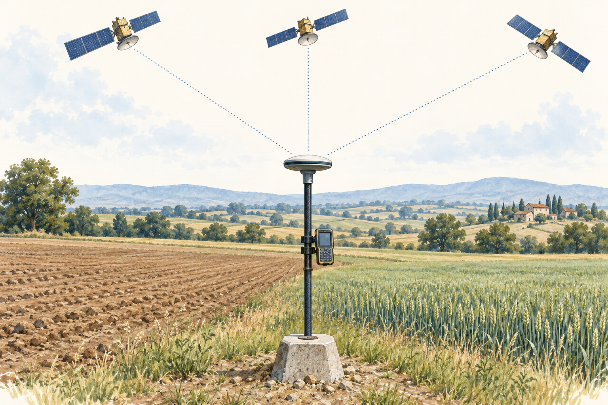

> 設定で確認するのは、測地系・系番号・ジオイドモデル。

<!-- 実習で GNSS が出す座標は、今日の約束を順に通ったものです。設定が違うと③④で数 m〜数十 m ずれます。協力企業の実習で画面を見せてもらうとき、この表と対応させてください。
補足（従来の本文）：
| 段階 | 座標 | 誰が計算するか |
| --- | --- | --- |
| ① 衛星からの距離 | 地心直交座標 $(X, Y, Z)$ | 受信機 |
| ② 楕円体に投影 | 緯度・経度・楕円体高 (φ, λ, h) | 受信機 |
| ③ 平面に投影 | 平面直角座標 $(X, Y)$（系を指定） | 受信機・後処理ソフト |
| ④ ジオイド補正 | 標高 $H=h-N$（ジオイド2024） | 受信機・後処理ソフト |

- RTK の画面で「測地系」「系」「ジオイドモデル」の設定を確認する。3-1 の座標の階層そのもの。
新規イラストはAI生成の模式図。衛星は省略表現であり、通常の単独測位では時計誤差も含め少なくとも4衛星を用います。 -->

---

## 3-6 TS：角と距離から座標を求める

- 器械点の座標と、後視方向の方向角を入力する。
- 角と斜距離を測り、水平距離・平面距離へ換算する。
- 方向角 $T$ と平面距離で、今日の **順計算**を行う。

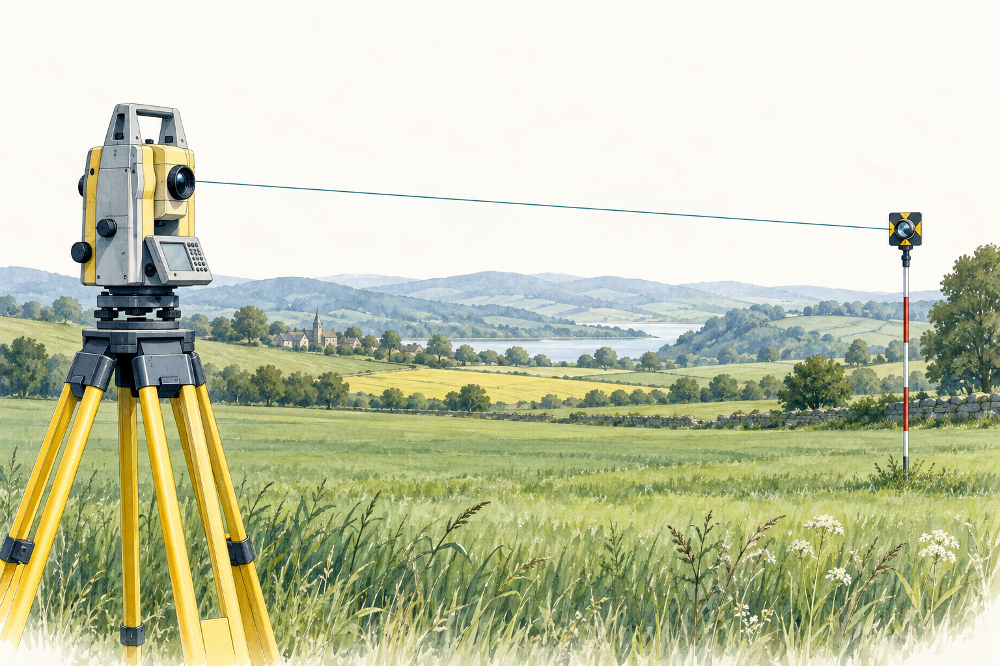

> 器械高・目標高、標高補正・縮尺係数の設定も確認する。

<!-- TS の「座標観測モード」は、今日やった順計算を機械が代わりにしているだけです。設定の縮尺係数を 1 のままにすると、座標が数 cm 単位でずれます。
補足（従来の本文）：
- 入力：器械点の座標 $(X_A, Y_A, H_A)$、後視点への方向角 $T_0$、器械高・目標高。
- 観測：水平角 $\beta$、鉛直角、斜距離 $L$。
- 計算：$T=T_0+\beta$ → 水平距離 $S=L\cos\theta$ → $X=X_A+S\cos T$、$Y=Y_A+S\sin T$。
- 標高補正・縮尺係数は設定で自動化できるが、何をしているかは今日の式。
新規イラストはAI生成の概念図。機器の特定製品を表すものではありません。座標計算には補正後の平面距離を用います。 -->

---

## 3-7 手計算テスト：問1 座標の逆計算と順計算（5点）

18分・10点満点。関数電卓使用可。$R=6370$ km。

| 点 | $X$（m） | $Y$（m） |
| --- | ---: | ---: |
| A | +1200.000 | +800.000 |
| B | +1050.000 | +600.000 |

- (1) $S_{AB}$ と $T_{AB}$ を求める（象限判定を書く）（3点）。
- (2) A から $T_{AC}=30^\circ00' 00'' $、$S_{AC}=200.000$ m の新点 C の座標（2点）。

<!-- 演習開始時刻を告げ、問1は9分を目安にします。配布用紙と同じ問題文です。質問には記号の意味だけ答え、数値は伝えません。 -->

---

## 3-7 手計算テスト：問2 距離の換算（5点）

標高 $H=200$ m 付近で、斜距離 $L=500.020$ m、高低差 $\Delta h=4.500$ m を観測した。縮尺係数 $m=0.9999$。

- (1) 水平距離 $S$（1点）
- (2) 基準面上の距離 $S_0$（1.5点）
- (3) 平面直角座標上の距離 $s$（1.5点）
- (4) (2)(3) の補正は距離を長くするか短くするか。理由を1行ずつ（1点）
- 発展（加点なし）：設計の平面距離 300.000 m を現地で測る水平距離に戻す。

<!-- 問2は7分を目安にします。発展問題は余った人向けで、採点しません。 -->

---

## 3-7 計算中のチェック

| 計算 | 確認する順序 |
| --- | --- |
| 逆計算 | 座標差の符号、象限、距離、方向角 |
| 順計算 | Xにcos、Yにsin、移動量の符号 |
| 距離換算 | 水平、基準面、平面の順 |
| 検算 | $\Delta X^2+\Delta Y^2=S^2$、順逆計算の一致 |

- 座標・距離：m、小数第3位。角：秒まで。
- **途中では丸めない**。最後に単位と補正の向きを書く。

<!-- このスライドは計算中に映しておきます。残り2分になったら検算と単位の確認へ移るよう声を掛けます。
補足（従来の本文）：
- 逆計算：$\Delta X$・$\Delta Y$ の符号 → 象限 → $S$ → $\arctan$ → 加える角。
- 順計算：$X$ に $\cos$、$Y$ に $\sin$。
- 距離換算：水平 → 基準面 → 平面の順。符号を文で書く。
- 座標・距離は m で小数第3位、角は秒まで。三角関数は途中で丸めない。
- 検算：順計算の結果を逆計算で戻す。$\Delta X^2+\Delta Y^2=S^2$。 -->

---

## 3-7 提出前の確認

- 小テストと、手計算テスト2ページをまとめる。
- **式・途中計算・単位**を残す。解けなかった部分も提出する。
- 提出用番号は、配布紙にのみ記入する。

> 解説は次回冒頭。順計算・逆計算を復習しておく。

<!-- 演習18分の終了を告げ、計算途中も採点対象になることを伝えます。小テストと手計算テストの両方がそろっているか確認させます。
補足（従来の本文）：
- 提出用番号は配布紙にのみ記入する。
- 冒頭の小テストの用紙と、手計算テスト2ページをまとめて提出する。
- 解けなかった箇所も、考えた式や途中計算を残す。
- 公開ファイルには個人を特定する情報を記入しない。
- 解説は次回冒頭に行う。 -->

---

## 3-8 今日の式と、その意味

| 何を求めるか | 関係式 |
| --- | --- |
| GNSSの高さから標高 | $H=h-N$ |
| 現地の水平距離から平面距離 | $s=mS\frac{R}{R+H}$（標高による近似） |
| 距離と方向角から座標差 | $\Delta X=S\cos T$、$\Delta Y=S\sin T$ |
| 座標差から距離 | $S=\sqrt{\Delta X^2+\Delta Y^2}$ |
| 座標差から方向角 | $\tan T=\frac{\Delta Y}{\Delta X}$、象限で補正 |

> どの座標系か、どの高さか、どの距離かを確かめてから使う。

<!-- 理論（座標・ジオイド・投影）と計算（距離の換算・順逆計算）を結び直します。どれも次回以降のトラバース・水準・GNSS の計算で前提になります。
補足（従来の本文）：
- 座標＝点と数の組の 1 対 1 の約束。測量では測地系・座標の種類・高さの基準の 3 点セット（CRS）を明記する。
- ジオイド＝平均海面を陸の下まで延長した、重力に垂直な面。$h=H+N$。GNSS は $h$、水準測量と地形図は $H$。ジオイド高は距離に比例して補間する。
- 測地系：GRS80（短軸＝自転軸）、地心直交座標は日本で $X<0, Y>0, Z>0$。JGD2011/2024、測地成果 2024 は標高のみ改定。セミ・ダイナミック補正は元期と今期を結ぶ。
- 投影：ガウス・クリューゲル（横メルカトル、正角）。UTM は 6° 幅・0.9996・180 km、平面直角座標系は 19 系・X が北・Y が東・$m_0=0.9999$・90 km。
- 距離の4段階：$L\to S\to S_0=S\,R/(R+H)\to s=mS_0$。
- 順計算 $X_B=X_A+S\cos T$、$Y_B=Y_A+S\sin T$。逆計算 $S=\sqrt{\Delta X^2+\Delta Y^2}$、$T=\arctan(\Delta Y/\Delta X)$＋象限の補正。 -->

---

## 3-8 次回小テストに向けた復習

| 分野 | 説明・計算できるようにすること |
| --- | --- |
| ジオイド | 定義と $h,H,N$ の関係、傾斜による補間 |
| 測地系・投影 | 地球の基準、元期、UTMと平面直角座標の違い |
| 平面直角座標 | Xが北、Yが東、19系、中央の縮尺係数0.9999 |
| 距離換算 | 基準面への縮約と、縮尺係数を掛ける操作 |
| 座標計算 | 順計算・逆計算・方向角の象限 |

> 次回はこの範囲から5問。式だけでなく、符号の理由も確認する。

<!-- 次回の小テストの範囲を予告します。計算は電卓なしで解ける数値にするので、式と符号の理解を優先して復習してください。
補足（従来の本文）：
- 次回の冒頭小テストは、この表から 5 問出す。

| 型 | 着眼点 |
| --- | --- |
| ジオイドと高さの関係 | ジオイドの定義（地表に平行ではない）、$H=h-N$、符号、ジオイドの傾斜の補間、N は楕円体面からジオイド面まで |
| 測地系・投影の正誤 | GRS80（短軸＝自転軸）、地心直交座標の軸と日本の符号、JGD2011/2024、旧日本測地系との差、セミ・ダイナミック補正、UTM と平面直角座標系の数値 |
| 平面直角座標系の正誤 | X 軸は原点で子午線に一致、Y は真東、19 系、原点の縮尺係数 0.9999、X 軸から離れるほど大きい |
| 標高補正・縮尺係数 | 向き（標高補正は短く）、$R=6370$ km の概算、1・2 級は楕円体高で縮約 |
| 座標計算（表付き）・方向角の象限 | $\cos$ が X、$\sin$ が Y、鈍角は象限で符号、$\arctan$ に 180°・360° を足す、成果表の符号と縮尺係数 | -->

---

## 3-8 次回：角測量

- 前回演習の解説と、第3回の範囲の小テスト。
- 単測法・倍角法・方向法と、観測の点検。
- 偏心観測、TSの自動視準・二軸補正。
- 巻尺の補正と光波測距の原理。

> 関数電卓を持参。方向角と順逆計算を復習する。

<!-- 次回は角の観測です。今日の方向角は、次回の観測した角と合わせて第5回のトラバース計算につながります。
補足（従来の本文）：
- 冒頭 5 分：本日の演習の解答確認。冒頭小テスト：第3回範囲から 5 問。
- 角の観測法（単測法・倍角法・方向法）と検算。
- 偏心観測の補正。TS の自動視準と二軸補正。
- 巻尺の補正（尺定数・温度・傾斜）と光波測距の原理も第4回の前半で扱う。
- 関数電卓を持参し、本日の順計算・逆計算を復習する。 -->

---

## 付録：主な出典

| 出典 | 対応する内容 |
| --- | --- |
| 国土地理院「日本の測地系」「平面直角座標系」 | 楕円体、19系、軸・縮尺係数 |
| 国土地理院「全国の標高成果の改定に関するQ&A」 | 測地成果2024、JGD2024、ジオイドモデル |
| 国土地理院「基準点情報の解説」 | 真北方向角、成果表 |
| 国土地理院「測量士・測量士補試験」 | 試験形式・出題の型 |
| 測量法第11条・測量法施行令 | 位置の表示と基準 |

数値例は教材用。図は模式図、イラストはAI生成。リンクは発表者ノートとREADMEに掲載。

<!-- 出典は公式サイトで最新を確認してください。本スライドの数値例は本教材用に作ったもので、実測データではありません。イラスト（illustrations/）は AI（Codex の画像生成）で作った概念図です。
補足（従来の本文）：
- **[1] 国土地理院「平面直角座標系（平成十四年国土交通省告示第九号）」** — 19 系の原点と適用区域。
- **[2] 国土地理院「測地成果 2024」「ジオイド2024日本とその周辺」「日本の測地系」** — 標高成果の改定、ジオイドモデル、世界測地系への移行（旧日本測地系との差）。
- **[3] 国土地理院「測量士・測量士補試験」受験案内・Q&A・出題区分** — 択一28問・700点満点・450点以上で合格、電卓不可、令和7年からの4区分。
- **[4] 測量法（昭和二十四年法律第百八十八号）第 11 条、測量法施行令第 2・3 条** — 位置の表示方法（経緯度・直角座標・平均海面からの高さ）、日本経緯度原点、楕円体の長半径 6 378 137 m と扁平率 1/298.257222101。
- **[5] 国土地理院「UTM 座標系」「地図投影法」解説ページ** — UTM の帯・中央子午線・縮尺係数 0.9996、ガウス・クリューゲル投影。
参考：https://www.gsi.go.jp/sokuchikijun/datum-main.html
https://www.gsi.go.jp/sokuchikijun/hyoko2024rev-QA.html
https://service.gsi.go.jp/kijunten/contents/data/datums/explain/detail_info.html -->
