# トラバース測量 I

測量学 第5回

角と距離をつないで、位置を一筆書きで決める

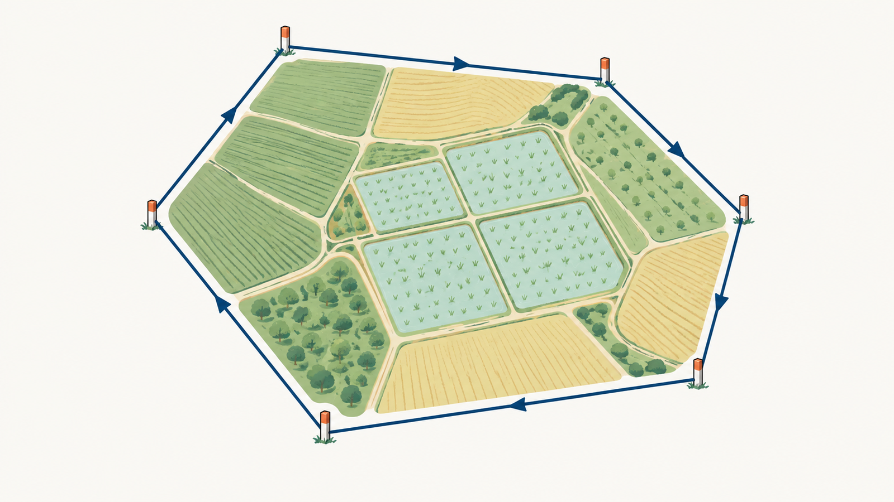

<!-- 第5回の表紙です。第3回で座標と方向角、第4回で角の観測を学びました。今回はその2つをつないで、測点を折れ線状にたどりながら位置を決める「トラバース測量（多角測量）」の前半、角の調整・方向角・緯距経距・逆計算を扱います。表紙の絵は AI（Codex の画像生成）で作った概念イラストで、実際の現場の写真ではありません。 -->

---

## 5-0 前回までの復習①：方向角と順計算（第3回）

平面直角座標は **X が北、Y が東**。方向角 $T$ は座標北から右回り。

$$
\Delta X=S\cos T,\qquad \Delta Y=S\sin T
$$

| 既知点 A | $T$ | $S$ | 新点 B |
| --- | --- | --- | --- |
| (1000.000, 2000.000) | 120° | 150.000 m | (925.000, 2129.904) |

> 今日はこの式を、折れ線の辺ごとに繰り返し使う。

<!-- 第3回の要点を1枚で戻します。X に cos、Y に sin が付くのは角を北から測るからでした。第5回では同じ式を、トラバースの辺 AB、BC、CD…と順番に当てはめます。
第4回の教材は別途作成中のため、ここでは第3回と第4回の要点をまとめて復習し、前回演習の解答確認はその資料ができてから差し替えます。 -->

---

## 5-0 前回までの復習②：角の観測（第4回）

- 水平角は **正反観測**で器械誤差を消す（鉛直軸誤差は残る）。
- 方向法では倍角差・観測差・較差を見て **許容範囲**と比べる。
- 観測した角は、後視点から前視点へ **右回り**に測った **交角（夾角）**。

> 今日はその交角を「方向角」に変え、座標の差に変える。

<!-- 第4回の要点です。角そのものは正しく測れても、トラバースでは測点の数だけ角があり、その和に誤差が出ます。今日はその誤差を扱ってから、角を方向角と座標差に変えていきます。 -->

---

## 5-0 今日の到達目標

1. **閉合トラバース**の内角の和から測角誤差を求め、**等配分**して調整できる。
2. 調整した交角から、各辺の **方向角**を順に計算できる（交角法・偏角法）。
3. 方向角と距離から **緯距・経距**を計算できる。
4. 2 点の座標から **距離と方向角を逆計算**でき、象限を判定できる。

> 到達度は 60 分からの手計算テスト（25 分、10 点）で確かめる。

<!-- 到達目標は講義計画の第5回のものです。閉合比とコンパス法則、調整後の座標計算は次回（第6回）です。今日は「角 → 方向角 → 座標差」までを確実にします。 -->

---

## 5-0 今日の流れ

| 時間 | 内容 |
| --- | --- |
| 0〜5 分 | 復習・到達目標 |
| 5〜12 分 | 5-1 トラバースの種類・用途・選点 |
| 12〜22 分 | 5-2 内角の和と測角誤差の調整 |
| 22〜36 分 | 5-3 方向角の計算（交角法・偏角法） |
| 36〜45 分 | 5-4 緯距・経距 |
| 45〜53 分 | 5-5 座標の逆計算と象限判定 |
| 53〜58 分 | 5-6 TS の座標観測モードとの接続 |
| 58〜85 分 | 5-7 手計算テスト（25 分） |
| 85〜90 分 | 5-8 まとめ・次回予告 |

<!-- 時間配分です。講義は 5-3 の方向角に一番時間をかけます。演習は 60 分前後から 25 分、計算表を配ります。 -->

---

## 5-1 トラバース測量とは

- 測点を **折れ線**（多角形）でつなぎ、各測点で **角**、各辺で **距離**を測る。
- 既知点から出発し、角 → 方向角 → 座標差 → 座標 の順に **一筆書き**で位置を決める。
- 日本語では **多角測量**。基準点測量・圃場・水路・ため池の骨格を作る。

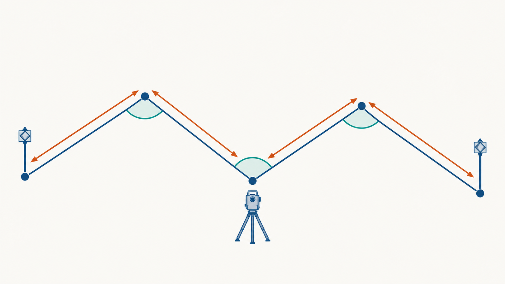

> 三角測量が「面」で位置を決めるなら、トラバースは「線」でたどる。

<!-- トラバース（traverse）は「横切る、たどる」の意味で、測点を順にたどって位置を決める方法です。TS 1 台で角と距離が測れるので、現在の基準点測量の中心です。絵は AI 生成の概念図で、特定の機器や現場ではありません。 -->

---

## 5-1 トラバースの3つの形

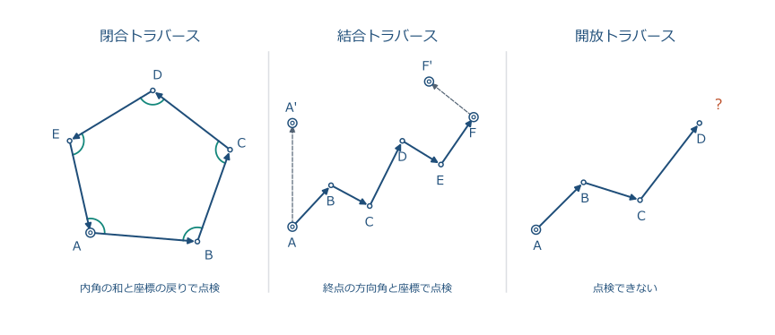

<!-- 閉合トラバースは出発点に戻る多角形、結合トラバースは既知点から別の既知点へつなぐ路線、開放トラバースは既知点から出て未知点で終わる路線です。違いは「最後に答え合わせができるか」です。 -->

---

## 5-1 閉合・結合・開放の使い分け

| 種類 | 形 | 点検 | 主な用途 |
| --- | --- | --- | --- |
| **閉合** | 出発点に戻る多角形 | 内角の和、座標が戻るか | 圃場・ため池の区画、面積 |
| **結合** | 既知点から別の既知点へ | 終点の方向角と座標 | 基準点測量、水路・道路の路線 |
| **開放** | 既知点から未知点へ | **できない** | 急ぎの踏査、仮の路線 |

> 公共測量では、点検できる閉合または結合を使う。開放は補助的にしか使わない。

<!-- 結合トラバースは、両端の既知点に加えて両端で既知の方向角が使えるので、角と座標の両方を点検できます。閉合トラバースは内角の和と座標の戻りで点検できますが、出発点の方向角が間違っていても図形は閉じてしまう弱点があります。 -->

---

## 5-1 なぜ「点検できる」と言えるのか

- **閉合**：内角の和は $(n-2)\times180^\circ$、座標差の和は $0$ になる **はず**。
- **結合**：計算した終点の方向角・座標が **既知の値に一致**する **はず**。
- 「はず」との差が **誤差**。差が許容範囲なら配分し、超えたら **再測**。

> 点検できない開放トラバースは、誤りに気づけない。

<!-- 測量の点検はすべて「理論上こうなるはずの量」と「実際の観測」の差を見ることです。第2回の残差の和が 0 になる話と同じ発想です。今日はこのうち角の点検を扱い、座標の点検（閉合差）は次回です。 -->

---

## 5-1 農業農村工学でのトラバース

- **圃場整備**：区画の角に測点を置く閉合トラバースで、面積と杭位置を決める。
- **水路・農道**：基準点から基準点へつなぐ結合トラバースで、路線の中心線を決める。
- **ため池・ダム**：堤体の周囲を閉合トラバースで囲み、変位観測の基準にする。

> 面積（第 9 回）も縦横断（第 8 回）も、トラバースの座標が出発点。

<!-- 本学科の実習や卒業研究で出てくる場面を挙げました。あとの回で扱う面積計算や土量計算は、ここで決めた座標の上で行います。 -->

---

## 5-1 選点の原則

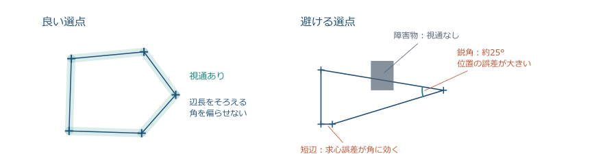

<!-- 選点とは測点を置く場所を決めることです。隣の測点と既知点が見通せること、辺の長さをなるべくそろえること、極端に鋭い角や極端に短い辺を避けること、杭が保存できる安定した地面であることが原則です。 -->

---

## 5-1 準則が示す数値と、その理由

| 原則 | 理由 |
| --- | --- |
| 隣接点・既知点と **視通**がある | 角と距離を直接測るため |
| 辺長を **なるべく等しく**、極端な短辺を避ける | 短辺では求心誤差が角誤差になりやすい |
| **夾角は 60° 以上**（作業規程の準則） | 鋭い角は位置の誤差を大きくする |
| 杭・鋲を **保存できる**場所 | 再測・次の工程で使う |

> 良い選点は、計算の前に誤差を小さくする。

<!-- 作業規程の準則では路線の夾角を 60° 以上とし、既知点間の距離や新点間の距離にも級ごとの上限があります。数値は級ごとに違うので、ここでは「鋭い角と短い辺を避ける」という考え方を覚えてください。 -->

---

## 5-1 ここまでの確認①

1. 既知点 A から出発して既知点 F で終わるトラバースは、閉合・結合・開放のどれか。
2. 開放トラバースで点検できないのはなぜか。
3. 辺長をそろえ、鋭い角を避ける理由を 1 行で言う。

> 答え：結合／比べる「はず」の値がない／短辺・鋭角は角の誤差が位置の誤差になりやすい。

<!-- 1 分ほど隣と確認してもらいます。「はず」の値と比べる、という言い方が今日のキーワードです。 -->

---

## 5-2 多角形の内角の和

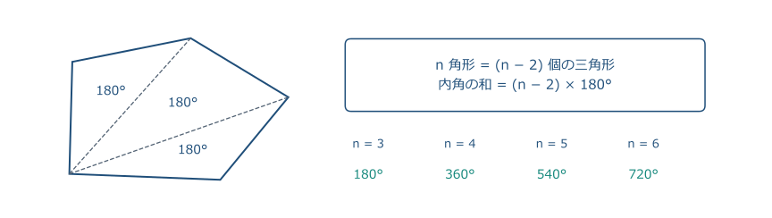

$$
\sum \beta_i = (n-2)\times180^\circ
$$

<!-- n 角形は 1 つの頂点から対角線を引くと n − 2 個の三角形に分かれ、三角形の内角の和は 180° なので、内角の和は (n − 2) × 180° です。4 角形で 360°、5 角形で 540°。これが閉合トラバースの「はず」の値です。 -->

---

## 5-2 右回りに測ると、外角になる

- 左回り（反時計回り）に進み、右回りに交角を測ると **内角**：和は $(n-2)\times180^\circ$。
- 右回りに進むと、同じ測り方で **外角**：和は $(n+2)\times180^\circ$。
- どちらでも方向角の公式は同じ。**「はず」の値だけ変わる**。

> 野帳に「右回り交角」と「進行方向」を書いておく。

<!-- 観測は常に後視から前視へ右回りに測ります。進行方向が左回りなら内角、右回りなら外角が記録されます。今日の例と演習は左回りに進み、内角を扱います。 -->

---

## 5-2 測角誤差の定義

$$
\varepsilon=\sum\beta_i^{\mathrm{obs}}-(n-2)\times180^\circ
$$

- $\varepsilon$ が正なら、観測した角が全体として **大きすぎる**。
- 器械・観測者・回数が同じなら、$n$ 個の角の精度は **同じ**とみなす。

> 誤差の符号と大きさを、まず書く。

<!-- 測角誤差は観測値の和から理論値を引いた量です。符号が大事で、正なら各角を小さくする向きに直します。 -->

---

## 5-2 許容範囲は √n で決まる

1 角の精度を $\sigma$ とすると、$n$ 個の和の精度は **誤差伝播**（第 2 回）で

$$
\sigma_{\Sigma}=\sigma\sqrt{n}
$$

| 1 角の許容 $\sigma$ | $n=4$ | $n=5$ | $n=10$ |
| --- | --- | --- | --- |
| 20″ | 40″ | 45″ | 63″ |
| 30″ | 60″ | 67″ | 95″ |

> 例：$\sigma=30″$、$n=4$ なら許容 60″。観測誤差 +40″ は配分してよい。

<!-- 許容範囲が n に比例せず √n に比例するのは、第2回の誤差伝播そのものです。公共測量では級ごとに許容値が表で与えられますが、考え方は同じです。許容を超えたら、配分せずに再測します。 -->

---

## 5-2 等配分の根拠

- 各角の精度が同じ → **重みが同じ** → 誤差は **均等に**配分する。

$$
\beta_i^{\mathrm{adj}}=\beta_i^{\mathrm{obs}}-\frac{\varepsilon}{n}
$$

- 割り切れないときは、端数を **短い辺に挟まれた角**（誤差が出やすい角）に配る。
- 配分後に **和を再計算**して $(n-2)\times180^\circ$ に戻ったことを確かめる。

> 配分は「誤りを隠す」のではなく、偶然誤差を公平に分ける操作。

<!-- 等配分は、重みが等しいときの最小二乗解です。符号は誤差と逆向き。配分後の和が理論値に戻ることを必ず確かめます。 -->

---

## 5-2 例題：4 点閉合トラバースの内角

左回りに A → B → C → D → A と進み、各点で右回り交角（内角）を観測した。

| 測点 | 観測した内角 |
| --- | --- |
| A | 92°10′20″ |
| B | 85°40′30″ |
| C | 98°20′10″ |
| D | 83°49′40″ |
| 和 | **360°00′40″** |

$$
\varepsilon=360^\circ00'40''-360^\circ=+40''
$$

<!-- 度・分・秒を別々に足します。秒の和 100″ は 1′40″、分の和 119′＋1′ は 120′ ＝ 2°、度の和 358°＋2° で 360°00′40″。理論値 360° との差 +40″ が測角誤差です。 -->

---

## 5-2 例題：配分して調整角を得る

$n=4$ なので、各角に $-40''/4=-10''$ を配る。

| 測点 | 観測 | 配分 | 調整角 |
| --- | --- | --- | --- |
| A | 92°10′20″ | −10″ | **92°10′10″** |
| B | 85°40′30″ | −10″ | **85°40′20″** |
| C | 98°20′10″ | −10″ | **98°20′00″** |
| D | 83°49′40″ | −10″ | **83°49′30″** |
| 和 | 360°00′40″ | −40″ | **360°00′00″** |

> 調整角の和が 360° に戻った。ここで初めて方向角の計算に進める。

<!-- 調整角の和を再計算して理論値に戻ることを確認します。演習でもこの表の形で書いてもらいます。 -->

---

## 5-2 流れの整理：観測 → 理論値 → 誤差 → 配分

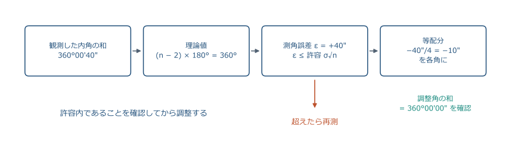

> 許容内であることを確かめてから配る。超えたら配分せず再測する。

<!-- 試験では「和 → 理論値 → 誤差 → 許容判定 → 配分 → 再計算」の順で書けるかを見ます。許容判定を飛ばす答案が多いので、ここで順序を固定します。 -->

---

## 5-2 結合トラバースの測角誤差

両端の既知方向角 $T_{\mathrm{start}}$、$T_{\mathrm{end}}$ と、$n$ 個の交角 $\beta_i$ から

$$
T_{\mathrm{end}}^{\mathrm{calc}}=T_{\mathrm{start}}+\sum\beta_i-n\times180^\circ\quad(\text{360° で整える})
$$

$$
\varepsilon=T_{\mathrm{end}}^{\mathrm{calc}}-T_{\mathrm{end}}
$$

| 例 | 値 |
| --- | --- |
| $T_{\mathrm{start}}=40^\circ00'00''$、$\sum\beta=551^\circ01'00''$、$n=3$ | $T^{\mathrm{calc}}_{\mathrm{end}}=51^\circ01'00''$ |
| 既知 $T_{\mathrm{end}}=51^\circ00'30''$ | $\varepsilon=+30''$ → 各角 −10″ |

<!-- 結合トラバースでは内角の和の代わりに、終点で既知の方向角と比べます。式の n × 180° は、交角法の「±180°」を n 回まとめたものです。 -->

---

## 5-2 ここまでの確認②

1. 5 点閉合トラバースの内角の和の理論値は何度か。
2. 観測した内角の和が 539°59′20″ のとき、測角誤差と各角への配分は。
3. 1 角の許容 20″ のとき、5 角の和の許容は何秒か。

> 答え：540°／ε = −40″、各角 +8″／20″ × √5 ≈ 45″。

<!-- 2 問目は符号に注意。観測が小さすぎるので、各角に足します。3 問目は √5 ≈ 2.24 を使います。 -->

---

## 5-3 方向角を思い出す

- 方向角 $T$：**座標北**から**右回り**に測った、測線の向き（0°〜360°）。
- 同じ測線でも向きが逆なら **反方向角**：

$$
T_{BA}=T_{AB}\pm180^\circ
$$

- 真北・磁北からの角（方位角・磁針方位）とは区別する（第 3 回）。

> 方向角は「どの点から見た、どの点への向き」をいつも書く。

<!-- 方向角の添字の順序が大切です。AB は A から B を見た向き、BA はその逆で 180° 違います。この反方向角が、次の交角法の出発点になります。 -->

---

## 5-3 交角法：後視・前視と交角

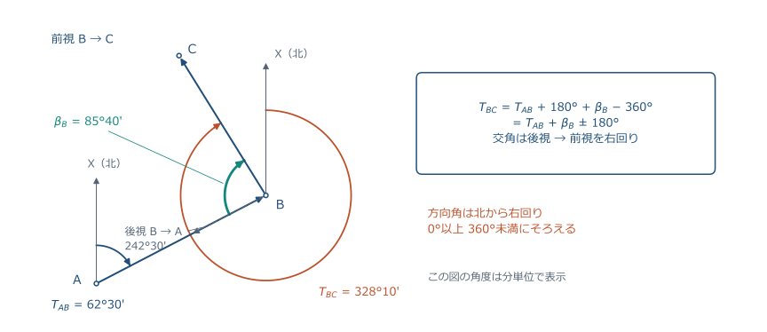

<!-- 測点 B に器械を据え、後視点 A を見てから右回りに前視点 C を見た角が交角 β_B です。B から A への向きは T_AB の反方向角、そこから右回りに β_B 回れば B から C への向き、つまり T_BC になります。 -->

---

## 5-3 交角法の公式

$$
T_{BC}=T_{AB}+\beta_B\pm180^\circ
$$

- $T_{AB}+\beta_B$ が **180° 以上なら −180°**、**180° 未満なら +180°**。
- 結果が **360° 以上なら −360°**。負になったら +360°。
- $\beta$ は後視から前視へ **右回り**に測った角。内角でも外角でも同じ式。

> 「前の方向角 ＋ 交角 ± 180°」を、測線の数だけ繰り返す。

<!-- 反方向角 T_AB + 180° に β_B を足し、360° を超えた分を引く、という操作を 1 行にまとめた式です。±180° のどちらを使うかは、足した値が 180° を超えるかどうかで決めます。 -->

---

## 5-3 例題：AB から BC へ

既知の方向角 $T_{AB}=62^\circ30'00''$、調整角 $\beta_B=85^\circ40'20''$。

$$
T_{AB}+\beta_B=62^\circ30'00''+85^\circ40'20''=148^\circ10'20''
$$

$148^\circ10'20''<180^\circ$ なので **+180°**：

$$
T_{BC}=148^\circ10'20''+180^\circ=\boxed{328^\circ10'20''}
$$

> 図で確かめる：AB は北東、BC は北西。左へ曲がった。

<!-- 計算のあと、必ず図で向きを確かめます。左回りに進むトラバースでは、方向角は各測点で左へ（反時計回りに）変わります。 -->

---

## 5-3 例題：CD、DA、そして AB に戻る

| 測線 | 前の方向角 ＋ 交角 | ±180° | 方向角 |
| --- | --- | --- | --- |
| BC | 62°30′00″ + 85°40′20″ = 148°10′20″ | +180° | **328°10′20″** |
| CD | 328°10′20″ + 98°20′00″ = 426°30′20″ | −180° | **246°30′20″** |
| DA | 246°30′20″ + 83°49′30″ = 330°19′50″ | −180° | **150°19′50″** |
| AB | 150°19′50″ + 92°10′10″ = 242°30′00″ | −180° | **62°30′00″** |

> 最後に出発の $T_{AB}$ に戻った。調整角を使ったから戻る。

<!-- 4 本目は検算です。調整前の角で計算すると 40″ ずれて戻りません。調整角の和が 360° だからこそ、一周して同じ方向角に戻ります。 -->

---

## 5-3 一周して戻れば、検算完了

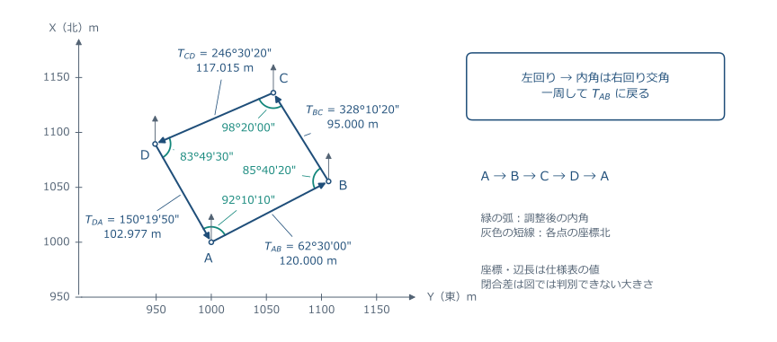

> 閉合トラバースの方向角は、出発の測線で **元の値に戻る**ことで検算する。

<!-- 図は例題の 4 点を平面直角座標に描いたものです。各測線の方向角を矢印の向きと見比べてください。北東、北西、南西、南東の順です。 -->

---

## 5-3 360° を超えたら引く、負なら足す

| 計算結果 | 整え方 | 例 |
| --- | --- | --- |
| 360° 以上 | −360° | 426°30′20″ → 66°30′20″ |
| 0° 未満 | +360° | −31°49′40″ → 328°10′20″ |
| 0°〜360° | そのまま | 150°19′50″ |

- 方向角は **0° 以上 360° 未満**で書く。
- $-180^\circ$ の代わりに $+180^\circ$ して $-360^\circ$ しても同じ結果。

> 式の形は違っても、向きは 1 つ。

<!-- ±180° と ±360° の整え方は同じことの言い換えです。電卓で度分秒の加減をするときは DMS 入力を使い、途中で 10 進に直さないようにします。 -->

---

## 5-3 偏角法：進行方向からの折れ角

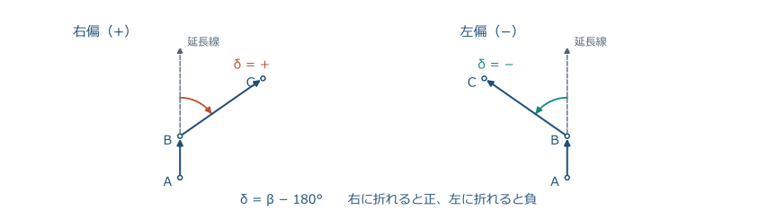

$$
\delta=\beta-180^\circ\qquad(\text{右へ折れると }+,\ \text{左へ折れると }-)
$$

<!-- 偏角は、前の測線を延長した向きから次の測線までの折れ角です。右に折れれば正、左に折れれば負。交角から 180° を引いたものと同じです。道路や水路の路線測量で使います。 -->

---

## 5-3 偏角法の公式と例

$$
T_{BC}=T_{AB}+\delta_B
$$

| 測点 | 交角 $\beta$ | 偏角 $\delta=\beta-180^\circ$ | 方向角 |
| --- | --- | --- | --- |
| B | 85°40′20″ | −94°19′40″（左偏） | 62°30′00″ − 94°19′40″ = **328°10′20″** |
| C | 98°20′00″ | −81°40′00″（左偏） | 328°10′20″ − 81°40′00″ = **246°30′20″** |

- 閉合トラバースでは偏角の和が **±360°**（左回りなら −360°）。

> 交角法と同じ答え。式が違うだけで、向きは 1 つ。

<!-- 偏角法の結果は交角法と一致します。偏角の和が ±360° になるのも検算に使えます。例題ではすべて左偏で、4 つの偏角の和は −360° です。 -->

---

## 5-3 交角法と偏角法の比較

| | 交角法 | 偏角法 |
| --- | --- | --- |
| 測る角 | 後視→前視の右回り角 $\beta$ | 延長線からの折れ角 $\delta$ |
| 式 | $T_{i+1}=T_i+\beta\pm180^\circ$ | $T_{i+1}=T_i+\delta$ |
| 点検 | 内角の和 $(n-2)\times180^\circ$ | 偏角の和 $\pm360^\circ$ |
| 向く場面 | 閉合・結合トラバース全般 | 道路・水路など細長い路線 |

> 試験では交角法が中心。偏角法は $\delta=\beta-180^\circ$ でつながる。

<!-- TS では後視を 0° にセットして前視を読むのが自然なので、実務も試験も交角法が中心です。偏角法は路線測量（第 11 回）でまた出てきます。 -->

---

## 5-3 関数電卓なしで解く：測量士補の型

既知 $T_{AB}=330^\circ20'10''$。B の交角 $\beta_B=95^\circ30'40''$、C の交角 $\beta_C=210^\circ15'20''$。

$$
\begin{aligned}
T_{BC}&=330^\circ20'10''+95^\circ30'40''-180^\circ=245^\circ50'50''\\
T_{CD}&=245^\circ50'50''+210^\circ15'20''-180^\circ=276^\circ06'10''
\end{aligned}
$$

- 度・分・秒を **別々に**足し引きし、60 で繰り上げ・繰り下げする。
- 測量士補試験は電卓不可。この型は **筆算だけ**で解ける。

<!-- 測量士補試験では、図に既知の方向角と交角が書かれ、何本か先の測線の方向角を選ぶ問題が繰り返し出ています。秒 → 分 → 度の順に繰り上げると間違えにくいです。 -->

---

## 5-3 ここまでの確認③

1. $T_{AB}=200^\circ$、$\beta_B=100^\circ$ のとき $T_{BC}$ は。
2. $T_{AB}=30^\circ$、$\beta_B=120^\circ$ のとき $T_{BC}$ は。
3. 交角 $\beta=250^\circ$ の偏角 $\delta$ は。右偏か左偏か。

> 答え：300° + 100° − 180° = 120°／150° + 180° = 330°／+70°、右偏。

<!-- 1 問目は和が 180° 以上なので −180°、2 問目は 180° 未満なので +180°。3 問目は 250° − 180° = +70° で右偏です。 -->

---

## 5-3 試験で問われる型：方向角の伝播

| 型 | 着眼点 |
| --- | --- |
| 既知方向角と交角から数本先の方向角 | $T_{i+1}=T_i+\beta\pm180^\circ$ を繰り返す。360° の整え |
| 閉合トラバースの内角の和と誤差 | $(n-2)\times180^\circ$、符号、等配分 |
| 反方向角 | $\pm180^\circ$ |
| 方位角と方向角の混同 | 方向角は **座標北**から右回り（第 3 回） |

> 計算は筆算。「右回り」「座標北」「±180°」の 3 点を押さえる。

<!-- 測量士補では多角測量の計算問題として毎年のように出る型です。公務員試験でも閉合トラバースの内角調整が定番です。 -->

---

## 5-4 緯距・経距の定義

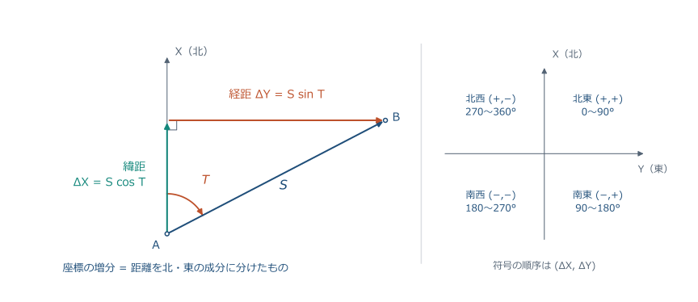

$$
\Delta X=S\cos T\ (\text{緯距}),\qquad \Delta Y=S\sin T\ (\text{経距})
$$

<!-- 緯距は測線の南北成分、経距は東西成分です。第3回の順計算と同じ式で、名前が付いただけです。北向きが正、東向きが正。 -->

---

## 5-4 符号は方向角の象限で決まる

| 方向角 $T$ | 向き | $\cos T$ → $\Delta X$ | $\sin T$ → $\Delta Y$ |
| --- | --- | --- | --- |
| 0°〜90° | 北東 | ＋ | ＋ |
| 90°〜180° | 南東 | − | ＋ |
| 180°〜270° | 南西 | − | − |
| 270°〜360° | 北西 | ＋ | − |

> 計算の前に向きを言葉で言い、符号を予想してから電卓を押す。

<!-- 電卓は正しい符号を返しますが、入力ミスに気づくには予想が必要です。328° は北西なので ΔX が正、ΔY が負、と先に言ってから計算します。 -->

---

## 5-4 例題：4 辺の緯距・経距（前半）

| 測線 | $S$（m） | $T$ | $\Delta X=S\cos T$ | $\Delta Y=S\sin T$ |
| --- | ---: | --- | ---: | ---: |
| AB | 120.000 | 62°30′00″ | +55.410 | +106.441 |
| BC | 95.000 | 328°10′20″ | +80.716 | −50.100 |

$$
\Delta X_{AB}=120.000\cos62^\circ30'00''=120.000\times0.461749=+55.410\ \mathrm{m}
$$

> AB は北東（＋,＋）、BC は北西（＋,−）。符号が向きと合っている。

<!-- 電卓は度モード、DMS 入力で 62°30′00″ を入れます。三角関数の値は途中で丸めず、最後に mm まで丸めます。 -->

---

## 5-4 例題：4 辺の緯距・経距（後半）と合計

| 測線 | $S$（m） | $T$ | $\Delta X$ | $\Delta Y$ |
| --- | ---: | --- | ---: | ---: |
| CD | 117.015 | 246°30′20″ | −46.649 | −107.314 |
| DA | 102.977 | 150°19′50″ | −89.476 | +50.973 |
| 合計 | 434.992 | | **+0.001** | **0.000** |

> 4 辺を足すと、ほぼ 0 に戻る。出発点に戻るのだから当然。

<!-- CD は南西で（−,−）、DA は南東で（−,＋）。合計の 1 mm は辺長を mm に丸めた影響です。実際の観測では距離にも誤差があるので、合計はもう少し大きく残ります。 -->

---

## 5-4 合計がほぼ 0 になる理由と、残りの扱い

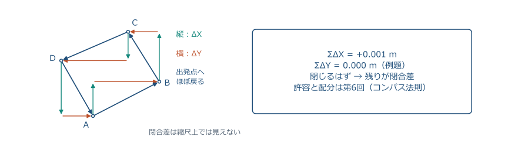

> 残った $\sum\Delta X$、$\sum\Delta Y$ が **閉合差**。許容と配分は次回（第 6 回）。

<!-- 閉合トラバースは出発点に戻るので、緯距の和も経距の和も 0 になる「はず」です。残りが閉合差で、距離に比例して配分するコンパス法則を次回扱います。 -->

---

## 5-4 関数表で解く：方向角 150°

$S=200.00\ \mathrm{m}$、$T=150^\circ$。関数表は $\sin30^\circ=0.50000$、$\cos30^\circ=0.86603$。

$$
\begin{aligned}
\Delta X&=200.00\cos150^\circ=200.00\times(-0.86603)=-173.21\ \mathrm{m}\\
\Delta Y&=200.00\sin150^\circ=200.00\times0.50000=+100.00\ \mathrm{m}
\end{aligned}
$$

- $150^\circ=180^\circ-30^\circ$ なので $\cos$ は負、$\sin$ は正（南東）。

> 鈍角は「180° との差」で表に戻し、象限で符号を付ける。

<!-- 測量士補試験では関数表が与えられ、鈍角を鋭角に直して符号を付ける操作が問われます。150° は南東なので ΔX が負です。 -->

---

## 5-4 ここまでの確認④

1. $S=100$ m、$T=270^\circ$ の緯距・経距は。
2. $T=225^\circ$ の測線は、緯距・経距の符号がどうなるか。
3. 閉合トラバースで $\sum\Delta X$ が 0 にならない原因を 2 つ挙げる。

> 答え：ΔX = 0、ΔY = −100 m／（−,−）／角と距離の観測誤差。

<!-- 1 問目は真西なので南北成分がありません。3 問目の答えが、次回の閉合差の話につながります。 -->

---

## 5-5 逆計算：2 点の座標から距離と方向角

「終点 − 始点」の順に差を取る。

$$
\Delta X=X_B-X_A,\qquad \Delta Y=Y_B-Y_A
$$

$$
S=\sqrt{\Delta X^2+\Delta Y^2},\qquad \tan T=\frac{\Delta Y}{\Delta X}
$$

- $\arctan$ は $-90^\circ$〜$+90^\circ$ しか返さない → **象限で補正**する。

> 順計算の逆。トラバースでは既知点間の方向角を得るのに使う。

<!-- 第3回の復習ですが、今日は「どの象限か」を確実にします。結合トラバースの出発方向角・終点方向角は、既知点 2 点の座標からこの逆計算で求めます。 -->

---

## 5-5 象限判定の表

| $\Delta X$ | $\Delta Y$ | 象限（向き） | $T$ |
| --- | --- | --- | --- |
| ＋ | ＋ | 第 1（北東） | $\arctan(\Delta Y/\Delta X)$ |
| − | ＋ | 第 2（南東） | $\arctan(\Delta Y/\Delta X)+180^\circ$ |
| − | − | 第 3（南西） | $\arctan(\Delta Y/\Delta X)+180^\circ$ |
| ＋ | − | 第 4（北西） | $\arctan(\Delta Y/\Delta X)+360^\circ$ |

> $\Delta X<0$ なら +180°。$\Delta X>0$ で $\Delta Y<0$ なら +360°。

<!-- 覚え方は「ΔX が負なら 180° を足す、北西なら 360° を足す」。ΔX = 0 のときは割らずに、東なら 90°、西なら 270° と判断します。 -->

---

## 5-5 例題：4 つの象限で同じ数字

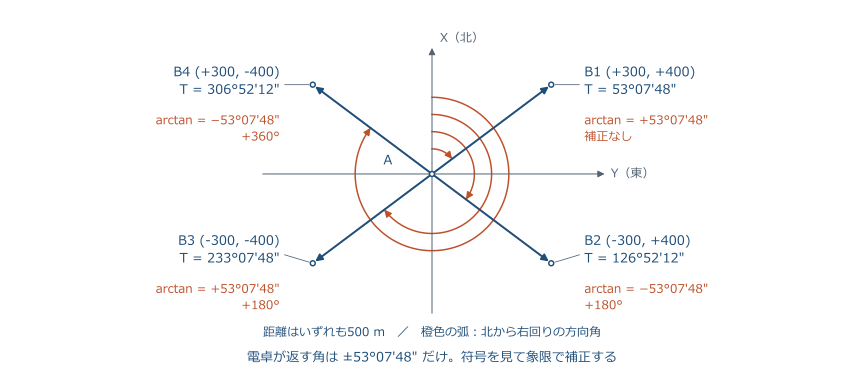

<!-- 座標差の絶対値を同じ 300 m・400 m にして、符号だけ変えた 4 通りです。距離はどれも 500 m、arctan の値はどれも ±53°07′48″ ですが、方向角は 4 つとも違います。 -->

---

## 5-5 例題：4 象限の答え

$|\Delta X|=300.000$、$|\Delta Y|=400.000$、$S=500.000$ m、$\arctan(400/300)=53^\circ07'48''$。

| $\Delta X$ | $\Delta Y$ | $\arctan(\Delta Y/\Delta X)$ | 補正 | $T$ |
| --- | --- | --- | --- | --- |
| +300 | +400 | +53°07′48″ | なし | **53°07′48″** |
| −300 | +400 | −53°07′48″ | +180° | **126°52′12″** |
| −300 | −400 | +53°07′48″ | +180° | **233°07′48″** |
| +300 | −400 | −53°07′48″ | +360° | **306°52′12″** |

> 電卓が返す角が同じでも、答えは 4 つとも違う。符号を先に見る。

<!-- 第 3 象限では arctan が正の値を返すので、第 1 象限と混同しやすい。第 4 象限では負の値が返るので 360° を足して 0〜360° に直します。 -->

---

## 5-5 ΔX = 0 や ΔY = 0 のとき

| 座標差 | 向き | $T$ |
| --- | --- | --- |
| $\Delta X>0$、$\Delta Y=0$ | 真北 | 0° |
| $\Delta X=0$、$\Delta Y>0$ | 真東 | 90° |
| $\Delta X<0$、$\Delta Y=0$ | 真南 | 180° |
| $\Delta X=0$、$\Delta Y<0$ | 真西 | 270° |

- $\Delta X=0$ では $\Delta Y/\Delta X$ を **計算しない**（0 で割らない）。
- 同じ点（両方 0）では方向角は **定まらない**。

<!-- 割り算の前に ΔX が 0 かどうかを見ます。TS や電卓の極座標変換は内部でこの場合分けをしています。 -->

---

## 5-5 逆計算はどこで使うか

- **結合トラバースの両端**：既知点 2 点の座標から、出発・終点の既知方向角を作る。
- **杭打ち（逆打ち）**：設計座標の点へ、器械点からの方向角と距離を出して誘導する。
- **検算**：順計算した座標を逆計算し、元の $S$・$T$ に戻るか見る。
- **既知点間の距離**：成果表の座標から求め、実測と比べる。

> 順計算と逆計算は、いつも対で使う。

<!-- 今日の演習の問 2 は、結合トラバースの出発方向角を作る場面を想定しています。逆打ち（セットアウト）は実習で TS の機能として体験します。 -->

---

## 5-5 電卓の極座標変換と atan2

- 関数電卓の Pol 機能：Pol($\Delta X$, $\Delta Y$) → $S$ と $T$（$-180^\circ$〜$+180^\circ$）。
- 負の角が出たら **+360°**。入力の順序は $(\Delta X,\ \Delta Y)$。
- プログラムでは atan2($\Delta Y$, $\Delta X$)。**引数の順が逆**なので注意。

> 便利だが、象限の意味が分かってから使う。

<!-- 電卓の Pol と Python などの atan2 は、象限の場合分けを内部でやってくれます。ただし引数の順序が機種・言語で違うので、必ず簡単な例（ΔX = 0、ΔY = 100 → 90°）で確かめてから使います。 -->

---

## 5-5 ここまでの確認⑤・試験で問われる型

1. A(100, 100)、B(100, 300) の $T_{AB}$ と $S_{AB}$ は。
2. $\Delta X=-50$、$\Delta Y=+50$ のとき $T$ は。
3. $\Delta X=+50$、$\Delta Y=-50$ のとき $T$ は。

| 型 | 着眼点 |
| --- | --- |
| 2 点の座標から方向角 | 「終点 − 始点」、符号 → 象限 → 加える角 |
| 2 点の座標から距離 | $\sqrt{\Delta X^2+\Delta Y^2}$。3:4:5 など整数比が多い |

> 答え：90°、200 m／135°／315°。

<!-- 1 問目は ΔX = 0 で真東。2 問目は第 2 象限で −45° + 180°。3 問目は第 4 象限で −45° + 360°。 -->

---

## 5-6 TS は内部で同じ計算をしている

- 入力：器械点の座標 $(X_0, Y_0)$、後視点の方向角 $T_0$（または後視点の座標）。
- 観測：水平角、鉛直角、斜距離 → 水平距離 $S$、方向角 $T$。
- 計算：$X=X_0+S\cos T$、$Y=Y_0+S\sin T$ を **画面に出すだけ**。

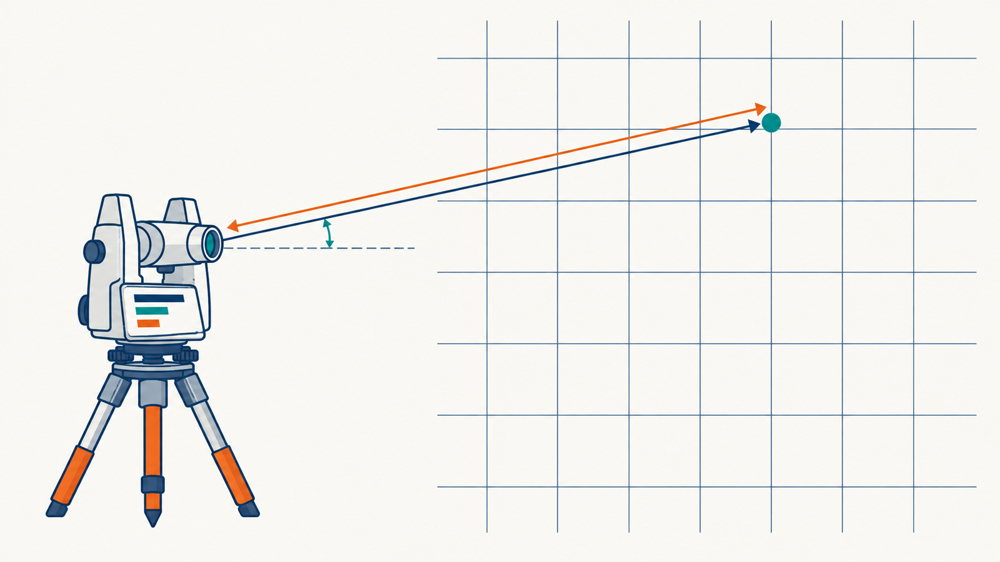

<!-- TS の座標観測モードは、今日の順計算を器械が代わりにしているだけです。後視点の座標を入れた場合は、まず逆計算で後視の方向角を作ります。絵は AI 生成の概念図です。 -->

---

## 5-6 座標観測モードの出力の意味

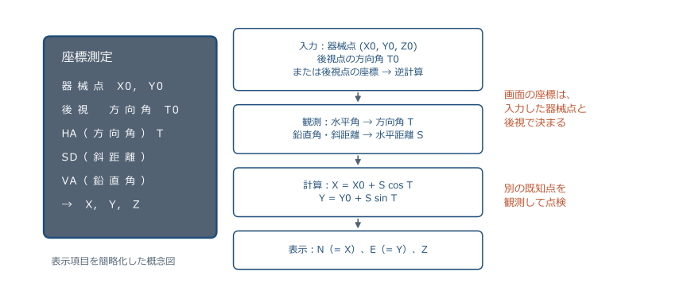

<!-- 画面の N・E（または X・Y）は、器械点と後視で決めた座標系の中での値です。器械が「正しい」のは計算だけで、入力した器械点座標と後視方向角が違えば、出てくる座標もその分だけ違います。 -->

---

## 5-6 後視を間違えると、全部が回る

- 後視の方向角を $\delta$ だけ誤ると、その器械点から測った **すべての点が**器械点を中心に $\delta$ だけ回る。
- 距離 100 m で $\delta=1'$ なら位置は約 **3 cm**、$\delta=1^\circ$ なら約 **1.7 m** ずれる。
- 対策：**2 つ目の既知点**を観測して座標が合うか確かめる（器械点の点検）。

$$
\text{ずれ}\approx S\times\delta\ [\mathrm{rad}]=100\times\frac{60''}{206265''}=0.029\ \mathrm{m}
$$

> 器械の計算は正しい。誤るのは入力。点検を手順に組み込む。

<!-- 後視の誤りは系統誤差です。偶然誤差と違って平均しても消えません。器械を据えたら、必ず別の既知点を 1 点観測して座標が成果表と合うことを確かめます。 -->

---

## 5-6 精度管理と倫理

- **野帳の数値は消さない**。訂正は二重線で、元の値が読めるようにする。
- 許容範囲を **超えたら再測**。配分で「合わせに行かない」。
- 点検計算（内角の和、方向角の戻り、閉合差）を **記録して残す**。
- 使った既知点の成果が **最新か**（改定・移動）を確かめる。

> トラバースの信頼は、点検の記録で示す。

<!-- 配分は偶然誤差を分ける操作で、過失や許容超過を隠す道具ではありません。公共測量では点検計算の記録が成果の一部です。 -->

---

## 5-7 手計算テスト 問 1：測角の調整と方向角（6 点）

25 分・10 点満点。関数電卓使用可。計算表を配布。

左回りに A → B → C → D → E → A と進み、右回り交角（内角）を観測した。

| 測点 | A | B | C | D | E |
| --- | --- | --- | --- | --- | --- |
| 観測内角 | 100°12′12″ | 118°35′52″ | 95°48′32″ | 128°10′42″ | 97°13′42″ |

- 既知 $T_{AB}=115^\circ20'30''$。(1) 測角誤差と配分、調整角（2 点）。(2) 5 辺の方向角（2.5 点）。(3) 表の空欄の緯距・経距（1.5 点）。

<!-- 演習開始時刻を告げ、問 1 は 15 分を目安にします。配布用紙と同じ問題文です。質問には記号の意味だけ答え、数値は伝えません。 -->

---

## 5-7 問 1 の図：5 点閉合トラバース

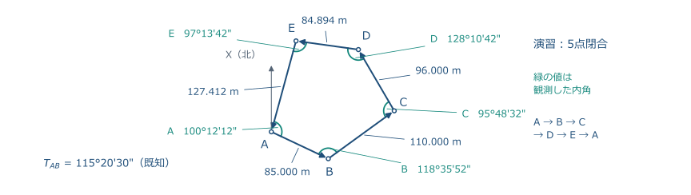

> 図は縮尺どおりではない。辺長と角は表の値を使う。方向角は 0°〜360° に整える。

<!-- 図は位置関係の確認用です。計算は配布した計算表の値で行わせます。内角の和の理論値は (5−2)×180°=540° で、観測和との差を先に出させます。 -->

---

## 5-7 手計算テスト：問 2 座標の逆計算（4 点）

| 点 | $X$（m） | $Y$（m） |
| --- | ---: | ---: |
| P | +1500.000 | +2300.000 |
| Q | +1580.000 | +2150.000 |

- (1) $\Delta X$、$\Delta Y$ と符号、象限（1 点）。
- (2) 距離 $S_{PQ}$（1 点）。
- (3) 方向角 $T_{PQ}$。$\arctan$ の値と加える角を書く（1.5 点）。
- (4) 反方向角 $T_{QP}$（0.5 点）。

<!-- 問 2 は 7 分を目安にします。残り 3 分は検算に使ってもらいます。 -->

---

## 5-7 計算中のチェック

| 計算 | 確認する順序 |
| --- | --- |
| 測角誤差 | 度・分・秒を別々に足す → 理論値との差 → 符号 |
| 配分 | 誤差と逆符号、$n$ で割る → 和が理論値に戻る |
| 方向角 | 前の方向角 ＋ 交角 → ±180° → 0°〜360° → 一周で戻る |
| 緯距・経距 | 向きを言ってから符号 → $\cos$ が X、$\sin$ が Y |
| 逆計算 | 終点 − 始点 → 符号 → 象限 → 距離 → 加える角 |

- 角は秒まで、距離・座標は m で小数第 3 位。**途中では丸めない**。

<!-- このスライドは計算中に映しておきます。残り 3 分で検算（一周で方向角が戻る、ΔX² + ΔY² = S²）に移るよう声を掛けます。 -->

---

## 5-7 提出前の確認

- 計算表と解答用紙をまとめる。**式・途中計算・単位**を残す。
- 方向角は **0°〜360°**、秒まで。負のままや 360° 以上のまま提出しない。
- 解けなかった部分も提出する。提出用番号は配布紙にのみ記入。

> 解説は次回冒頭。方向角の伝播と象限判定を復習しておく。

<!-- 演習 25 分の終了を告げ、計算途中も採点対象になることを伝えます。公開ファイルには個人を特定する情報を書かないことも再度確認します。 -->

---

## 5-8 今日の式と、その意味

| 何を求めるか | 関係式 |
| --- | --- |
| 内角の和（はずの値） | $(n-2)\times180^\circ$ |
| 測角誤差と配分 | $\varepsilon=\sum\beta-(n-2)\times180^\circ$、各角 $-\varepsilon/n$ |
| 交角から方向角 | $T_{i+1}=T_i+\beta\pm180^\circ$（偏角なら $T_i+\delta$） |
| 方向角・距離から座標差 | $\Delta X=S\cos T$、$\Delta Y=S\sin T$ |
| 座標差から距離・方向角 | $S=\sqrt{\Delta X^2+\Delta Y^2}$、$\tan T=\Delta Y/\Delta X$ ＋ 象限 |

> 「はず」の値と比べて点検し、差が小さければ公平に分ける。

<!-- 角の点検（内角の和）→ 方向角 → 座標差、という一本の流れです。次回はこの先、座標差の点検（閉合差）と調整、座標の確定へ進みます。 -->

---

## 5-8 次回に向けた復習

| 分野 | できるようにすること |
| --- | --- |
| 測角誤差 | 内角の和、符号、等配分、許容 $\sigma\sqrt{n}$ |
| 方向角 | 交角法 ±180°、偏角 $\delta=\beta-180^\circ$、一周で戻る検算 |
| 緯距・経距 | 象限と符号、$\sum\Delta X\approx0$ の意味 |
| 逆計算 | 「終点 − 始点」、象限補正、$\Delta X=0$ の扱い |
| TS | 器械点・後視の入力が座標を決める。別の既知点で点検 |

> 次回は今日の緯距・経距の表の続きから始める。計算表を持参する。

<!-- 次回冒頭に今日の演習を解説し、その表をそのまま使って閉合差と調整を進めます。 -->

---

## 5-8 次回：トラバース測量 II

- 閉合差 $f_X$、$f_Y$ と閉合誤差 $e=\sqrt{f_X^2+f_Y^2}$、閉合比 $e/P$。
- 結合トラバースの閉合差（既知点間の座標差を引く）。
- **コンパス法則**（辺長に比例配分）と、調整後の座標計算。
- 放射法と、TS のワンマン測量。

> 関数電卓を持参。方向角と緯距・経距の計算を復習する。

<!-- 次回は今日の続きで、緯距・経距の和が 0 にならない分をどう配り、座標を確定するかです。閉合比は「小さいほど良い」量で、逆数の表し方と混同しないことを次回強調します。 -->

---

## 付録：主な出典

| 出典 | 対応する内容 |
| --- | --- |
| 国土地理院「作業規程の準則」（基準点測量） | 多角路線の夾角、点検計算、許容範囲の考え方 |
| 国土地理院「基準点成果等の閲覧」 | 成果表の座標・方向角の読み方 |
| 国土地理院「測量士・測量士補試験」 | 試験形式・出題の型（方向角の伝播、座標計算） |
| 測量法第 11 条・平面直角座標系告示 | X 北・Y 東の約束、方向角の定義 |

数値例は教材用。図は模式図、イラストは AI 生成。リンクは発表者ノートと README に掲載。

<!-- 出典は公式サイトで最新を確認してください。本スライドの数値例（4 点・5 点のトラバース）は本教材用に作ったもので、実測データではありません。イラスト（illustrations/）は AI（Codex の画像生成）で作った概念図です。
参考：https://www.gsi.go.jp/LAW/jyunsoku.html
https://www.gsi.go.jp/sokuchikijun/datum-main.html
https://www.gsi.go.jp/LAW/heimencho.html -->
