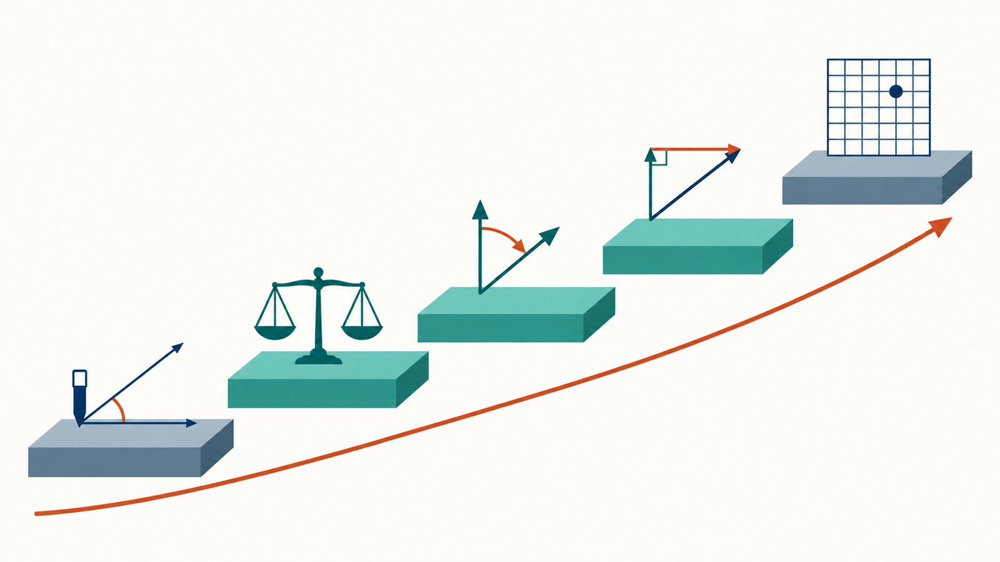
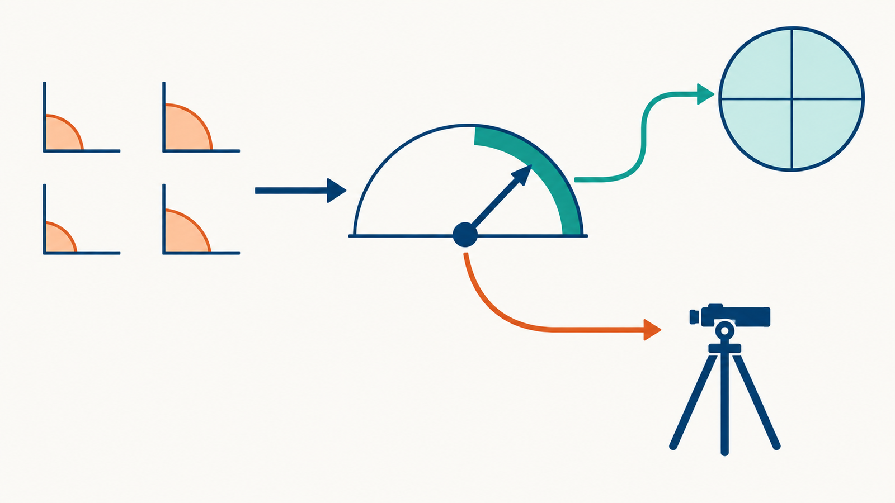
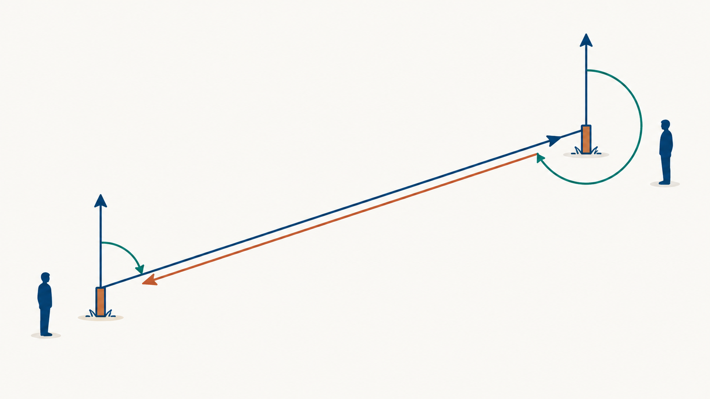
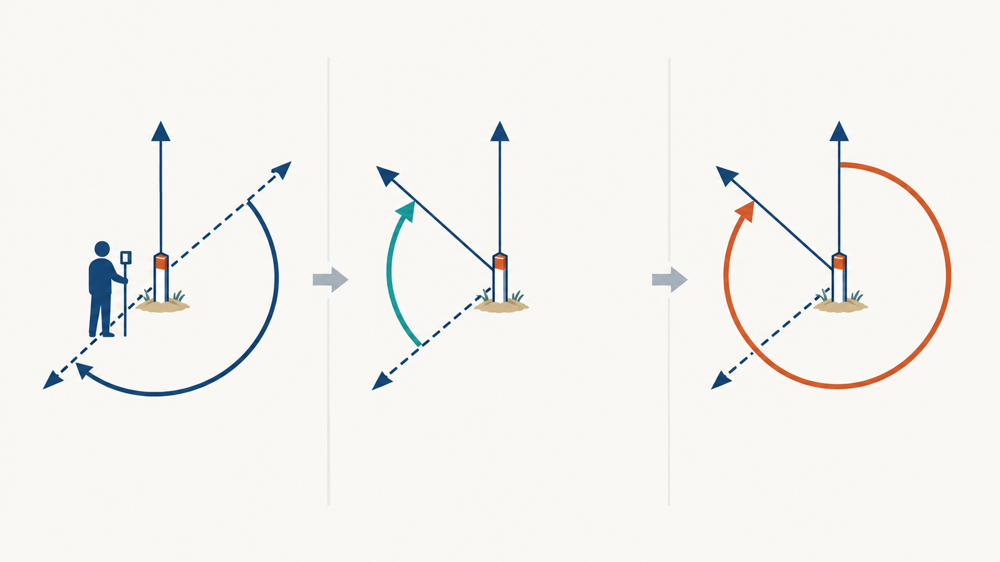
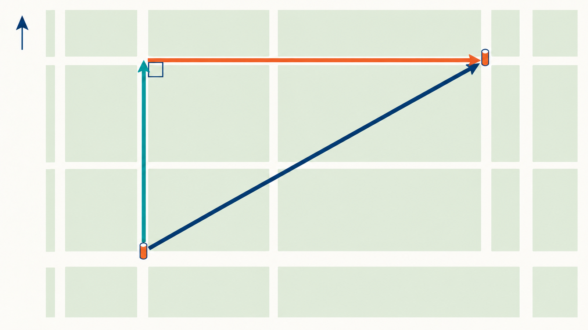
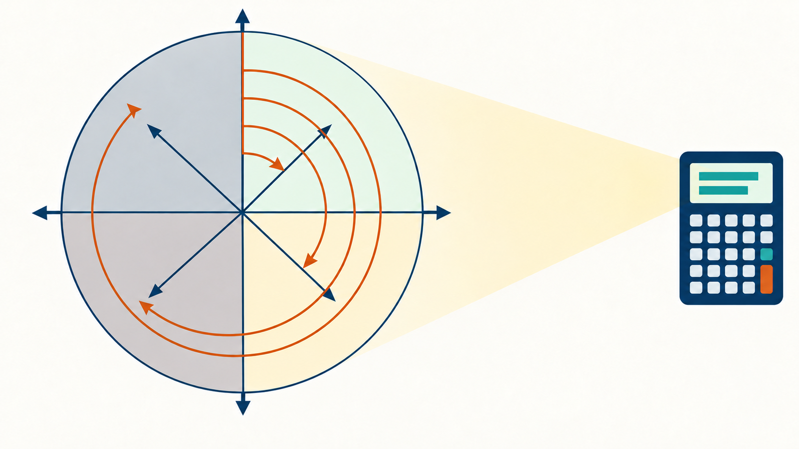
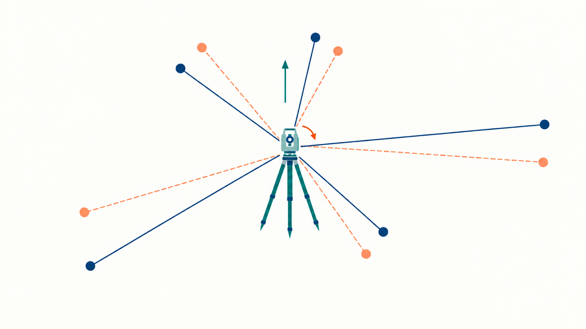

# トラバース測量 I

測量学 第5回

角と距離をつないで、位置を一筆書きで決める

<!-- 第5回の表紙です。第3回で座標と方向角、第4回で角の観測を学びました。今日はその2つをつないで、測点を折れ線のようにたどりながら位置を決める「トラバース測量」の前半を扱います。
たとえば、田んぼの4隅に杭を打って、杭から杭へ順に歩きながら、各杭で角を、杭の間で距離を測る。これがトラバースです。今日は、測った角をどう整え、どう「向き」に変え、どう「北へ何 m・東へ何 m」に変えるかを、1段ずつ進めます。
表紙の絵は AI で作った概念イラストで、実際の現場の写真ではありません。 -->

---

## 5-0 今日の一本の筋：角 → 向き → 成分 → 座標

> 田んぼの隅の杭 A・B・C・D を順に歩き、各杭で角、杭の間で距離を測ったあと、どう「座標」にするか。今日は真ん中の 3 段。

<!-- 今日の全体像を、1 枚の絵で先に見せます。階段の 5 段が、角から座標までの道のりです。
具体的な場面で言うと、田んぼの隅 A・B・C・D に杭があり、A の座標だけ分かっているとします。1 段目、各杭で角を、杭の間で距離を測る。これは第4回でやりました。2 段目、4 つの角を足して理論値と比べ、ずれを公平に直す。3 段目、「A から B は北から 62 度半の向き」のように、各辺の向きを出す。4 段目、「北へ 55 m、東へ 106 m」のように、斜めの 1 本を縦と横に分ける。5 段目、A の座標に足して B・C・D の座標を決める。これは次回です。
今日は真ん中の 3 段です。計算そのものより、「今どの段の話か」を見失ったときに学生はつまずきます。節が変わるたびに、この階段のどこにいるかを言います。次の枚で、各段で何を問うかを表にします。 -->

---

## 5-0 5 段のそれぞれで、何を問うか

| 段 | すること | 問い | 扱う回 |
| --- | --- | --- | --- |
| ① 角を測る | 各杭で交角、各辺で距離 | 器械で正しく測れたか | 第 4 回 |
| ② 角を整える | 内角の和を理論値に合わせる | 和はいくつになる**はず**か | 今日 5-2 |
| ③ 向きにする | 交角を方向角に変える | 各辺は北から何度の向きか | 今日 5-3 |
| ④ 成分にする | 方向角と距離を緯距・経距に | 北へ何 m、東へ何 m か | 今日 5-4 |
| ⑤ 座標にする | 成分を足して座標を確定 | 閉じなかった分をどう配るか | 第 6 回 |

> 今日は ②③④。各節の最初に「今はどの段か」を示す。5-5 はこの筋を **逆向き**にたどる。

<!-- 前の絵を表にしたものです。この表が今日の「地図」で、各節の最初にもう一度出します。
大事なのは「問い」の列です。② は「和はいくつになるはずか」、③ は「各辺は北から何度か」、④ は「北へ何 m、東へ何 m か」。各段で答える問いが 1 つずつ決まっているので、計算の途中で「今なにを求めているのか」が分からなくなったら、この列に戻ってください。
5-5 の逆計算は、この筋を下から上へ逆向きにたどります。座標から成分、成分から向きと距離です。 -->

---

## 5-0 前回までの復習①：方向角と順計算（第3回）

平面直角座標は **X が北、Y が東**。方向角 $T$ は座標北から右回り。

$$
\Delta X=S\cos T,\qquad \Delta Y=S\sin T
$$

| 既知点 A | $T$ | $S$ | 新点 B |
| --- | --- | --- | --- |
| (1000.000, 2000.000) | 120° | 150.000 m | (925.000, 2129.904) |

> 今日はこの式を、折れ線の辺ごとに繰り返し使う。

<!-- 第3回の要点を 1 枚で戻します。測量の座標は数学と違って X が北、Y が東です。方向角は北から時計回りに測ります。
表の例で確かめます。120° は南東の向きです。北から 120° 回ると、南へ少し傾いた東向きになります。だから X は減って 1000 から 925 に、Y は増えて 2000 から 2129.9 になっています。cos 120° が負、sin 120° が正、という計算と、「南東へ進んだ」という言葉が合っていることを確認してください。
今日はこの式を、トラバースの辺 AB、BC、CD と、順番に当てはめていきます。第4回の教材は別途作成中のため、前回演習の解答確認はその資料ができてから差し替えます。 -->

---

## 5-0 前回までの復習②：角の観測（第4回）

- 水平角は **正反観測**で器械誤差を消す（鉛直軸誤差は残る）。
- 方向法では倍角差・観測差・較差を見て **許容範囲**と比べる。
- 観測した角は、後視点から前視点へ **右回り**に測った **交角（夾角）**。

> 今日はその交角を「方向角」に変え、座標の差に変える。

<!-- 第4回の要点です。器械を据え、来た方向（後視）を見てから、進む方向（前視）を見る。このとき右回りに何度回ったか、が交角です。
たとえば杭 B に器械を据え、杭 A を見てから右回りに杭 C を見たら 85 度 40 分 30 秒だった、というのが観測値です。
1 つの角は正しく測れていても、杭が 4 本あれば角は 4 つ、5 本なら 5 つあり、その和には小さな誤差が出ます。今日はまずその誤差を扱い、それから交角を方向角に、方向角を座標の差に変えていきます。 -->

---

## 5-0 今日の到達目標

1. **閉合トラバース**の内角の和から測角誤差を求め、**等配分**して調整できる。
2. 調整した交角から、各辺の **方向角**を順に計算できる（交角法・偏角法）。
3. 方向角と距離から **緯距・経距**を計算できる。
4. 2 点の座標から **距離と方向角を逆計算**でき、象限を判定できる。

> 到達度は 58 分からの手計算テスト（25 分、10 点）で確かめる。

<!-- 到達目標は講義計画の第5回のものです。1 が「角を整える」、2 が「向きにする」、3 が「成分にする」、4 がその逆向きです。
テストの問 1 は 1〜3 をそのまま、問 2 は 4 をそのまま問います。今日の例題は 4 点の閉合トラバース、テストは 5 点の閉合トラバースで、数が 1 つ増えるだけで手順は同じです。
閉合比とコンパス法則、調整後の座標の確定は次回の第6回です。今日は「角 → 方向角 → 座標差」までを確実にします。 -->

---

## 5-0 今日の流れ

| 時間 | 内容 |
| --- | --- |
| 0〜5 分 | 復習・到達目標 |
| 5〜12 分 | 5-1 トラバースの種類・用途・選点 |
| 12〜23 分 | 5-2 内角の和と測角誤差の調整 |
| 23〜37 分 | 5-3 方向角の計算（交角法・偏角法） |
| 37〜45 分 | 5-4 緯距・経距 |
| 45〜53 分 | 5-5 座標の逆計算と象限判定 |
| 53〜58 分 | 5-6 TS の座標観測モードとの接続 |
| 58〜83 分 | 5-7 手計算テスト（25 分） |
| 83〜90 分 | 5-8 まとめ・次回予告 |

<!-- 時間配分です。講義は 5-3 の方向角に一番時間をかけます。ここが今日の山で、テストの配点も一番大きいところです。
各節に「つまずきポイント」と「ここまでの確認」の枚があります。時間が押したら、つまずきポイントは口頭だけにして進みます。テストは 58 分前後から 25 分、計算表を配ります。 -->

---

## 5-1 トラバース測量とは

- 測点を **折れ線**（多角形）でつなぎ、各測点で **角**、各辺で **距離**を測る。
- 既知点から出発し、角 → 方向角 → 座標差 → 座標 の順に **一筆書き**で位置を決める。
- 日本語では **多角測量**。基準点測量・圃場・水路・ため池の骨格を作る。

> 三角測量が「面」で位置を決めるなら、トラバースは「線」でたどる。

<!-- トラバース（traverse）は「横切る、たどる」という意味で、測点を順にたどって位置を決める方法です。
身近なたとえで言うと、地図のない町で「駅から北東へ 120 m、そこから左に曲がって 95 m」と道順を教えるのと同じです。出発点と、各交差点での曲がる角度と、区間の距離が分かれば、目的地の位置は決まります。測量ではその「曲がる角度」を交角として、「区間の距離」を辺長として、器械で測ります。
TS 1 台で角と距離が両方測れるので、現在の基準点測量の中心です。絵は AI 生成の概念図で、特定の機器や現場ではありません。 -->

---

## 5-1 トラバースの3つの形

<!-- トラバースには 3 つの形があります。図の左から見てください。
閉合トラバースは出発点に戻る多角形です。田んぼの周りを一周して元の杭に戻る形です。結合トラバースは、既知点から出発して別の既知点に着く路線です。水路に沿って、上流の基準点から下流の基準点までたどる形です。開放トラバースは、既知点から出て、知らない点で終わる路線です。
3 つの違いは「最後に答え合わせができるか」です。一周して戻れば、角の和と座標の戻りで確かめられます。既知点に着けば、着いた点の座標と比べられます。知らない点で終わると、比べる相手がありません。 -->

---

## 5-1 閉合・結合・開放の使い分け

| 種類 | 形 | 点検 | 主な用途 |
| --- | --- | --- | --- |
| **閉合** | 出発点に戻る多角形 | 内角の和、座標が戻るか | 圃場・ため池の区画、面積 |
| **結合** | 既知点から別の既知点へ | 終点の方向角と座標 | 基準点測量、水路・道路の路線 |
| **開放** | 既知点から未知点へ | **できない** | 急ぎの踏査、仮の路線 |

> 公共測量では、点検できる閉合または結合を使う。開放は補助的にしか使わない。

<!-- 表で使い分けを整理します。閉合は区画と面積、結合は細長い路線、開放は点検ができないので仮の作業にしか使いません。
結合トラバースは、両端の既知点に加えて、両端で既知の方向角が使えるので、角と座標の両方を点検できます。一方、閉合トラバースには弱点があります。出発点の方向角、つまり「最初の辺がどちらを向いているか」を間違えても、図形はきれいに閉じてしまうのです。全体が少し回転した形で閉じる、と思ってください。だから閉合トラバースでも、出発の方向角は別の既知点から確かめます。 -->

---

## 5-1 なぜ「点検できる」と言えるのか

- **閉合**：内角の和は $(n-2)\times180^\circ$、座標差の和は $0$ になる **はず**。
- **結合**：計算した終点の方向角・座標が **既知の値に一致**する **はず**。
- 「はず」との差が **誤差**。差が許容範囲なら配分し、超えたら **再測**。

> 点検できない開放トラバースは、誤りに気づけない。

<!-- 今日のキーワードは「はず」です。測量の点検はすべて、「理論上こうなるはずの量」と「実際に測った量」の差を見ることです。
家計簿にたとえると、財布に 1 万円入れて買い物をし、レシートの合計が 7,000 円なら、財布には 3,000 円残っているはずです。残りが 2,950 円なら 50 円どこかで食い違っている。この「はず」があるから食い違いに気づけます。レシートを取らずに買い物をすると、残りがいくらでも「そういうものか」で終わってしまう。これが開放トラバースです。
第2回で、残差の和が 0 になるという話をしました。あれも「はず」の値との比較です。今日はこのうち角の点検を扱い、座標の点検（閉合差）は次回です。 -->

---

## 5-1 農業農村工学でのトラバース

- **圃場整備**：区画の角に測点を置く閉合トラバースで、面積と杭位置を決める。
- **水路・農道**：基準点から基準点へつなぐ結合トラバースで、路線の中心線を決める。
- **ため池・ダム**：堤体の周囲を閉合トラバースで囲み、変位観測の基準にする。

> 面積（第 9 回）も縦横断（第 8 回）も、トラバースの座標が出発点。

<!-- 本学科の実習や卒業研究で出てくる場面です。
圃場整備では、1 枚の田を 30 a や 1 ha の区画に作り直します。区画の 4 隅の座標が決まらないと面積も杭の位置も決まりません。水路や農道は細長いので、上流の基準点から下流の基準点へ結合トラバースを通し、その座標を元に中心線や勾配を設計します。ため池の堤体は、周囲に閉合トラバースを置いて座標を決めておくと、何年か後に同じ点を測って「堤体が動いていないか」を見られます。
あとの回で扱う面積計算や土量計算は、ここで決めた座標の上で行います。 -->

---

## 5-1 選点の原則

<!-- 選点とは、測点、つまり杭を置く場所を決めることです。図の左が良い例、右が避ける例です。
原則は 4 つ。隣の測点と既知点が見通せること。辺の長さをなるべくそろえること。極端に鋭い角や極端に短い辺を避けること。杭が保存できる安定した地面であること。
右の図の短い辺を見てください。辺が 10 m しかないと、器械を杭の真上に据えるときの 2 mm のずれが、角にすると 40 秒ほどの誤差になります。辺が 100 m あれば同じ 2 mm が 4 秒で済みます。短い辺は角の誤差を大きくする、と覚えてください。 -->

---

## 5-1 準則が示す数値と、その理由

| 原則 | 理由 |
| --- | --- |
| 隣接点・既知点と **視通**がある | 角と距離を直接測るため |
| 辺長を **なるべく等しく**、極端な短辺を避ける | 短辺では求心誤差が角誤差になりやすい |
| **夾角は 60° 以上**（作業規程の準則） | 鋭い角は位置の誤差を大きくする |
| 杭・鋲を **保存できる**場所 | 再測・次の工程で使う |

> 良い選点は、計算の前に誤差を小さくする。

<!-- 作業規程の準則では、路線の夾角を 60° 以上とし、既知点間の距離や新点間の距離にも級ごとの上限があります。数値は級ごとに違うので、ここでは「鋭い角と短い辺を避ける」という考え方を覚えてください。
なぜ鋭い角がだめか。細長い三角形を思い浮かべてください。先の尖った頂点の角を少し間違えると、遠い側の辺の位置が大きくずれます。角の誤差が位置の誤差に拡大されやすい形、ということです。
今日の計算は「測ったあと」の話ですが、良い選点は「測る前」に誤差を小さくします。計算で直せるのは偶然誤差の配分だけで、選点の悪さは計算では取り戻せません。 -->

---

## 5-1 ここまでの確認①

1. 既知点 A から出発して既知点 F で終わるトラバースは、閉合・結合・開放のどれか。
2. 開放トラバースで点検できないのはなぜか。
3. 辺長をそろえ、鋭い角を避ける理由を 1 行で言う。

> 答え：結合／比べる「はず」の値がない／短辺・鋭角は角の誤差が位置の誤差になりやすい。

<!-- 1 分ほど隣と確認してもらいます。
1 問目は、両端が既知点なので結合です。出発点に戻っていないので閉合ではありません。2 問目は、「はず」の値と比べる、という今日の言い方で答えられれば十分です。3 問目は、短い辺の例（10 m の辺で 2 mm のずれが 40 秒）を思い出してもらいます。 -->

---

## 5-2 地図：いま「② 角を整える」段

| ① 角を測る | **② 角を整える** | ③ 向きにする | ④ 成分にする | ⑤ 座標にする |
| --- | --- | --- | --- | --- |
| 第 4 回 | **今ここ** | 5-3 | 5-4 | 第 6 回 |

問い：4 点の内角を足したら **360°00′40″** だった。どうする？

- (a) そのまま使う　(b) 4 つの角を少しずつ直す　(c) 測り直す

> 答え：差が許容内なら (b)、超えたら (c)。(a) はない。この節でその判断を作る。

<!-- 節の最初に、今日の地図のどこにいるかを示します。今は 2 段目、角を整える段です。
問いを出します。4 本の杭で角を測って足したら 360 度 0 分 40 秒だった。四角形の内角の和は 360 度のはずです。40 秒余っている。どうしますか。
(a) そのまま次の計算に使うと、一周して戻ったときに方向角が 40 秒ずれ、座標も閉じません。(c) 測り直すのは正しいですが、40 秒が「よくある偶然のばらつき」なら、測り直しても同じくらいの差がまた出ます。そこで (b)、4 つの角に 10 秒ずつ分けて引く。ただし、差が大きすぎるときは (b) ではなく (c) です。この「許容内なら配る、超えたら測り直す」という判断を、この節で作ります。 -->

---

## 5-2 多角形の内角の和

$$
\sum \beta_i = (n-2)\times180^\circ
$$

<!-- まず「はず」の値です。n 角形は、1 つの頂点から対角線を引くと n − 2 個の三角形に分かれます。三角形の内角の和は 180° なので、n 角形の内角の和は (n − 2) × 180° です。
図の五角形では、1 つの頂点から対角線が 2 本引けて、三角形が 3 つできます。180° × 3 = 540°。四角形なら三角形 2 つで 360°、六角形なら 4 つで 720°。
今日の例題は 4 点なので 360°、テストは 5 点なので 540° です。この値が、閉合トラバースの角の「はず」です。 -->

---

## 5-2 右回りに測ると、内角になるか外角になるか

- 左回り（反時計回り）に進み、右回りに交角を測ると **内角**：和は $(n-2)\times180^\circ$。
- 右回りに進むと、同じ測り方で **外角**：和は $(n+2)\times180^\circ$。
- どちらでも方向角の公式は同じ。**「はず」の値だけ変わる**。

> 野帳に「右回り交角」と「進行方向」を書いておく。

<!-- 観測は常に、後視から前視へ右回りに測ります。それが内角になるか外角になるかは、トラバースをどちら回りに歩くかで決まります。
田んぼの周りを左回り（反時計回り）に歩くと、来た道を振り返ってから右回りに進む方向を見るので、測った角は多角形の内側の角になります。右回りに歩くと、同じ測り方で外側の角になります。
外角のときは、和の「はず」が (n + 2) × 180° に変わります。四角形なら 720° です。今日の例とテストは左回りに進み、内角を扱います。野帳に進行方向を書いておかないと、あとで (n − 2) か (n + 2) か分からなくなります。 -->

---

## 5-2 度分秒の足し算：秒 → 分 → 度の順に繰り上げる

| | 度 | 分 | 秒 |
| --- | ---: | ---: | ---: |
| A 92°10′20″ ＋ B 85°40′30″ ＋ C 98°20′10″ ＋ D 83°49′40″ | 358 | 119 | 100 |
| 秒 100″ = 1′40″ → 分へ 1 繰り上げ | 358 | 120 | **40** |
| 分 120′ = 2°00′ → 度へ 2 繰り上げ | **360** | **00** | 40 |

和 ＝ **360°00′40″**。引き算の例：328°10′20″ − 81°40′00″ → 分が足りないので 1° を 60′ に **繰り下げ** → 246°30′20″

> 60 進法。秒と分は 60 で繰り上げ、足りなければ 1 つ上から 60 借りる。

<!-- 今日は度分秒の足し算・引き算を何十回もします。最初に型を決めます。
度・分・秒を別々の列に足します。秒の列が 100″。60″ で 1′ なので、1′40″。40″ を残して分の列に 1 を繰り上げる。分の列は 119′ + 1′ = 120′。60′ で 1° なので、ちょうど 2°00′。0′ を残して度の列に 2 を繰り上げる。度は 358° + 2° = 360°。だから和は 360°00′40″ です。
引き算は逆で、足りなければ上から 60 借ります。328°10′20″ から 81°40′00″ を引くとき、分は 10′ から 40′ が引けません。1° を 60′ にくずして 70′ − 40′ = 30′、度は 327° − 81° = 246°。答は 246°30′20″。
時計の計算と同じです。1 時間 50 分 + 30 分 = 2 時間 20 分、と計算するのと同じ手順です。関数電卓の DMS 入力でも計算できますが、筆算の型を知らないと電卓の答を確かめられません。 -->

---

## 5-2 測角誤差の定義と符号

$$
\varepsilon=\sum\beta_i^{\mathrm{obs}}-(n-2)\times180^\circ
$$

- 例題：$\varepsilon=360^\circ00'40''-360^\circ=+40''$
- $\varepsilon$ が **正** → 観測した角が全体として **大きすぎる** → 各角を **小さく**する向きに直す。
- 器械・観測者・回数が同じなら、$n$ 個の角の精度は **同じ**とみなす。

> 「観測 − 理論」の順で引く。符号を先に書く。

<!-- 測角誤差は、観測値の和から理論値を引いた量です。引く順番を固定してください。観測 引く 理論。
例題では 360°00′40″ − 360° = +40″。プラスということは、測った角が全体として 40 秒ぶん大きすぎた、ということです。だから直すときは、各角を小さくする向き、つまりマイナスを配ります。
もし観測の和が 359°59′20″ なら ε = −40″。測った角が全体として小さすぎたので、各角にプラスを配ります。符号を逆にする答案が毎年あります。「プラスなら引く、マイナスなら足す」と、ここで声に出しておきます。 -->

---

## 5-2 許容範囲は √n で決まる

1 角の精度を $\sigma$ とすると、$n$ 個の和の精度は **誤差伝播**（第 2 回）で

$$
\sigma_{\Sigma}=\sigma\sqrt{n}
$$

| 1 角の許容 $\sigma$ | $n=4$ | $n=5$ | $n=10$ |
| --- | --- | --- | --- |
| 20″ | 40″ | 45″ | 63″ |
| 30″ | 60″ | 67″ | 95″ |

> 例：$\sigma=30''$、$n=4$ なら許容 60″。観測誤差 +40″ は配分してよい。

<!-- 配る前に、「配ってよい大きさか」を判断します。基準は誤差伝播です。
1 つの角に 30 秒くらいのばらつきがあるとき、4 つ足した和のばらつきは 30 × 4 = 120 秒にはなりません。誤差はプラスにもマイナスにも出て一部打ち消し合うので、30 × √4 = 60 秒です。これが第2回で学んだ誤差伝播そのものです。
例題の +40″ は 60″ の中に収まっているので、偶然のばらつきとみなして配ってよい。もし +90″ だったら、どこかの角に測り間違いがあると考えて、配らずに測り直します。公共測量では級ごとに許容値が表で与えられますが、考え方はこの √n です。 -->

---

## 5-2 等配分の根拠

- 各角の精度が同じ → **重みが同じ** → 誤差は **均等に**配分する。

$$
\beta_i^{\mathrm{adj}}=\beta_i^{\mathrm{obs}}-\frac{\varepsilon}{n}
$$

- 符号は誤差と **逆**。$\varepsilon=+40''$、$n=4$ なら各角 **−10″**。
- 配分後に **和を再計算**して $(n-2)\times180^\circ$ に戻ったことを確かめる。

> 配分は「誤りを隠す」のではなく、偶然誤差を公平に分ける操作。

<!-- 配るときの根拠です。4 つの角は同じ器械で同じ人が同じ回数測ったので、どの角も同じくらい信用できます。信用の度合い、つまり重みが同じなら、誤差は均等に分けるのが最も確からしい。これは重みが等しいときの最小二乗解です。
4 人で均等に出し合った会費が 40 円余ったら、10 円ずつ返すのと同じです。誰か 1 人に 40 円返す理由はありません。
式は観測値から ε/n を引きます。ε が +40″ で n = 4 なら、各角から 10″ 引く。配ったら必ず和を取り直して、理論値に戻ったことを確かめます。戻っていなければ、符号か割り算を間違えています。 -->

---

## 5-2 例題：配分して調整角を得る

$n=4$ なので、各角に $-40''/4=-10''$ を配る。

| 測点 | 観測 | 配分 | 調整角 |
| --- | --- | --- | --- |
| A | 92°10′20″ | −10″ | **92°10′10″** |
| B | 85°40′30″ | −10″ | **85°40′20″** |
| C | 98°20′10″ | −10″ | **98°20′00″** |
| D | 83°49′40″ | −10″ | **83°49′30″** |
| 和 | 360°00′40″ | −40″ | **360°00′00″** |

> 調整角の和が 360° に戻った。ここで初めて方向角の計算に進める。

<!-- 表の形で書きます。テストでもこの表を埋めてもらいます。
観測の列、配分の列、調整角の列。配分は全部 −10″。A は 92°10′20″ から 10″ 引いて 92°10′10″。B は 85°40′30″ から 10″ 引いて 85°40′20″。C は 98°20′10″ から引いて 98°20′00″。D は 83°49′40″ から引いて 83°49′30″。
最後に調整角を足し直します。秒は 10 + 20 + 0 + 30 = 60″ = 1′00″、分は 10 + 40 + 20 + 49 + 1 = 120′ = 2°、度は 358 + 2 = 360°。ぴったり 360°00′00″ に戻りました。この行を書かない答案は、配分の検算をしていないとみなされます。 -->

---

## 5-2 割り切れないときと、許容を超えたとき

- 例：$\varepsilon=+50''$、$n=4$ → $50/4=12.5''$ は秒の整数にならない。
- 端数は **短い辺に挟まれた角**（誤差が出やすい角）に多めに配る：−12″、−13″、−12″、−13″（計 −50″）。
- 許容（例：60″）を **超えたら配分しない**。どの角が怪しいかを野帳で確かめ、**再測**する。

> 等配分は「秒の整数」で。合計が ε と一致すればよい。

<!-- 2 つの例外を先に片づけます。
1 つ目、割り切れないとき。ε が +50″ で 4 つの角なら 12.5″ ずつですが、角は秒の整数で書きます。そこで 12″ と 13″ を混ぜ、合計が 50″ になるようにします。13″ をどの角に付けるか。短い辺に挟まれた角は、器械を杭の真上に据えるずれが角に効きやすいので、そこに多めに配ります。例題なら、一番短い辺 BC の両端、B と C です。
2 つ目、許容を超えたとき。たとえば ε が +90″ なら、配りません。どこかの角に過失があると考え、野帳を見て怪しい角を測り直します。配分は偶然のばらつきを公平に分ける操作であって、間違いを隠す操作ではありません。 -->

---

## 5-2 流れの整理：観測から再確認までの 6 段

> 許容内であることを確かめてから配る。超えたら配分せず再測する。

<!-- ここまでを 1 本の流れにします。観測した内角の和を出す。理論値 (n − 2) × 180° を書く。引いて誤差 ε と符号を出す。許容 σ√n と比べる。許容内なら −ε/n を各角に配る。配った後の和が理論値に戻ることを確かめる。
試験では、この 6 段を順に書けるかを見ます。特に「許容判定」を飛ばして、いきなり配る答案が多い。実務では許容判定を飛ばすと、測り間違いを配分でならしてしまい、あとの座標が全部ずれます。
図の右下の分岐、「超えたら再測」を忘れないでください。 -->

---

## 5-2 発展：結合トラバースの測角誤差

両端の既知方向角 $T_{\mathrm{start}}$、$T_{\mathrm{end}}$ と、$n$ 個の交角 $\beta_i$ から

$$
T_{\mathrm{end}}^{\mathrm{calc}}=T_{\mathrm{start}}+\sum\beta_i-n\times180^\circ\quad(\text{360° で整える}),\qquad \varepsilon=T_{\mathrm{end}}^{\mathrm{calc}}-T_{\mathrm{end}}
$$

| 例 | 値 |
| --- | --- |
| $T_{\mathrm{start}}=40^\circ00'00''$、$\sum\beta=551^\circ01'00''$、$n=3$ | $T^{\mathrm{calc}}_{\mathrm{end}}=51^\circ01'00''$ |
| 既知 $T_{\mathrm{end}}=51^\circ00'30''$ | $\varepsilon=+30''$ → 各角 −10″ |

<!-- 閉合でなく結合トラバースのときは、内角の和の代わりに「終点で既知の方向角」と比べます。「はず」の値が、内角の和から終点の方向角に変わるだけで、考え方は同じです。
例では、出発の方向角 40° に 3 つの交角を足し、180° を 3 回引くと 51°01′00″。終点で既知の方向角は 51°00′30″。差の +30″ が測角誤差で、3 つの角に −10″ ずつ配ります。
式の中の n × 180° は、次の節で学ぶ交角法の「±180°」を n 回分まとめたものです。今は「終点で比べる」ことだけ押さえてください。時間が押していたらこの枚は飛ばして構いません。 -->

---

## 5-2 つまずきポイント

| つまずき | 症状 | 防ぎ方 |
| --- | --- | --- |
| 符号を逆にする | 配分後の和が 360°01′20″ になる | 「観測 − 理論」の順。正なら引く |
| 秒を繰り上げない | 和を 358°119′100″ のまま書く | 秒 → 分 → 度の順に 60 で繰り上げ |
| 許容判定を飛ばす | 90″ の誤差をそのまま配る | 配る前に σ√n と比べる |
| 外角なのに (n−2) | 誤差が 360″ 単位で大きく出る | 進行方向を野帳で確かめる |

> 配分後の和を取り直せば、上の 3 つは自分で気づける。

<!-- よくあるつまずきを 4 つ、症状と防ぎ方の対で示します。
一番多いのは符号の逆。+40″ の誤差に +10″ ずつ配ると、和は 360°01′20″ になります。配分後の和を取り直せば、戻っていないので気づけます。次が秒の繰り上げ忘れ。358°119′100″ と書いたまま理論値と比べようとして止まります。3 つ目は許容判定を飛ばすこと。4 つ目は、右回りに歩いたのに (n − 2) を使うこと。誤差が 360° 単位で大きく出るので、そのときは進行方向を疑ってください。
「配分後の和を取り直す」という 1 つの習慣で、上の 3 つは自分で発見できます。 -->

---

## 5-2 ここまでの確認②

1. 5 点閉合トラバースの内角の和の理論値は何度か。
2. 観測した内角の和が 539°59′20″ のとき、測角誤差と各角への配分は。
3. 1 角の許容 20″ のとき、5 角の和の許容は何秒か。

> 答え：540°／ε = −40″、各角 +8″／20″ × √5 ≈ 45″。

<!-- テストの問 1 と同じ 5 点の設定です。
1 問目は (5 − 2) × 180° = 540°。2 問目は符号に注意。539°59′20″ − 540° = −40″、観測が小さすぎるので、各角に 40 ÷ 5 = 8″ を足します。3 問目は √5 ≈ 2.24 なので 20 × 2.24 ≈ 45″。2 問目の 40″ は 45″ の中なので配ってよい、というところまで言えれば完璧です。 -->

---

## 5-3 地図：いま「③ 向きにする」段

| ① 角を測る | ② 角を整える | **③ 向きにする** | ④ 成分にする | ⑤ 座標にする |
| --- | --- | --- | --- | --- |
| 第 4 回 | 5-2 済 | **今ここ** | 5-4 | 第 6 回 |

問い：B の調整角は 85°40′20″ と分かった。では **B から C はどちらを向いている**か？

- 角だけでは決まらない。**前の辺 AB の向き**（方向角 62°30′00″）が要る。
- 「前の辺の向き」＋「曲がった角」→「次の辺の向き」。これを辺の数だけ繰り返す。

> 向きは「北から何度」で表す。これが方向角。

<!-- 角が整いました。次は 3 段目、向きにする段です。
問いを出します。B での角が 85°40′20″ と分かった。B から C はどちらを向いていますか。答えられません。「右に 85 度曲がった」だけでは、もともとどちらを向いていたかが分からないからです。
道案内と同じです。「交差点で右に 90 度曲がれ」と言われても、北へ歩いていたなら東へ、東へ歩いていたなら南へ向くことになります。だから「前の辺の向き」が要る。出発の辺 AB の向きは既知で、北から 62°30′00″ です。これに B で曲がった角を組み合わせて BC の向きを出し、次は BC の向きに C で曲がった角を組み合わせて CD の向きを出す。この繰り返しです。 -->

---

## 5-3 方向角を思い出す

- 方向角 $T$：**座標北**から**右回り**に測った、測線の向き（0°〜360°）。
- 真北・磁北からの角（方位角・磁針方位）とは区別する（第 3 回）。
- 添字は「どの点から、どの点へ」：$T_{AB}$ は **A から B を見た向き**。

> 方向角は「どの点から見た、どの点への向き」をいつも書く。

<!-- 方向角の定義を戻します。座標北、つまり平面直角座標の X 軸の正の向きを 0° とし、時計回りに 360° まで測った角です。
時計の文字盤を思い浮かべてください。12 時が北で 0°、3 時が東で 90°、6 時が南で 180°、9 時が西で 270° です。62°30′ なら、2 時より少し手前、北東の向きです。
添字の順序が大切です。T_AB は A に立って B を見た向き、T_BA は B に立って A を見た向きです。同じ線でも向きが逆なら 180° 違います。この「逆向き」を次の枚で扱います。 -->

---

## 5-3 反方向角：振り返れば 180°

$$
T_{BA}=T_{AB}\pm180^\circ\qquad(T_{AB}\ \text{が 180° 未満なら} +180^\circ,\ \text{180° 以上なら} -180^\circ)
$$

| 元の方向角 | 180° 未満か | 反方向角 |
| --- | --- | --- |
| $T_{AB}=62^\circ30'00''$（北東） | 未満 → +180° | $T_{BA}=242^\circ30'00''$（南西） |
| $T_{BC}=328^\circ10'20''$（北西） | 以上 → −180° | $T_{CB}=148^\circ10'20''$（南東） |

> 答が 0°〜360° に収まる方を選ぶ。足しても引いても、向きは同じ「真後ろ」。

<!-- 反方向角は、来た道を振り返った向きです。A から B へ歩いて、B で振り返って A を見る。向きはちょうど 180° 変わります。
62°30′ は北東。振り返ると南西で、62°30′ + 180° = 242°30′。328°10′20″ は北西。振り返ると南東ですが、328° に 180° を足すと 508° になって 360° を超えてしまうので、引いて 148°10′20″。
足すか引くかの判断は簡単で、答が 0° から 360° に収まる方を選びます。元が 180° 未満なら足す、180° 以上なら引く。この「±180° の選び方」は、次の交角法でそのまま使います。ここで慣れておいてください。 -->

---

## 5-3 交角法：後視・前視と交角

<!-- 図で交角法の原理を見ます。測点 B に器械を据え、後視点 A を見てから右回りに前視点 C を見た角が交角 β_B です。
B から A への向きは、A から B への向き 62°30′ の反方向角、242°30′ です。図の灰色の破線がそれです。その向きから右回りに β_B = 85°40′ 回ると、B から C への向き、つまり T_BC になります。図の橙色の大きな弧が T_BC で、北から右回りに 328°10′ です。
つまり、方向角の伝播は「振り返る → 右に回る」の 2 動作です。これを式にしたのが次の枚です。 -->

---

## 5-3 交角法を 3 ステップで：まず絵で見る

- 左：来た道（後視）へ **振り返る**。中：そこから **右回り** に交角だけ回る。右：北から前視までの大きな弧が **方向角**。

> 「振り返って、右に回って、一周分を引く」。この 3 動作が交角法のすべて。

<!-- 式を覚える前に、体の動きで覚えます。この絵は、測点 B に立った人の 3 コマです。
左のコマ。B に着いたら、まず来た道、つまり A の方へ振り返ります。これが後視。向きで言えば、AB の方向角を 180° ひっくり返した反方向角です。
真ん中のコマ。振り返った向きから、右回り、時計回りに、観測した交角 β だけ体を回します。回り終えた先が、次の点 C の方向、つまり前視です。
右のコマ。その前視の向きを「北から右回りに何度か」で読む。北向きの小さな矢印から前視まで、大きな橙の弧を描いたぶんが、BC の方向角です。
つまり交角法は、振り返る、右に回る、北から測り直す、の 3 動作です。次の枚で、この 3 動作をそのまま数字にします。 -->

---

## 5-3 交角法を 3 ステップで：数字で追う（B で）

| ステップ | すること | 例（$T_{AB}=62^\circ30'00''$、$\beta_B=85^\circ40'20''$） |
| --- | --- | --- |
| ① 振り返る | 反方向角 $T_{BA}=T_{AB}\pm180^\circ$ | 62°30′00″ + 180° = **242°30′00″** |
| ② 右に回る | 交角を足す $T_{BA}+\beta_B$ | 242°30′00″ + 85°40′20″ = **328°10′20″** |
| ③ 整える | 360° 以上なら −360° | 360° 未満なのでそのまま → $T_{BC}=$ **328°10′20″** |

> 前の枚の 3 コマが、そのまま 3 行になっている。絵と数字を往復できれば、式は要らない。

<!-- 前の枚の 3 コマを、そのまま数字にします。
ステップ①、振り返る。B に立って A を見る向きは、T_AB の反方向角で 242°30′00″。ステップ②、右に回る。後視から前視へ右回りに 85°40′20″ 回るので、足して 328°10′20″。ステップ③、整える。360° を超えていれば 360° を引きますが、328° なので そのまま。これが T_BC です。
図と照らします。AB は北東向き、BC は北西向きで、左に曲がっています。方向角は 62° から 328° に変わりました。328° は 360° の少し手前、つまり北の少し左です。合っています。
C でも同じです。振り返って 328°10′20″ − 180° = 148°10′20″、右に 98°20′00″ 回って 246°30′20″、360° 未満なのでそのまま。 -->

---

## 5-3 3 ステップを 1 行にまとめる：±180°

$$
T_{BC}=T_{AB}+\beta_B\pm180^\circ
$$

- ①の +180° と ③の −360° を合わせると **−180°**。③が不要なら **+180°** のまま。
- 判断は「$T_{AB}+\beta_B$」が **180° 以上なら −180°**、**180° 未満なら +180°**。
- 例：62°30′00″ + 85°40′20″ = 148°10′20″ **＜ 180°** → +180° → **328°10′20″**（3 ステップと同じ）
- $\beta$ は後視から前視へ **右回り**に測った角。内角でも外角でも同じ式。

> 「前の方向角 ＋ 交角 ± 180°」を、測線の数だけ繰り返す。

<!-- 3 ステップを 1 行にします。振り返るときの +180° と、整えるときの −360° を合わせると −180° です。整える必要がないときは +180° のまま。だから「前の方向角 + 交角 ± 180°」という 1 つの式になります。
±180° のどちらを使うか。前の方向角と交角を足した値が 180° 以上なら引く、180° 未満なら足す。理屈は反方向角のときと同じで、答が 0° から 360° に収まる方を選んでいるだけです。
B で確かめます。62°30′00″ + 85°40′20″ = 148°10′20″。180° 未満なので +180° で 328°10′20″。3 ステップで出した値と同じです。慣れるまでは 3 ステップで、慣れたら 1 行で。どちらで解いても答は 1 つです。 -->

---

## 5-3 例題：CD、DA、そして AB に戻る

| 測線 | 前の方向角 ＋ 交角 | ±180° | 方向角 |
| --- | --- | --- | --- |
| BC | 62°30′00″ + 85°40′20″ = 148°10′20″ | +180° | **328°10′20″** |
| CD | 328°10′20″ + 98°20′00″ = 426°30′20″ | −180° | **246°30′20″** |
| DA | 246°30′20″ + 83°49′30″ = 330°19′50″ | −180° | **150°19′50″** |
| AB | 150°19′50″ + 92°10′10″ = 242°30′00″ | −180° | **62°30′00″** |

> 最後に出発の $T_{AB}$ に戻った。調整角を使ったから戻る。

<!-- 1 行の式で残りの辺を進めます。
CD。328°10′20″ + 98°20′00″ = 426°30′20″。180° 以上なので −180° で 246°30′20″。南西向きです。
DA。246°30′20″ + 83°49′30″ = 330°19′50″。−180° で 150°19′50″。南東向きです。
そして 4 本目、AB。150°19′50″ + 92°10′10″ = 242°30′00″。−180° で 62°30′00″。出発の方向角にぴったり戻りました。
これが検算です。もし調整前の角、つまり 10″ ずつ大きい角で計算すると、4 回で 40″ 余り、62°30′40″ になって戻りません。調整角の和が 360° だからこそ、一周して同じ方向角に戻るのです。テストでもこの「戻る」行まで書いてもらいます。 -->

---

## 5-3 一周して戻れば、検算完了

> 閉合トラバースの方向角は、出発の測線で **元の値に戻る**ことで検算する。

<!-- 図は例題の 4 点を平面直角座標に描いたものです。各測線の方向角を矢印の向きと見比べてください。
AB は 62°30′ で北東。BC は 328°10′ で北西。CD は 246°30′ で南西。DA は 150°20′ で南東。左回りに一周しているので、向きは北東 → 北西 → 南西 → 南東と、反時計回りに変わっていきます。
計算のあとには、必ずこうして図で向きを確かめる習慣をつけてください。「CD が南西のはずなのに方向角が 66° になった」という矛盾は、図を見ればすぐ気づけます。 -->

---

## 5-3 360° を超えたら引く、負なら足す

| 計算結果 | 整え方 | 例 |
| --- | --- | --- |
| 360° 以上 | −360° | 426°30′20″ → 66°30′20″ |
| 0° 未満 | +360° | −31°49′40″ → 328°10′20″ |
| 0°〜360° | そのまま | 150°19′50″ |

- 方向角は **0° 以上 360° 未満**で書く。
- $-180^\circ$ の代わりに $+180^\circ$ して $-360^\circ$ しても同じ結果。

> 式の形は違っても、向きは 1 つ。

<!-- 方向角は 0° 以上 360° 未満で書く約束です。一周は 360° なので、360° を足しても引いても向きは変わりません。
時計で言えば、13 時と 1 時は同じ針の位置です。426° と 66° も同じ向きです。
±180° と ±360° の整え方は、同じことの言い換えです。「+180° して 360° を超えたら −360°」と「最初から −180°」は、同じ答になります。電卓で度分秒の加減をするときは DMS 入力を使い、途中で 10 進に直さないようにします。 -->

---

## 5-3 偏角法：進行方向からの折れ角

$$
\delta=\beta-180^\circ\qquad(\text{右へ折れると }+,\ \text{左へ折れると }-)
$$

<!-- 方向角を出すもう 1 つの方法、偏角法です。
偏角は、前の測線をまっすぐ延ばした向きから、次の測線までの折れ角です。車の運転で言えば、「ハンドルを右に何度切ったか」です。まっすぐなら 0°、右に折れればプラス、左に折れればマイナス。
交角との関係は δ = β − 180°。後視を見てから右回りに 180° 回ると、ちょうどまっすぐ前を向きます。そこからさらに回った分が偏角です。例題の B では β = 85°40′20″ なので δ = −94°19′40″、左に 94° ほど折れた、ということです。道路や水路のように細長い路線で使います。 -->

---

## 5-3 偏角法の公式と例

$$
T_{BC}=T_{AB}+\delta_B
$$

| 測点 | 交角 $\beta$ | 偏角 $\delta=\beta-180^\circ$ | 方向角 |
| --- | --- | --- | --- |
| B | 85°40′20″ | −94°19′40″（左偏） | 62°30′00″ − 94°19′40″ = −31°49′40″ → +360° → **328°10′20″** |
| C | 98°20′00″ | −81°40′00″（左偏） | 328°10′20″ − 81°40′00″ = **246°30′20″** |

- 閉合トラバースでは偏角の和が **±360°**（左回りなら −360°）。

> 交角法と同じ答え。式が違うだけで、向きは 1 つ。

<!-- 偏角法では ±180° が要りません。前の方向角に偏角を足すだけです。
B では 62°30′00″ に −94°19′40″ を足して −31°49′40″。負なので 360° を足して 328°10′20″。交角法と同じ答です。C では 328°10′20″ − 81°40′00″ = 246°30′20″。これも同じです。
閉合トラバースを一周すると、偏角の和は左回りなら −360°、右回りなら +360° になります。例題は 4 つとも左偏で、和は −360° です。これも検算に使えます。 -->

---

## 5-3 交角法と偏角法の比較

| | 交角法 | 偏角法 |
| --- | --- | --- |
| 測る角 | 後視→前視の右回り角 $\beta$ | 延長線からの折れ角 $\delta$ |
| 式 | $T_{i+1}=T_i+\beta\pm180^\circ$ | $T_{i+1}=T_i+\delta$ |
| 点検 | 内角の和 $(n-2)\times180^\circ$ | 偏角の和 $\pm360^\circ$ |
| 向く場面 | 閉合・結合トラバース全般 | 道路・水路など細長い路線 |

> 試験では交角法が中心。偏角法は $\delta=\beta-180^\circ$ でつながる。

<!-- 2 つの方法を並べます。測る角が違い、式が違い、点検の仕方が違いますが、出てくる方向角は同じです。
TS では後視を 0° にセットして前視を読むのが自然なので、実務も試験も交角法が中心です。偏角法は、路線測量（第 11 回）でまた出てきます。今日は「δ = β − 180° で交角法につながる」ことだけ押さえてください。 -->

---

## 5-3 関数電卓なしで解く：測量士補の型

既知 $T_{AB}=330^\circ20'10''$。B の交角 $\beta_B=95^\circ30'40''$、C の交角 $\beta_C=210^\circ15'20''$。

$$
\begin{aligned}
T_{BC}&=330^\circ20'10''+95^\circ30'40''-180^\circ=245^\circ50'50''\\
T_{CD}&=245^\circ50'50''+210^\circ15'20''-180^\circ=276^\circ06'10''
\end{aligned}
$$

- 度・分・秒を **別々に**足し引きし、60 で繰り上げ・繰り下げする。
- 測量士補試験は電卓不可。この型は **筆算だけ**で解ける。

<!-- 測量士補試験の型です。図に既知の方向角と交角が書かれ、何本か先の測線の方向角を選ぶ問題が繰り返し出ています。
筆算でやります。BC は 330°20′10″ + 95°30′40″。秒は 50″、分は 50′、度は 425°。180° 以上なので −180° で 245°50′50″。CD は 245°50′50″ + 210°15′20″。秒は 70″ → 1′10″、分は 65′ + 1′ = 66′ → 1°06′、度は 455° + 1° = 456°。−180° で 276°06′10″。
秒 → 分 → 度の順に繰り上げると間違えにくいです。交角が 210° のように 180° を超えていても、式はそのまま使えます。 -->

---

## 5-3 つまずきポイント

| つまずき | 症状 | 防ぎ方 |
| --- | --- | --- |
| ±180° を逆に選ぶ | 方向角が 180° ずれる（真後ろを向く） | 和が 180° 以上なら引く、未満なら足す |
| −180° の代わりに −360° | 457°55′ → 97°55′ になる | 引くのは 180°。360° 以上なら さらに −360° |
| 添字を逆に読む | $T_{BA}$ を $T_{AB}$ として使う | 「どの点から、どの点へ」を声に出す |
| 調整前の角で計算 | 一周しても戻らない | 調整角の和が理論値になってから進む |

> 一周して戻るか、図の向きと合うか。この 2 つで全部気づける。

<!-- 方向角のつまずきは 4 つです。
±180° を逆に選ぶと、答が真後ろを向きます。たとえば 328° のはずが 148° になる。図で向きを確かめれば気づけます。2 つ目は、−180° の代わりに −360° を引くこと。457°55′ から 360° を引いて 97°55′ とする答案がテストで毎年出ます。引くのはあくまで 180°、それでも 360° 以上なら さらに 360° を引く、です。3 つ目は添字。4 つ目は、調整前の角で計算して一周しても戻らないことです。
どれも、「一周して戻るか」と「図の向きと合うか」の 2 つの検算で気づけます。 -->

---

## 5-3 ここまでの確認③

1. $T_{AB}=200^\circ$、$\beta_B=100^\circ$ のとき $T_{BC}$ は。
2. $T_{AB}=30^\circ$、$\beta_B=120^\circ$ のとき $T_{BC}$ は。
3. 交角 $\beta=250^\circ$ の偏角 $\delta$ は。右偏か左偏か。

> 答え：300° − 180° = 120°／150° + 180° = 330°／+70°、右偏。

<!-- 1 問目は 200° + 100° = 300°。180° 以上なので −180° で 120°。2 問目は 30° + 120° = 150°。180° 未満なので +180° で 330°。3 問目は 250° − 180° = +70°、プラスなので右偏です。
1 問目を 3 ステップでも確かめます。振り返って 200° − 180° = 20°、右に 100° 回って 120°、360° 未満なのでそのまま。同じ答です。 -->

---

## 5-3 試験で問われる型：方向角の伝播

| 型 | 着眼点 |
| --- | --- |
| 既知方向角と交角から数本先の方向角 | $T_{i+1}=T_i+\beta\pm180^\circ$ を繰り返す。360° の整え |
| 閉合トラバースの内角の和と誤差 | $(n-2)\times180^\circ$、符号、等配分 |
| 反方向角 | $\pm180^\circ$ |
| 方位角と方向角の混同 | 方向角は **座標北**から右回り（第 3 回） |

> 計算は筆算。「右回り」「座標北」「±180°」の 3 点を押さえる。

<!-- 測量士補では多角測量の計算問題として毎年のように出る型です。公務員試験でも閉合トラバースの内角調整が定番です。
どの型も、今日の「振り返って、右に回って、整える」で解けます。 -->

---

## 5-4 地図：いま「④ 成分にする」段

| ① 角を測る | ② 角を整える | ③ 向きにする | **④ 成分にする** | ⑤ 座標にする |
| --- | --- | --- | --- | --- |
| 第 4 回 | 5-2 済 | 5-3 済 | **今ここ** | 第 6 回 |

問い：A から **北から 62°30′ の向きに 120.000 m** 進んだ。**北へ何 m、東へ何 m** 進んだか？

- 斜めの 1 本を、縦（北）と横（東）の 2 本に分ける。分けるのは三角比：$\cos$ が北向き、$\sin$ が東向き。

> この「縦と横」が緯距・経距。次回、これを足して座標にする。

<!-- 向きが決まりました。4 段目、成分にする段です。
問いです。A から北東、正確には北から 62°30′ の向きに 120 m 進みました。北へ何 m、東へ何 m 進んだでしょうか。
座標は「北へいくら、東へいくら」の 2 つの数で表されます。斜めに 120 m 進んだ 1 本の矢印を、北向きの矢印と東向きの矢印の 2 本に分ける。これが今日の 4 段目です。分けるときに使うのが三角比で、北向きの長さが 120 × cos 62°30′、東向きの長さが 120 × sin 62°30′ です。答は北へ 55.410 m、東へ 106.441 m。
この縦と横の成分に名前が付いていて、緯距と経距といいます。 -->

---

## 5-4 緯距・経距の定義

$$
\Delta X=S\cos T\ (\text{緯距}),\qquad \Delta Y=S\sin T\ (\text{経距})
$$

<!-- 緯距は測線の南北成分、経距は東西成分です。名前は緯度・経度から来ていて、緯距は緯度方向（南北）の距離、経距は経度方向（東西）の距離です。
第3回の順計算と同じ式です。X 軸が北なので、北からの角 T の cos が X 成分、sin が Y 成分になります。数学の「x に cos」と同じ形ですが、測量では X が北、角は北から、という約束に乗っているだけです。
図の右の 4 象限の小図は次の枚で使います。北向きが正、東向きが正です。 -->

---

## 5-4 符号は方向角の象限で決まる

| 方向角 $T$ | 向き | $\cos T$ → $\Delta X$ | $\sin T$ → $\Delta Y$ |
| --- | --- | --- | --- |
| 0°〜90° | 北東 | ＋ | ＋ |
| 90°〜180° | 南東 | − | ＋ |
| 180°〜270° | 南西 | − | − |
| 270°〜360° | 北西 | ＋ | − |

> 計算の前に向きを言葉で言い、符号を予想してから電卓を押す。

<!-- 符号の表です。覚え方は「北へ進めば ΔX がプラス、東へ進めば ΔY がプラス」。それだけです。
南東に進むなら、南へ行くので ΔX はマイナス、東へ行くので ΔY はプラス。北西に進むなら、北へ行くので ΔX はプラス、西へ行くので ΔY はマイナス。
電卓は正しい符号を返しますが、入力ミスに気づくには予想が必要です。「328° は北西だから ΔX がプラス、ΔY がマイナス」と先に言ってから電卓を押してください。予想と違ったら、入力か cos・sin の取り違えを疑います。 -->

---

## 5-4 電卓の手順：AB を一歩ずつ

| 手順 | すること | AB（$S=120.000$、$T=62^\circ30'00''$） |
| --- | --- | --- |
| ① 向きを言う | 象限と符号を予想 | 北東 → (＋, ＋) |
| ② 角を入れる | DEG モード、DMS で入力 | 62°30′00″ |
| ③ $\cos$ → ×S | 丸めずに掛ける | 0.461749 × 120.000 = 55.40988 |
| ④ $\sin$ → ×S | 同じ角で | 0.887011 × 120.000 = 106.44132 |
| ⑤ mm に丸める | 最後に 1 回だけ | $\Delta X=$ **+55.410**、$\Delta Y=$ **+106.441** |

> 予想した符号と合っているか、最後に照合する。

<!-- 電卓の操作を 5 手順に固定します。
①向きを言う。62°30′ は北東、符号は両方プラス。②電卓を DEG モードにして、度分秒で 62°30′00″ を入れる。10 進に直すなら 62.5° ですが、分や秒が端数のときは DMS 入力の方が安全です。③cos を取ると 0.461749。これに 120.000 を掛けて 55.40988。④同じ角の sin は 0.887011、掛けて 106.44132。⑤最後に mm、つまり小数第 3 位に丸めて +55.410 と +106.441。
途中の三角関数の値を 0.46 のように丸めてしまうと、120 m 掛けたときに数 cm ずれます。丸めるのは最後に 1 回だけです。最後に①の予想と符号を照合します。 -->

---

## 5-4 例題：4 辺の緯距・経距（前半）

| 測線 | $S$（m） | $T$ | $\Delta X=S\cos T$ | $\Delta Y=S\sin T$ |
| --- | ---: | --- | ---: | ---: |
| AB | 120.000 | 62°30′00″ | +55.410 | +106.441 |
| BC | 95.000 | 328°10′20″ | +80.716 | −50.100 |

$$
\Delta Y_{BC}=95.000\sin328^\circ10'20''=95.000\times(-0.527368)=-50.100\ \mathrm{m}
$$

> AB は北東（＋,＋）、BC は北西（＋,−）。符号が向きと合っている。

<!-- 例題の 4 辺のうち、前半 2 辺です。
AB は前の枚で出した +55.410 と +106.441。BC は距離 95.000 m、方向角 328°10′20″。向きを言います。北西、符号は (＋, −)。cos 328°10′20″ = 0.849637、掛けて +80.716。sin 328°10′20″ = −0.527368、掛けて −50.100。予想どおり ΔX がプラス、ΔY がマイナスです。
北西なので北へは進むが西へ戻る、という向きが、数字の符号にそのまま出ています。 -->

---

## 5-4 例題：4 辺の緯距・経距（後半）と合計

| 測線 | $S$（m） | $T$ | $\Delta X$ | $\Delta Y$ |
| --- | ---: | --- | ---: | ---: |
| CD | 117.015 | 246°30′20″ | −46.649 | −107.314 |
| DA | 102.977 | 150°19′50″ | −89.476 | +50.973 |
| 合計 | 434.992 | | **+0.001** | **0.000** |

> 4 辺を足すと、ほぼ 0 に戻る。出発点に戻るのだから当然。

<!-- 後半 2 辺です。CD は南西なので (−, −)、−46.649 と −107.314。DA は南東なので (−, ＋)、−89.476 と +50.973。
4 辺の ΔX を足すと +55.410 + 80.716 − 46.649 − 89.476 = +0.001。ΔY は +106.441 − 50.100 − 107.314 + 50.973 = 0.000。
一周して出発点に戻るのだから、北へ進んだ分と南へ戻った分は打ち消し合い、東と西も打ち消し合う。だから合計はほぼ 0 です。残った 1 mm は、辺長を mm に丸めた影響です。実際の観測では距離にも誤差があるので、合計はもう少し大きく残ります。 -->

---

## 5-4 合計がほぼ 0 になる理由と、残りの扱い

> 残った $\sum\Delta X$、$\sum\Delta Y$ が **閉合差**。許容と配分は次回（第 6 回）。

<!-- 図で見ます。各辺の矢印を縦成分（緑）と横成分（橙）に分けて並べると、縦の上向きと下向き、横の右向きと左向きがそれぞれ打ち消し合い、出発点に戻ります。
これも「はず」の値です。閉合トラバースでは緯距の和も経距の和も 0 になるはず。実際に残った分が閉合差で、角の誤差を配ったのと同じように、今度は距離に比例して配ります。それがコンパス法則で、次回扱います。
今日はここまで、つまり「成分を出して、合計がほぼ 0 になることを確かめる」ところまでです。 -->

---

## 5-4 関数表で解く：方向角 150°

$S=200.00\ \mathrm{m}$、$T=150^\circ$。関数表は $\sin30^\circ=0.50000$、$\cos30^\circ=0.86603$。

$$
\begin{aligned}
\Delta X&=200.00\cos150^\circ=200.00\times(-0.86603)=-173.21\ \mathrm{m}\\
\Delta Y&=200.00\sin150^\circ=200.00\times0.50000=+100.00\ \mathrm{m}
\end{aligned}
$$

- $150^\circ=180^\circ-30^\circ$ なので $\cos$ は負、$\sin$ は正（南東）。

> 鈍角は「180° との差」で表に戻し、象限で符号を付ける。

<!-- 測量士補試験では電卓が使えず、0° から 90° までの関数表が与えられます。鈍角はそのままでは表にありません。
150° は 180° − 30°。南東向きです。南東なら ΔX が負、ΔY が正。大きさは 30° の cos と sin で出せるので、cos 30° = 0.86603 にマイナスを付けて −173.21、sin 30° = 0.50000 はそのまま +100.00。
「180° との差で表に戻し、象限で符号を付ける」。この操作は次の節の逆計算でも、そのまま出てきます。時間が押していたらこの枚は口頭で済ませます。 -->

---

## 5-4 ここまでの確認④

1. $S=100$ m、$T=270^\circ$ の緯距・経距は。
2. $T=225^\circ$ の測線は、緯距・経距の符号がどうなるか。
3. 閉合トラバースで $\sum\Delta X$ が 0 にならない原因を 2 つ挙げる。

> 答え：ΔX = 0、ΔY = −100 m／（−,−）／角と距離の観測誤差。つまずき：cos と sin の取り違えは、記入済みの行と照合すれば気づける。

<!-- 1 問目は 270° で真西。北にも南にも進まないので ΔX = 0、西へ 100 m なので ΔY = −100 m。2 問目の 225° は南西なので両方マイナス。3 問目は、角にも距離にも観測誤差があるから。この答が次回の閉合差の話につながります。
テストの計算表には AB と DE の緯距・経距が記入済みです。自分の計算で cos と sin を取り違えていたら、記入済みの行で同じ計算をして照合すれば気づけます。 -->

---

## 5-5 地図：今日の筋を「逆向き」にたどる

| 順計算（5-4） | 向きと距離 → 成分 → 座標 | $S,\ T$ から $\Delta X,\ \Delta Y$ |
| --- | --- | --- |
| **逆計算（5-5）** | **座標 → 成分 → 向きと距離** | $\Delta X,\ \Delta Y$ から $S,\ T$ |

問い：既知点 P と Q の座標が成果表にある。**P に器械を据えて Q を見た向き**（方向角）は？

- 距離は三平方、向きは $\arctan$。ただし電卓は **象限**を知らない。テストの問 2 がこの場面。

> 順計算と逆計算は、いつも対で使う。

<!-- 5-5 は、今日の筋を逆向きにたどります。順計算は「向きと距離から成分、成分から座標」。逆計算は「座標から成分、成分から向きと距離」です。
場面を言います。基準点 P と Q の座標が成果表に載っている。P に器械を据え、Q を後視して出発の方向角を与えたい。そのためには P から Q への方向角が要ります。座標から向きを出す、これが逆計算で、テストの問 2 がちょうどこの場面です。
距離は三平方の定理で出ます。向きは arctan で出ますが、電卓の arctan は象限を知りません。そこが今日の最後の山です。 -->

---

## 5-5 逆計算：2 点の座標から距離と方向角

「終点 − 始点」の順に差を取る。

$$
\Delta X=X_B-X_A,\qquad \Delta Y=Y_B-Y_A
$$

$$
S=\sqrt{\Delta X^2+\Delta Y^2},\qquad \tan T=\frac{\Delta Y}{\Delta X}
$$

- $\arctan$ は $-90^\circ$〜$+90^\circ$ しか返さない → **象限で補正**する。

> 順計算の逆。トラバースでは既知点間の方向角を得るのに使う。

<!-- 式です。まず差を取ります。順番は「終点 − 始点」。A から B を見るなら B の座標から A の座標を引く。逆にすると符号が全部ひっくり返り、方向角が 180° ずれます。
距離は三平方の定理。方向角は tan T = ΔY / ΔX から arctan で出します。ただし、電卓の arctan は −90° から +90° の範囲の角しか返しません。方向角は 0° から 360° まであるので、電卓の答をそのまま書くと、半分の場合で間違えます。そこで象限で補正します。 -->

---

## 5-5 逆計算を 4 ステップで

| ステップ | すること | 例（$\Delta X=-300$、$\Delta Y=+400$） |
| --- | --- | --- |
| ① 差を取る | 終点 − 始点 | ΔX = −300.000、ΔY = +400.000 |
| ② 向きを言う | 符号 → 象限 | X 負（南）・Y 正（東）→ **南東**（第 2 象限） |
| ③ 鋭角 $\alpha$ を出す | 符号を外して $\alpha=\arctan(\Delta Y/\Delta X)$ | $\arctan(400/300)=$ **53°07′48″** |
| ④ 象限で整える | 北東 $\alpha$、南東 $180^\circ-\alpha$、南西 $180^\circ+\alpha$、北西 $360^\circ-\alpha$ | 南東 → 180° − 53°07′48″ = **126°52′12″** |

距離：$S=\sqrt{300^2+400^2}=500.000$ m

> 「差 → 向き → 鋭角 → 整える」。鋭角は絶対値で出すので、電卓の符号に惑わされない。

<!-- 4 ステップに固定します。①差を取る。②符号を見て向きを言葉で言う。ΔX が負なら南、ΔY が正なら東、合わせて南東。③絶対値で鋭角 α を出す。400 ÷ 300 の arctan で 53°07′48″。これは「南北の軸から 53° 傾いている」という意味です。④向きに応じて整える。南東なら南軸から東へ 53° なので、180° から 53°07′48″ を引いて 126°52′12″。
地図で言えば、「南から東に 53° 寄った向き」を「北から時計回りに何度」に言い換えているだけです。北東なら α そのまま、南東なら 180° − α、南西なら 180° + α、北西なら 360° − α。
絶対値で鋭角を出すので、電卓が返す符号に惑わされません。 -->

---

## 5-5 例題：4 つの象限で同じ数字

<!-- 座標差の絶対値を同じ 300 m・400 m にして、符号だけ変えた 4 通りです。
距離はどれも 500 m。鋭角 α もどれも 53°07′48″。それなのに方向角は 4 つとも違います。北東の B1 は 53°、南東の B2 は 127°、南西の B3 は 233°、北西の B4 は 307°。
図の橙の弧を見てください。北から時計回りに測った角が、象限ごとに 1 周分の違う位置を指しています。同じ数字でも符号で 4 つに分かれる、これが象限判定です。 -->

---

## 5-5 例題：4 象限の答え（鋭角法と電卓法）

$|\Delta X|=300$、$|\Delta Y|=400$、$S=500.000$ m、鋭角 $\alpha=53^\circ07'48''$。電卓法は $\arctan(\Delta Y/\Delta X)$ に補正を足す。

| $\Delta X$ | $\Delta Y$ | 向き | 鋭角法 | 電卓法 | $T$ |
| --- | --- | --- | --- | --- | --- |
| +300 | +400 | 北東 | $\alpha$ | +53°07′48″ そのまま | **53°07′48″** |
| −300 | +400 | 南東 | $180^\circ-\alpha$ | −53°07′48″ +180° | **126°52′12″** |
| −300 | −400 | 南西 | $180^\circ+\alpha$ | +53°07′48″ +180° | **233°07′48″** |
| +300 | −400 | 北西 | $360^\circ-\alpha$ | −53°07′48″ +360° | **306°52′12″** |

> どちらの方法でも答は同じ。電卓法は「ΔX が負なら +180°、北西なら +360°」。

<!-- 4 つの答を表にします。鋭角法と、電卓に符号付きで入れる方法の両方を並べました。
鋭角法は前の枚の④そのままです。電卓法は、ΔY ÷ ΔX を符号付きで入れて arctan を取る方法で、覚え方は「ΔX が負なら 180° を足す、ΔX が正で ΔY が負なら 360° を足す」。
注意は南西です。マイナス割るマイナスでプラスになるので、電卓は北東と同じ +53°07′48″ を返します。符号を見ずに電卓の答を書くと、真反対の向きになります。テストの問 2 では「arctan の値と加える角」を書いてもらうので、電卓法の形で答えてください。鋭角法で出して確かめるのは自由です。 -->

---

## 5-5 ΔX = 0 や ΔY = 0 のとき

| 座標差 | 向き | $T$ |
| --- | --- | --- |
| $\Delta X>0$、$\Delta Y=0$ | 真北 | 0° |
| $\Delta X=0$、$\Delta Y>0$ | 真東 | 90° |
| $\Delta X<0$、$\Delta Y=0$ | 真南 | 180° |
| $\Delta X=0$、$\Delta Y<0$ | 真西 | 270° |

- $\Delta X=0$ では $\Delta Y/\Delta X$ を **計算しない**（0 で割らない）。
- 同じ点（両方 0）では方向角は **定まらない**。

<!-- 軸の上に乗る場合です。ΔX が 0 なら真東か真西で、ΔY ÷ 0 は計算できません。割り算をする前に ΔX が 0 かどうかを見て、東なら 90°、西なら 270° と判断します。
ΔY が 0 なら真北か真南で、arctan 0 = 0° なので、北なら 0°、南なら 180°。
2 点が同じ点なら向きは定まりません。TS や電卓の極座標変換は、内部でこの場合分けをしています。 -->

---

## 5-5 逆計算はどこで使うか

- **結合トラバースの両端**：既知点 2 点の座標から、出発・終点の既知方向角を作る。
- **杭打ち（逆打ち）**：設計座標の点へ、器械点からの方向角と距離を出して誘導する。
- **検算**：順計算した座標を逆計算し、元の $S$・$T$ に戻るか見る。
- **既知点間の距離**：成果表の座標から求め、実測と比べる。

> 順計算と逆計算は、いつも対で使う。

<!-- 逆計算を使う場面です。
1 つ目が、今日の問 2 の場面。結合トラバースの出発点と終点で、既知点 2 点の座標から方向角を作ります。2 つ目が杭打ち。設計図に「この座標に杭を打て」と書いてあるとき、器械点からその座標への方向角と距離を逆計算し、TS でその向き・その距離の点に杭を誘導します。実習で TS のセットアウト機能として体験します。3 つ目が検算。順計算で出した座標を逆計算して、元の距離と方向角に戻れば計算は正しい。4 つ目が、成果表の座標から既知点間の距離を出して、実測と比べる使い方です。 -->

---

## 5-5 電卓の極座標変換と atan2

- 関数電卓の Pol 機能：Pol($\Delta X$, $\Delta Y$) → $S$ と $T$（$-180^\circ$〜$+180^\circ$）。
- 負の角が出たら **+360°**。入力の順序は $(\Delta X,\ \Delta Y)$。
- プログラムでは atan2($\Delta Y$, $\Delta X$)。**引数の順が逆**なので注意。

> 便利だが、象限の意味が分かってから使う。

<!-- 電卓の Pol と、Python などの atan2 は、象限の場合分けを内部でやってくれます。ただし引数の順序が機種・言語で違います。電卓の Pol は (ΔX, ΔY)、atan2 は (ΔY, ΔX)。
必ず簡単な例で確かめてから使ってください。ΔX = 0、ΔY = 100 を入れて 90° が出れば正しい。−90° や 0° が出たら順序が逆です。
テストでは Pol を使っても構いませんが、「arctan の値と加える角」の欄は埋めてください。時間が押していたらこの枚は口頭で済ませます。 -->

---

## 5-5 ここまでの確認⑤・試験で問われる型

1. A(100, 100)、B(100, 300) の $T_{AB}$ と $S_{AB}$ は。
2. $\Delta X=-50$、$\Delta Y=+50$ のとき $T$ は。
3. $\Delta X=+50$、$\Delta Y=-50$ のとき $T$ は。

| 型 | 着眼点 |
| --- | --- |
| 2 点の座標から方向角 | 「終点 − 始点」、符号 → 象限 → 加える角 |
| 2 点の座標から距離 | $\sqrt{\Delta X^2+\Delta Y^2}$。3:4:5 など整数比が多い |

> 答え：90°、200 m／135°／315°。

<!-- 1 問目は ΔX = 0、ΔY = +200 で真東。90°、距離 200 m。2 問目は南東で、鋭角は arctan 1 = 45°。180° − 45° = 135°。電卓法なら −45° + 180° = 135°。3 問目は北西で、360° − 45° = 315°。電卓法なら −45° + 360° = 315°。
試験の型では、距離が 3:4:5 や 8:15:17 のような整数比になるよう数値が作られていることが多いので、平方根がきれいに開けなければ計算を疑ってください。 -->

---

## 5-6 TS は内部で同じ計算をしている

- 入力：器械点の座標 $(X_0, Y_0)$、後視点の方向角 $T_0$（または後視点の座標）。
- 観測：水平角、鉛直角、斜距離 → 水平距離 $S$、方向角 $T$。
- 計算：$X=X_0+S\cos T$、$Y=Y_0+S\sin T$ を **画面に出すだけ**。

<!-- 今日の計算が現場でどう使われているかです。TS の座標観測モードは、今日の順計算を器械が代わりにしているだけです。
器械点の座標を入れ、後視点を見て方向角を与える。あとは目標を見るたびに、器械が水平角から方向角を、斜距離と鉛直角から水平距離を出し、S cos T と S sin T を器械点の座標に足して画面に出します。後視点の座標を入れた場合は、まず 5-5 の逆計算で後視の方向角を作っています。
つまり、今日手で解いた計算が、器械の中で 1 秒ごとに動いています。絵は AI 生成の概念図です。 -->

---

## 5-6 座標観測モードの出力の意味

<!-- 画面の N・E（または X・Y）は、器械点と後視で決めた座標系の中での値です。
図の流れを上から追います。入力は器械点の座標と後視の方向角。観測は水平角と鉛直角と斜距離。計算は順計算。表示が N・E・Z。
器械が「正しい」のは計算の部分だけです。入力した器械点座標と後視方向角が違えば、出てくる座標もその分だけ違います。画面に出た数字を見ると正しそうに見えますが、入力が違えば全部違う。それを次の枚で数字にします。 -->

---

## 5-6 後視を間違えると、全部が回る

- 後視の方向角を $\delta$ だけ誤ると、その器械点から測った **すべての点が**器械点を中心に $\delta$ だけ回る。遠い点ほど大きくずれる。

> 器械の計算は正しい。誤るのは入力。何回測って平均しても消えない **系統誤差**。

<!-- 後視の方向角を間違えるとどうなるか。器械点を中心に、測った点が全部同じ角だけ回ります。絵の橙の薄い点が、回ってしまった位置です。
扇子を思い浮かべてください。要（かなめ）を少し回すと、要に近い骨はほとんど動きませんが、先端は大きく動きます。器械点が要、測った点が骨の先端です。だから遠い点ほど大きくずれます。
後視の誤りは系統誤差です。偶然誤差と違って、何回測って平均しても消えません。1 点目を測った時点で全部が同じ向きに回っているので、平均しても同じ場所に戻るだけです。どのくらいずれるかを次の枚で数字にします。 -->

---

## 5-6 ずれの大きさと、対策

$$
\text{ずれ}\approx S\times\delta\ [\mathrm{rad}]=100\times\frac{60''}{206265''}=0.029\ \mathrm{m}
$$

| 距離 $S$ | 後視の誤り $\delta=1'$ | $\delta=10'$ | $\delta=1^\circ$ |
| --- | --- | --- | --- |
| 100 m | 約 3 cm | 約 29 cm | 約 1.7 m |
| 300 m | 約 9 cm | 約 87 cm | 約 5.2 m |

- 対策：器械を据えたら **2 つ目の既知点**を観測し、画面の座標が成果表と合うか確かめる（器械点の点検）。

> 点検を手順に組み込む。合わなければ、後視か器械点の入力を疑う。

<!-- 数字にします。ずれは弧の長さで、距離 × 角（ラジアン）。1 分は 60 秒、1 ラジアンは約 206265 秒なので、100 m 先で 100 × 60 ÷ 206265 = 0.029 m、約 3 cm です。1 度なら 60 倍で約 1.7 m。300 m 先なら、さらに 3 倍です。
圃場整備で杭の位置が 3 cm ずれると、区画の面積や水路の勾配に効いてきます。1.7 m ずれたら、隣の区画に杭を打つことになります。
対策は 1 つ。器械を据えて後視を取ったら、必ず別の既知点を 1 点観測して、画面の座標が成果表と合うことを確かめる。合わなければ、後視か器械点の入力が違います。この点検を手順に組み込んでおけば、1 日分の観測をやり直す事態を防げます。 -->

---

## 5-6 精度管理と倫理

- **野帳の数値は消さない**。訂正は二重線で、元の値が読めるようにする。
- 許容範囲を **超えたら再測**。配分で「合わせに行かない」。
- 点検計算（内角の和、方向角の戻り、閉合差）を **記録して残す**。
- 使った既知点の成果が **最新か**（改定・移動）を確かめる。

> トラバースの信頼は、点検の記録で示す。

<!-- 最後に精度管理と倫理です。
今日学んだ配分は、偶然誤差を公平に分ける操作で、過失や許容超過を隠す道具ではありません。許容を超えたのに配分で合わせに行くと、数字は閉じても座標は間違っています。
野帳の数値は消さない。訂正は二重線で、元の値が読めるようにする。内角の和、方向角の戻り、閉合差の点検計算は記録して残す。公共測量では点検計算の記録が成果の一部です。既知点の成果が古い（改定された、杭が動いた）こともあるので、最新かどうかを確かめます。 -->

---

## 5-7 手計算テスト 問 1：測角の調整と方向角（6 点）

25 分・10 点満点。関数電卓使用可。計算表を配布。

左回りに A → B → C → D → E → A と進み、右回り交角（内角）を観測した。

| 測点 | A | B | C | D | E |
| --- | --- | --- | --- | --- | --- |
| 観測内角 | 100°12′12″ | 118°35′52″ | 95°48′32″ | 128°10′42″ | 97°13′42″ |

- 既知 $T_{AB}=115^\circ20'30''$。(1) 測角誤差と配分、調整角（2 点）。(2) 5 辺の方向角（2.5 点）。(3) 表の空欄の緯距・経距（1.5 点）。

<!-- 演習開始時刻を告げ、問 1 は 15 分を目安にします。配布用紙と同じ問題文です。
今日の例題が 4 点だったのに対し、5 点になっただけで、手順は同じです。(1) は「② 角を整える」、(2) は「③ 向きにする」、(3) は「④ 成分にする」。地図の 3 段をそのまま解きます。
質問には記号の意味だけ答え、数値は伝えません。 -->

---

## 5-7 問 1 の図：5 点閉合トラバース

> 図は縮尺どおりではない。辺長と角は表の値を使う。方向角は 0°〜360° に整える。

<!-- 図は位置関係の確認用です。計算は配布した計算表の値で行わせます。
内角の和の理論値は (5 − 2) × 180° = 540° で、観測和との差を先に出させます。方向角が出たら、図の矢印の向きと合っているか（AB が南東、BC が北東、のように）を確かめるよう促します。 -->

---

## 5-7 手計算テスト：問 2 座標の逆計算（4 点）

| 点 | $X$（m） | $Y$（m） |
| --- | ---: | ---: |
| P | +1500.000 | +2300.000 |
| Q | +1580.000 | +2150.000 |

- (1) $\Delta X$、$\Delta Y$ と符号、象限（1 点）。
- (2) 距離 $S_{PQ}$（1 点）。
- (3) 方向角 $T_{PQ}$。$\arctan$ の値と加える角を書く（1.5 点）。
- (4) 反方向角 $T_{QP}$（0.5 点）。

<!-- 問 2 は 7 分を目安にします。5-5 の 4 ステップ、差 → 向き → 鋭角 → 整える、の順で解けます。(3) は「arctan の値と加える角」を書く形なので、電卓法の形で答えてもらいます。残り 3 分は検算に使ってもらいます。 -->

---

## 5-7 計算中のチェック

| 計算 | 確認する順序 |
| --- | --- |
| 測角誤差 | 度・分・秒を別々に足す → 理論値との差 → 符号 |
| 配分 | 誤差と逆符号、$n$ で割る → 和が理論値に戻る |
| 方向角 | 前の方向角 ＋ 交角 → ±180° → 0°〜360° → 一周で戻る |
| 緯距・経距 | 向きを言ってから符号 → $\cos$ が X、$\sin$ が Y |
| 逆計算 | 終点 − 始点 → 符号 → 象限 → 距離 → 加える角 |

- 角は秒まで、距離・座標は m で小数第 3 位。**途中では丸めない**。

<!-- このスライドは計算中に映しておきます。各行が今日の各節の手順です。
残り 3 分で検算（一周で方向角が戻る、ΔX² + ΔY² = S²、記入済みの緯距・経距と自分の計算の照合）に移るよう声を掛けます。 -->

---

## 5-7 提出前の確認

- 計算表と解答用紙をまとめる。**式・途中計算・単位**を残す。
- 方向角は **0°〜360°**、秒まで。負のままや 360° 以上のまま提出しない。
- 解けなかった部分も提出する。提出用番号は配布紙にのみ記入。

> 解説は次回冒頭。方向角の伝播と象限判定を復習しておく。

<!-- 演習 25 分の終了を告げ、計算途中も採点対象になることを伝えます。公開ファイルには個人を特定する情報を書かないことも再度確認します。 -->

---

## 5-8 今日の 5 段と、それぞれの式

| 段 | 何を求めるか | 関係式 |
| --- | --- | --- |
| ② 角を整える | 内角の和の「はず」、誤差と配分 | $(n-2)\times180^\circ$、$\varepsilon=\sum\beta-(n-2)\times180^\circ$、各角 $-\varepsilon/n$ |
| ③ 向きにする | 交角から方向角 | $T_{i+1}=T_i+\beta\pm180^\circ$（偏角なら $T_i+\delta$） |
| ④ 成分にする | 方向角・距離から座標差 | $\Delta X=S\cos T$、$\Delta Y=S\sin T$ |
| 逆向き | 座標差から距離・方向角 | $S=\sqrt{\Delta X^2+\Delta Y^2}$、$\tan T=\Delta Y/\Delta X$ ＋ 象限 |

> 「はず」の値と比べて点検し、差が小さければ公平に分ける。

<!-- 今日の地図に戻ります。② 角を整える、③ 向きにする、④ 成分にする、そして逆向き。
どの段にも「はず」の値があり、それと比べて点検しました。角は内角の和、方向角は一周して戻ること、成分は合計がほぼ 0 になること。差が小さければ公平に分け、大きければ測り直す。
次回はこの先、⑤ 座標にする段です。成分の合計が 0 にならなかった分（閉合差）をどう配り、座標を確定するかを扱います。 -->

---

## 5-8 次回に向けた復習

| 分野 | できるようにすること |
| --- | --- |
| 測角誤差 | 内角の和、符号、等配分、許容 $\sigma\sqrt{n}$ |
| 方向角 | 交角法 ±180°、偏角 $\delta=\beta-180^\circ$、一周で戻る検算 |
| 緯距・経距 | 象限と符号、$\sum\Delta X\approx0$ の意味 |
| 逆計算 | 「終点 − 始点」、象限補正、$\Delta X=0$ の扱い |
| TS | 器械点・後視の入力が座標を決める。別の既知点で点検 |

> 次回は今日の緯距・経距の表の続きから始める。計算表を持参する。

<!-- 次回冒頭に今日の演習を解説し、その表をそのまま使って閉合差と調整を進めます。計算表を持ってきてください。
復習は、今日の例題（4 点）を白紙から一周通すのが一番効きます。角の調整から緯距・経距の合計まで、20 分ほどで通せます。 -->

---

## 5-8 次回：トラバース測量 II

- 閉合差 $f_X$、$f_Y$ と閉合誤差 $e=\sqrt{f_X^2+f_Y^2}$、閉合比 $e/P$。
- 結合トラバースの閉合差（既知点間の座標差を引く）。
- **コンパス法則**（辺長に比例配分）と、調整後の座標計算。
- 放射法と、TS のワンマン測量。

> 関数電卓を持参。方向角と緯距・経距の計算を復習する。

<!-- 次回は今日の続きで、緯距・経距の和が 0 にならない分をどう配り、座標を確定するかです。
角の誤差を「角の数で等分」したのと対になって、座標の誤差は「辺の長さに比例して配分」します。これがコンパス法則です。閉合比は「小さいほど良い」量で、逆数の表し方と混同しないことを次回強調します。 -->

---

## 付録：主な出典

| 出典 | 対応する内容 |
| --- | --- |
| 国土地理院「作業規程の準則」（基準点測量） | 多角路線の夾角、点検計算、許容範囲の考え方 |
| 国土地理院「基準点成果等の閲覧」 | 成果表の座標・方向角の読み方 |
| 国土地理院「測量士・測量士補試験」 | 試験形式・出題の型（方向角の伝播、座標計算） |
| 測量法第 11 条・平面直角座標系告示 | X 北・Y 東の約束、方向角の定義 |

数値例は教材用。図は模式図、イラストは AI 生成。リンクは発表者ノートと README に掲載。

<!-- 出典は公式サイトで最新を確認してください。本スライドの数値例（4 点・5 点のトラバース）は本教材用に作ったもので、実測データではありません。イラスト（illustrations/）は AI（Codex の画像生成）で作った概念図です。
参考：https://www.gsi.go.jp/LAW/jyunsoku.html
https://www.gsi.go.jp/sokuchikijun/datum-main.html
https://www.gsi.go.jp/LAW/heimencho.html -->
